# GearStream

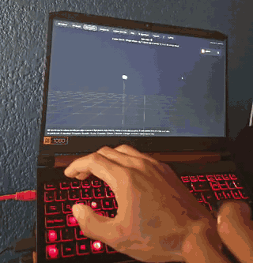

Un Galaxy Watch de primera generación (46 mm, Tizen) manda todos sus sensores a la laptop, y con la muñeca escribes en el aire, mueves el cursor, revientas globos o aprietas un tornillo.

| | |
|---|---|
| 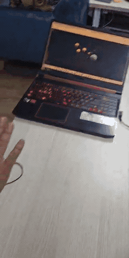 <br> **[Revienta globos](#revienta-globos).** Un amigo jugando por primera vez. Le expliqué que entre más fuerte empujas, más lejos llega el dardo, y terminó con 4700 puntos, su récord. | 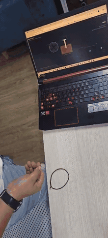 <br> **[Tornillo y tempo](#tornillo-y-tempo).** El mismo amigo, cuando ya le había explicado que el tornillo entra hasta cierto punto y ahí deja de entrar. |
| 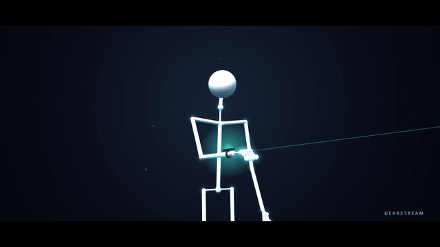 <br> **[Mocap con un reloj](#mocap-con-un-reloj).** Un stickman que se mueve con lo que leería el reloj. | 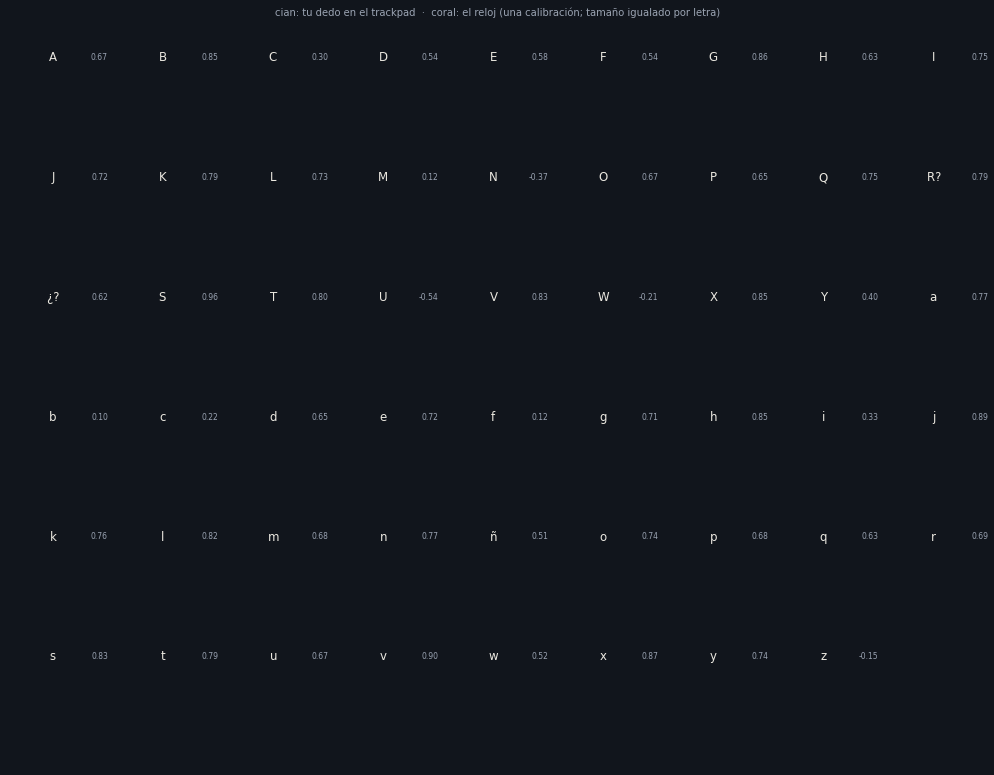 <br> **[Lo que el reloj ve de tu escritura](#lo-que-el-reloj-ve-de-tu-escritura).** En cian, el dedo en el trackpad. En coral, lo que reconstruye el reloj. |

## Cómo funciona

```
Galaxy Watch  --Wi-Fi-->  laptop (server/server.py)  -->  páginas en el navegador
                          graba cada sesión en CSV
```

Con el servidor prendido, las páginas se abren en tu propio computador, en `http://localhost:8765/`. Por eso abajo solo digo el nombre de cada una, por ejemplo `dibuja.html`.

## Probarlo sin reloj

```bash
pip install -r requirements.txt
```
```bash
python server/server.py
```
En otra terminal, un reloj de mentira que manda datos con el mismo protocolo:
```bash
python tools/fake_watch.py
```

## La app: GearStream.exe

Todavía no hay una versión publicada en *Releases*. Mientras tanto se corre desde el código (cualquier sistema; el ratón aéreo es solo para Windows):

```bash
pip install -r app/requirements.txt
```
```bash
python app/gearstream.py
```

Si quieres armar el .exe, `python tools/build_app.py --zip` lo deja en `dist/GearStream/` y lo prueba. Con una etiqueta `v*`, GitHub lo publica solo.

Cuando abras el .exe, Windows va a avisar con SmartScreen porque no está firmado: *Más información → Ejecutar de todos modos*.

La primera vez te lleva paso a paso: misma Wi-Fi, modo desarrollador y depuración en el reloj, buscar su IP, conectar y aceptar en el reloj. Con **Probar sin reloj** puedes explorar todo con un reloj simulado.

Después es una ventana y un ícono en la bandeja. Ahí ves la IP de la laptop y la del reloj, si están conectados, cuántas muestras por segundo llegan, un botón por página y el ratón aéreo. En **Ajustes** eliges la muñeca, las muestras por paquete, el puerto, la carpeta de tus datos (por defecto *Documentos/GearStream*) y qué página abrir al conectar.

## Conectar el reloj sin instalarle nada

Samsung ya no da certificados para relojes Tizen, así que instalar una app propia es difícil. Por eso el puente lee los sensores por la conexión de depuración:

```bash
python tools/sdb_bridge.py
```

Busca el reloj en la red local; con `--device <ip>` va directo. El reloj necesita la depuración activada y el Bluetooth del teléfono apagado. La primera vez te pide permiso.

| A 100 Hz | A 10 Hz | No se puede |
|---|---|---|
| acelerómetro, giroscopio, gravedad, aceleración lineal | barómetro, altitud, temperatura, luz | PPG (permiso denegado), magnetómetro (no tiene) |

El pulso sale del log de Samsung Health mientras mide, más o menos una vez por segundo.

### Preparar el reloj

1. Conéctalo a la misma Wi-Fi de la laptop: *Ajustes → Conexiones → Wi-Fi*.
2. Prende el modo desarrollador: en *Ajustes → Acerca del reloj → Software*, toca **Versión de software** 5 veces. Después activa *Ajustes → Acerca del reloj → Depuración*.
3. Anota su IP (*Wi-Fi → tu red → detalles*).
4. En Windows, la primera vez que corras el servidor, permite Python en el firewall para redes privadas.

Si el reloj está enlazado al teléfono, puede mandar el tráfico por Bluetooth y no llegar a la laptop. Si no conecta, deja el Wi-Fi del reloj en *Siempre activo* o apaga el Bluetooth del teléfono.

### Desde el teléfono, sin laptop

1. Instala Termux desde F-Droid y corre `pkg install -y python unzip`, luego `pip install websockets`.
2. En la laptop, genera el paquete con `python tools/build_phone_zip.py`. Con el servidor prendido y los dos en la misma Wi-Fi, bájalo en Termux: `curl -O http://<IP-laptop>:8765/gearstream-phone.zip && unzip -o gearstream-phone.zip`.
3. Corre `bash gearstream/phone/start.sh` y abre el dashboard en el navegador del teléfono.

Si no hay router, prende el punto de acceso del teléfono en 2.4 GHz con WPA2, porque el SM-R800 no ve 5 GHz ni WPA3. En ese caso solo el teléfono puede leer el reloj: el hotspot aísla a sus clientes y una laptop conectada ahí no lo ve.

### Medir el retraso


El puente, el servidor y el dashboard muestran cuánto tarda en llegar la muestra más reciente. El número es relativo a la entrega más rápida que se haya visto.

El protocolo manda un paquete por sensor y espera el acuse antes del siguiente, así que pasa una muestra por ida y vuelta. Con unos 10 ms en casa alcanza para 100 Hz. En el hotspot del teléfono la ida y vuelta es de unos 60 ms, pasan unas 17 muestras por segundo y el resto se acumula en el reloj. Para eso está `--batch 10`, que junta 10 muestras por paquete a cambio de hasta 100 ms más de retraso. `phone/start.sh` ya lo usa. Con menos sensores también mejora: `--sensors accelerometer,gyroscope`.

`python tools/batch_test.py --device <ip-del-reloj>` compara los modos en tu red.

## Instalar la app en el reloj

Este camino necesita un certificado de Samsung, y hoy su servidor solo entrega certificados de TV que el reloj rechaza con *"Invalid certificate chain"*. Lo dejo por si consigues uno.

Hace falta Tizen Studio (basta la versión CLI) con **Samsung Certificate Extension** y **Wearable Extension**.

1. Crea el certificado en *Tools → Certificate Manager → + → Samsung → Mobile/Wearable*, con el reloj conectado por `sdb`, y llámalo `gearstream`.
2. Conecta el reloj y acepta la clave que aparece en la pantalla:
   ```bash
   sdb connect 192.168.0.XX
   ```
3. Pon la dirección del servidor en `SERVER_URL`, en [watch-app/js/config.js](watch-app/js/config.js). `server.py` la imprime al arrancar.
4. Empaqueta e instala:
   ```bash
   tizen package -t wgt -s gearstream -- watch-app
   ```
   ```bash
   tizen install -n GearStream.wgt -- watch-app
   ```
5. Abre GearStream en el reloj, toca **Iniciar** y acepta los permisos.

El bisel mueve la lista de sensores. El botón atrás solo oculta la app y sigue transmitiendo; para parar, toca **Detener**. La pantalla se queda prendida porque apagada Tizen puede pausar los sensores, y eso gasta bastante batería.

## Qué manda el reloj


La app del reloj le pregunta a Tizen qué sensores existen y los abre todos, hasta 100 Hz.

| Fuente | API | Notas |
|---|---|---|
| ACCELERATION, GYROSCOPE, GRAVITY, LINEAR_ACCELERATION, GYROSCOPE_ROTATION_VECTOR, *_UNCALIBRATED, MAGNETIC… | `tizen.sensorservice` | lo que el reloj reporte |
| HRM_RAW | `tizen.sensorservice` | señal PPG cruda |
| PRESSURE, LIGHT | `tizen.sensorservice` | 10 Hz |
| HRM, PEDOMETER, WRIST_UP, SLEEP_MONITOR, SLEEP_DETECTOR, STRESS_MONITOR | `tizen.humanactivitymonitor` | pulso, pasos, gestos |
| GPS | `navigator.geolocation` | necesita cielo abierto |
| ORIENTATION | `deviceorientation` | alpha, beta y gamma |
| BATTERY | `tizen.systeminfo` | |
| BEZEL | evento `rotarydetent` | giros del bisel |

Lo que tu reloj no soporte sale en el dashboard en "No disponibles", con el error de Tizen.

## Muñeca izquierda o derecha


Si el reloj va en la derecha y no le avisas, arriba sale abajo y atornillar sale desatornillar. Dibuja y el Sismógrafo tienen un botón (o la tecla M) para elegir, y la elección también la usan los globos, el tornillo y el avatar. Para el ratón aéreo: `--forearm=-x`.

## Dibuja en 1D, 2D y 3D


`dibuja.html`. Mantén el botón atrás del reloj para bajar el lápiz y gira el bisel para cambiar de color.

- **2D:** apuntas con la muñeca y dibujas en un lienzo.
- **3D:** la muñeca da la dirección y atornillar da la profundidad. Con O orbitas el dibujo e I invierte el sentido.
- **Modo creativo (F):** vuelas como en Minecraft creativo, con WASD, E y Q para subir y bajar y el ratón para mirar. El lápiz va delante de ti.
- **1D:** la muñeca mueve la aguja de un sismógrafo y el papel corre solo. E elige el giro.

M cambia de muñeca, R recentra, Z deshace y S guarda la imagen.

Cada trazo se guarda solo en `recordings/dibujos/`. **Abrir** carga tus dibujos para seguirlos, **P** los reproduce como timelapse y **X** exporta una página HTML que se reproduce en cualquier navegador. También se ven desde el teléfono en `visor.html?f=<nombre>`.

### El lápiz suena


**N** cambia el modo. En **Pulsos**, cada dimensión del lápiz elige una razón sobre un pulso base: `[1 ; 3 ; 2]` es un tres contra dos. El bisel dobla o parte el pulso, y pasando de unos 20 golpes por segundo dejas de oír golpes y oyes una nota: las mismas razones son un acorde. En **Arpa**, la altura es la nota de una pentatónica y el color es el instrumento.

Reproducir un dibujo suena igual que cuando lo hiciste, y en el visor **Grabar video** guarda el lienzo con su sonido.

## Revienta globos

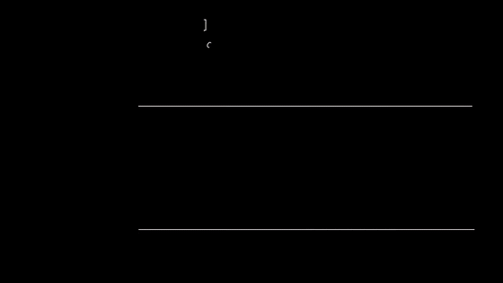

`game.html`. Apuntas con la muñeca y empujas la mano hacia la pantalla para lanzar un dardo. Un empujón suave llega a los globos cercanos y uno fuerte a los lejanos, que valen el triple. El botón atrás empieza y recentra la mira. Sin reloj se juega con el ratón y las teclas 1, 2 y 3. Apaga el ratón aéreo mientras juegas.

## Tornillo y tempo

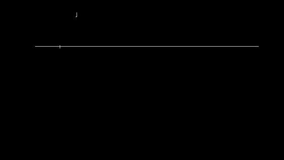

`tempo.html`. Gira la muñeca como con un destornillador. Un giro de más de 200 °/s mete o saca el tornillo una vuelta. Apuntando normal, los giros accidentales de mi dataset nunca pasaron de 117 °/s. Si giras a ritmo constante te da el tempo, y con el botón atrás o Espacio lo fijas y suena un metrónomo.

## Sismógrafo: sigue la línea


`sismo.html`. Una línea amarilla viene corriendo por el papel y tienes 20 segundos para mantener la aguja encima con la muñeca. El botón atrás o Espacio empieza, el bisel cambia el nivel, E cambia el giro y V elige si ves venir la línea o vas a ciegas.

McRuer usaba tareas así en los años 60 para medir pilotos. La línea es una suma de senos que parece imprevisible, pero cada seno da vueltas enteras en los 20 s, así que al final la transformada de Fourier separa tu respuesta onda por onda: cuánto seguiste de cada una, con cuánto retraso y cuánto error te quedó.

## Mocap con un reloj

`mocap.html`. Un stickman camina, usa una tablet o apunta a una pantalla virtual, visita cuatro íconos con un clic de muñeca y dibuja un círculo. El botón **Comercial** (F) lo filma como un anuncio, y así salió el GIF de arriba.

En la pantalla hay dos cursores: el cian es donde pega el rayo de verdad y el coral es el del reloj. Sin ruido van a menos de 1 cm de mediana. Con el ruido de un giroscopio real, el del reloj se va corriendo. El antebrazo se reconstruye solo con lo que leería el reloj, y el botón Fusión/Proyección compara dos formas de hacerlo:

- **Fusión**, la de los trajes de mocap: integra la orientación con el giroscopio y corrige la inclinación con la gravedad. Queda a menos de 1° sin ruido, y con ruido solo se desvía el rumbo.
- **Proyección**, la de las páginas que apuntan: sirve con el brazo apuntando, pero caminando, con el brazo colgando, se pierde (16° de mediana y hasta 79°).

`python tools/export_mocap.py` corta tus sesiones en tomas y aparecen en "Tus grabaciones", con el antebrazo moviéndose con tus datos.

## Ratón aéreo


El reloj mueve el cursor de Windows:

```bash
python tools/sdb_bridge.py --flush-ms 10 --sensors accelerometer,gyroscope,gravity
```
```bash
python tools/air_mouse.py
```

Deja el brazo relajado unos segundos para que calibre el reposo, y después levanta la mano y apunta.

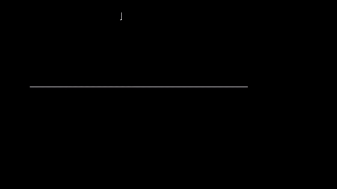

- **Clic:** botón atrás, y si lo mantienes arrastras. También hay un toque en la esfera (`--click tap`) o un giro rápido de muñeca y de vuelta (`--click flick`; `button+flick` deja los dos).
- **Scroll:** el bisel. `--scroll roll` usa el giro del antebrazo.
- **Para frenarlo:** mover el ratón físico lo pausa, la tecla Pausa lo pausa y lo reanuda, y dejar el cursor 1.5 s en la esquina superior izquierda lo apaga.
- **Calibrar:** en `calibrate.html`, con el ratón corriendo, ajustas sensibilidad, zona muerta y suavizado en vivo, y haces las pruebas de objetivos, clic y scroll. *Calibrar clic* saca tus umbrales de 8 giros.

`--replay recordings/<sesión>` repite una grabación sin tocar el cursor.

## Dibujar con el trackpad

```bash
python tools/draw_recorder.py --device <IP-del-reloj>
```

Escribes con el índice de la mano del reloj sobre el trackpad de precisión. El trackpad da el trazo real y el reloj graba a su máxima resolución, con un tiempo común, para poder entrenarlo a reconstruir lo que escribiste. Cierra el puente antes, porque el reloj acepta una sola conexión.

## Lo que el reloj ve de tu escritura

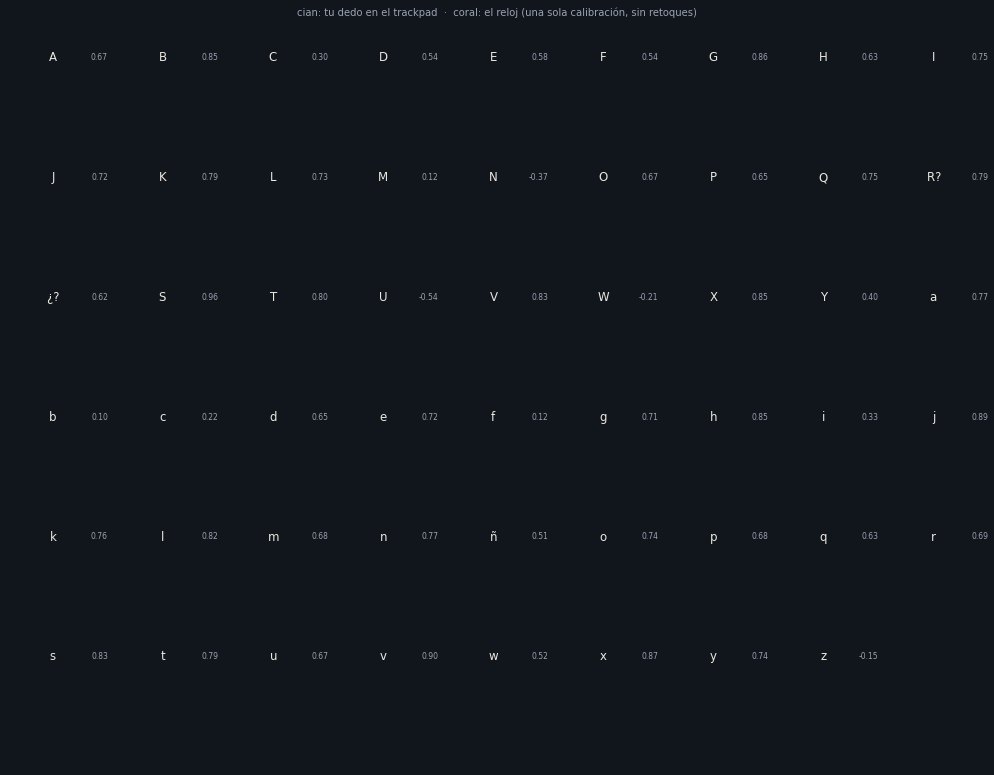

Escribí dos abecedarios en el trackpad mientras el reloj grababa. Con una sola calibración para toda la sesión, sale esto. El GIF de arriba del todo escala cada letra para comparar la forma, y este va sin retoques. El número junto a cada letra es el parecido, donde 1 es idéntica.

- El parecido mediano es **0.69**. Las mejores son S 0.96, v 0.90 y j 0.89. Las peores salen giradas: U, N y W.
- Lo que más ayuda es cuánto gira la muñeca, y eso crece con el tamaño de la letra. Las letras chiquitas se escriben con los dedos y el reloj casi no las ve.
- Apoyar y levantar el dedo casi no deja huella en el reloj.

### Redibujar letras que el modelo nunca vio

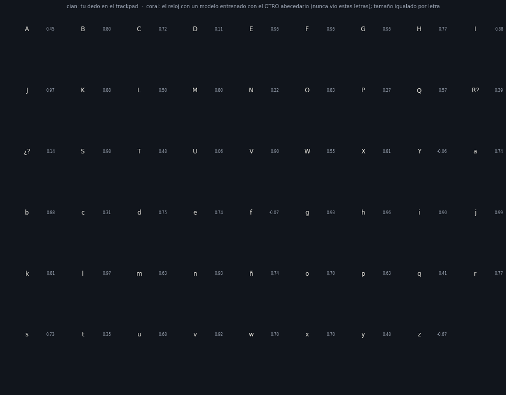

Aquí un modelo aprende a pasar de lo que siente el reloj a la velocidad del dedo, y esa velocidad se integra para redibujar. Las mayúsculas las redibuja un modelo entrenado sin mayúsculas, y las minúsculas uno entrenado sin minúsculas.

| Método, con letras nunca vistas | Parecido mediano | Letras por encima de 0.8 | Largo reconstruido / real |
|---|---|---|---|
| una calibración lineal de posición | 0.60 | 12 / 53 | 0.36 |
| regresión ridge sobre la velocidad | **0.74** | **19 / 53** | 0.58 |
| red neuronal pequeña (numpy) | 0.60 | 14 / 53 | 0.70 |

Con 53 letras de una sola sesión, las diferencias entre variantes son ruido. Para mejorar hacen falta más datos. `tools/reconstruct_drawing.py` entrena y evalúa.

## Grabar gestos

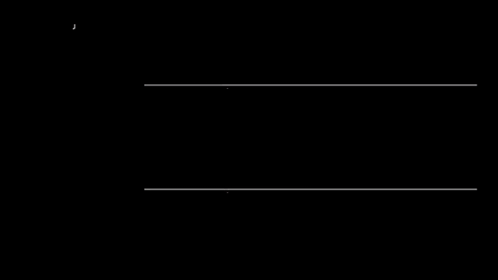

`dataset.html` o `tools/dataset_capture.py` graban 13 gestos guiados, y `tools/analyze_dataset.py recordings/<sesión>` dice cuáles se distinguen. Con la pantalla del reloj apagada, los sensores bajan a unas 45 muestras por segundo, así que déjala prendida.

## Tus datos

Cada sesión crea `recordings/AAAAMMDD-HHMMSS/` con un CSV por sensor y un `meta.jsonl` con la información del reloj. Con `--no-record` no graba y con `--out <carpeta>` graba en otra parte.

Las grabaciones son datos personales y `recordings/` no se sube al repo. Las llaves tampoco: viven en `~/.tizen/sdbkey` o `~/.gearstream/`.

## Protocolo, por si haces otro cliente

JSON por WebSocket, del reloj al servidor:

```json
{"type":"hello","app":"1.0.0","device":{"model_name":"SM-R800",...},"available":["ACCELERATION",...]}
{"type":"status","source":"HRM_RAW","state":"on|waiting|error|unsupported","detail":"...","hw":{...}}
{"type":"data","samples":[["ACCELERATION",1729800000123,{"x":0.1,"y":9.8,"z":0.3}], ...]}
```

El reloj manda un lote cada 50 ms. Si se cae la conexión, guarda hasta 20 000 muestras y reconecta solo.

## Dónde está cada cosa

```
watch-app/            la app del reloj
server/server.py      servidor WebSocket, HTTP y grabación
server/web/           las páginas: dashboard, dibuja, game, tempo, sismo, mocap, avatar, calibrate
tools/fake_watch.py   reloj simulado
tools/sdb_bridge.py   puente: sensores, pulso, bisel y botones
tools/sdb_client.py   cliente del protocolo de depuración de Tizen
tools/air_mouse.py    ratón aéreo
tools/batch_test.py   mide la red entre el puente y el reloj
phone/start.sh        arranque en Termux
app/gearstream.py     la app de escritorio
tools/build_app.py    arma GearStream.exe y lo prueba
```
