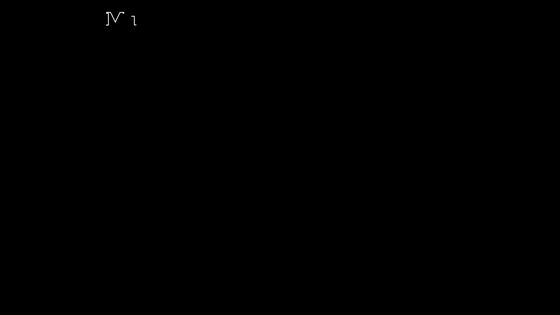
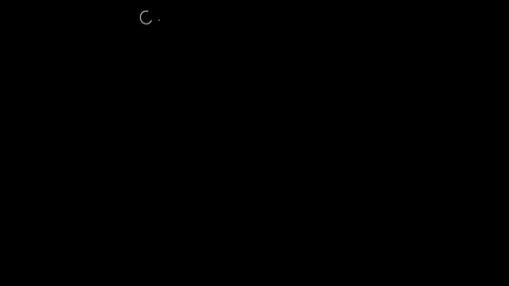
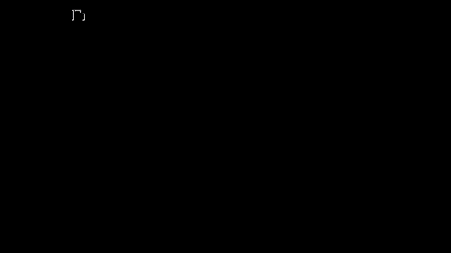
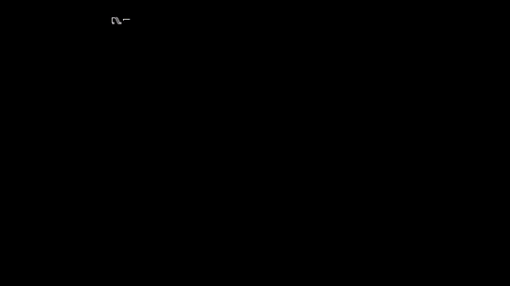

# Capítulo 0 · Un número que cambia

**Pregunta guía.** ¿Cómo se guarda en una computadora algo que no para de cambiar, como el movimiento de tu muñeca?

La respuesta corta: no se guarda. Se guardan algunos números sueltos, cada uno con su unidad y su hora. Este capítulo
es todo lo que hay que saber de esos números antes de hacer cuentas con ellos: cuántos son, cuándo se midieron, cuánto
tardaron en llegar y qué se perdió en el camino.

Las animaciones salen de [`animaciones/cap00.py`](../animaciones/cap00.py) (Manim), con señales inventadas y números
de reloj de verdad. La línea del Sismógrafo es `wave` de `server/web/sismomath.js`, que
[`animaciones/datos_cap00.js`](../animaciones/datos_cap00.js) corre para comparar; `norm` viene de
`tools/air_mouse.py`, importada tal cual, y `Bridge.map_time` se lee de `tools/sdb_bridge.py`. Lo que dice el capítulo
se comprueba en [`tools/test_muestreo.js`](../../../tools/test_muestreo.js).

---

## 1. Una señal

Un punto que sube y baja es, en cada instante, un solo número. Si anotas ese número para cada instante tienes una
curva, $x(t)$. A eso se le llama **señal**: un número que cambia con el tiempo. El giro de tu muñeca es una señal. La
línea del Sismógrafo es otra: `wave` de `server/web/sismomath.js` da su altura para cualquier $t$.

## 2. Unidades

Un número solo no dice nada: cada uno viene con su **unidad**. 9.81 m/s² quiere decir que algo gana 9.81 metros por
segundo de rapidez cada segundo. 300 °/s quiere decir que algo gira 300 grados cada segundo.

Cambiar de unidad es multiplicar por un factor. 300 °/s son 0.83 vueltas por segundo (entre 360) y 50 vueltas por
minuto (por 60). La curva no se mueve: solo cambian los números del costado. Nada físico cambia, pero una cuenta que
mezcla unidades da cualquier cosa, así que en el código cada conversión está a la vista:

- `Bridge.read_sensor` de `tools/sdb_bridge.py` hace `int(parts[0]) / 1000`: el reloj da microsegundos y aquí se
  trabaja en milisegundos.
- `FlickDetector.tempo` de `server/web/flick.js` hace `60000 / intervalo`: de ms entre giros a giros por minuto. Con
  500 ms da 120.
- `norm` de `tools/air_mouse.py` pasa de píxeles a la escala de 0 a 65535 que pide Windows.

## 3. Muestrear

La señal no para, pero la computadora solo guarda algunos de sus valores. Medir cada cierto tiempo es **muestrear**, y
cada medida es una **muestra**. Si se mide cada $\Delta t$:

$$t_k = t_0 + k\,\Delta t, \qquad f = \frac{1}{\Delta t}$$

$f$ es la frecuencia de muestreo: muestras por segundo, o **Hz**. El reloj mide cada 10 ms, así que da 100 Hz
(`--interval` de `sdb_bridge.py`), y `Bridge.report` imprime cada 5 s cuántas llegaron de verdad por segundo.

En la animación, unir las muestras con rectas se equivoca hasta 0.38 a 1 Hz, 0.15 a 2 Hz, 0.04 a 5 Hz y 0.003 a 20 Hz.
Más muestras cuestan más: transmitir sin parar gasta la batería del reloj en un par de horas.

**¿Qué pasó entre dos medidas? ¿Se puede adivinar?** No con certeza. Tres señales muy distintas pueden tener
exactamente las mismas muestras, y las muestras no tienen forma de distinguirlas. Lo de en medio siempre es una
suposición: que la señal no hizo nada raro entre medida y medida.

## 4. Marcas de tiempo

Si llegan 100 por segundo, ¿para qué trae cada una su hora? Porque 100 por segundo es un promedio. Cada muestra lleva
una **marca de tiempo**, el instante en que se midió, y $\Delta t$ es la resta de dos marcas seguidas. No siempre da lo
mismo: varía un poco de muestra en muestra, y a veces falta un tramo entero. Con la pantalla apagada el reloj frena sus
sensores (de 200 a unas 45 muestras por segundo, dice `tools/guided_capture.py`) o las entrega en ráfagas.

En la animación se pierde medio segundo. Si solo cuentas muestras, todo llega antes y terminas en unos 3.5 s cuando
pasaron 4. Con la hora de cada una, cada muestra cae donde debe y el hueco se ve como hueco.

Cada parte del código decide qué hacer con un hueco:

- `Motion.feed_gyro` de `tools/air_mouse.py` resta las marcas. Usa ese $\Delta t$ real, entre 5 y 100 ms, y pasando de
  100 ms lo trata como un hueco: ese paso no mueve el cursor.
- `onGyro` de `server/web/dibuja.js` también resta, pero con un hueco de más de 100 ms usa 10 ms: lo que giraste durante
  la pausa se pierde. Es un supuesto, y está en el apéndice.
- `FlickDetector.update` de `server/web/flick.js` limita $\Delta t$ a 0.1 s.
- `gap_free` de `tools/export_mocap.py` descarta un tramo si tiene un hueco de medio segundo o más.
- `timeline` de `server/web/trazos.js` usa las marcas al revés: para reproducir un dibujo acorta las pausas largas a
  400 ms.

**En el ¡hola!** del índice, cada punto del trazo sale de una muestra del reloj, y `onGyro` usa la resta de su marca
con la anterior. En los 14.6 s de letras llegaron 1453 muestras y el hueco más largo fue de 13 ms, así que el atajo de
10 ms no entró nunca.

## 5. Entre dos muestras: interpolar

Si hay que suponer algo entre dos muestras, lo más simple es la recta que las une. Eso es **interpolar**:

$$x(t) \approx x_k + \frac{t - t_k}{t_{k+1} - t_k}\,(x_{k+1} - x_k)$$

La fracción dice qué parte del camino llevas: 0 en la primera muestra, 1 en la segunda. Cuanto más curva la señal y más
separadas las muestras, peor adivina. Un movimiento de ±100 que va y viene dos veces por segundo se equivoca como
mucho 0.20 a 100 Hz, y 4.89 a 20 Hz.

Sirve sobre todo para una cosa. Cada sensor del reloj mide a su hora, así que sus muestras no caen en los mismos
instantes y no se pueden comparar una a una. La salida es elegir una **rejilla** pareja y leer cada sensor en esos
instantes: **remuestrear**. Es `np.interp` en `load` de `tools/analyze_dataset.py`, `interp3` de
`tools/analyze_drawing.py` y `resample` de `tools/export_mocap.py`. `analyze` de `server/web/sismomath.js` lo hace a
mano para llevar lo que hiciste a 100 Hz parejos, y `Drawing.point` de `server/web/trazos.js` usa la misma recta para
rellenar con puntos el trazo en 3D.

## 6. Cuantizar

A veces un número solo puede caer en ciertos escalones. Redondear al más cercano es **cuantizar**, y el tamaño del
escalón es la **resolución**. Redondeando, el error nunca pasa de medio escalón.

Que se note depende de qué tan grande es el escalón contra lo que te importa. Dos casos del repo:

- `ratio` de `server/web/musica.js` vuelve la altura del lápiz, de 0 a 1, un entero del 1 al 8. Se pierde mucho, a
  propósito: se oye como notas separadas.
- `norm` de `tools/air_mouse.py` lleva cada píxel a un escalón de 0 a 65535. En una pantalla de 1920 hay 34 escalones
  por píxel, así que al volver cada píxel cae en su sitio: la prueba lo comprueba en los 1920. No se pierde nada.

## 7. Muestras contra lecturas nuevas

Si pides 200 muestras por segundo y llegan 200, ¿son 200 medidas distintas? No. A 5 ms el reloj entrega unas 200
muestras por segundo, pero solo unas 115 son **lecturas nuevas**. Las demás repiten el valor de antes, y una muestra
repetida no trae información. La tasa que importa es la de lecturas distintas.

`main` de `tools/analyze_drawing.py` las cuenta con `np.unique`: cuántas filas distintas hay en la grabación, dividido
por sus segundos. Si un valor exacto volviera más adelante contaría una sola vez, pero con tres números con decimales
eso casi no pasa.

La animación usa un modelo simple, un sensor que se renueva 115 veces por segundo. Ese 115 es lo medido en el reloj, no
algo que salga de una cuenta, y el modelo solo muestra cómo pueden aparecer las repetidas: no sabemos qué pasa por dentro.

## 8. Resumir una ventana

De mil números hay que quedarse con pocos. Un tramo de muestras seguidas es una **ventana**, y se resume así:

- El **promedio** cuenta a todas. Un solo valor raro lo arrastra.
- La **mediana** es la del medio al ordenarlas. Un valor raro casi no la mueve. A cambio, no ve un suceso corto: en un
  segundo con 0.1 s de movimiento, la mediana sigue diciendo que no pasó nada.
- El **máximo** ve lo más grande, pero lo decide un solo valor.
- El **pico a pico** es el máximo menos el mínimo: cuánto se abrió la señal en la ventana.

Cada uno engaña a su modo, y por eso se miran varios juntos. `Motion._rest_window` de `tools/air_mouse.py` mira un
segundo con el pico a pico (¿se movió?) y la mediana (¿alrededor de qué?). `FlickDetector.tempo` usa la mediana de los
intervalos: una pausa rara en medio no cambia el resultado. `windows` de `tools/export_mocap.py` elige los tramos con
más giro por su promedio, y `event_features` de `tools/analyze_dataset.py` resume un gesto con su máximo.

## 9. Latencia

La **latencia** es cuánto tarda una muestra desde que el reloj la mide hasta que la laptop la usa. No es un número fijo:
casi todas tardan parecido, pero si el Wi-Fi se traba, una tanda sale junta y tarde. La red entrega en orden, así que
ninguna muestra adelanta a otra: lo que se midió durante el atasco espera, y lo que viene detrás llega después.

`Bridge.report` imprime el `retraso`, la edad de la muestra más nueva. `AirMouse.on_data` compara cada edad con la mínima
reciente, que baja de golpe y sube a lo sumo 30 ms por segundo; así una tanda atrasada no pasa por normal. Una muestra
que llega más de 300 ms más vieja de lo normal no mueve el cursor: para apuntar ya es tarde.

Otro caso distinto es `aimAt` de `server/web/game.js`. Ahí la demora no es de la red sino del gesto: el juego guarda la
mira de los últimos 400 ms y toma la de 120 ms antes.

## 10. Alinear dos relojes

Hay un problema: para medir la latencia hay que restar la hora de llegada menos la de medida, y son de relojes distintos.
Cada sensor cuenta desde su propio cero y la laptop desde 1970. Esa resta da dos cosas mezcladas:

$$\text{llegada} - \text{medida} = \text{desfase} + \text{latencia}$$

El **desfase** es la diferencia entre los dos relojes. Ninguno de los dos es "el de verdad", pero hay una pista: la
latencia nunca es negativa. Así que todos los puntos quedan por encima del desfase, y la entrega más rápida es la que
más se le acerca. La estimación es el mínimo de (llegada − medida).

Es `Bridge.map_time` de `tools/sdb_bridge.py`, 16 líneas, y hace tres cosas:

1. Se queda con el mínimo visto, por cada sensor. Anclar en la primera muestra sería un error: las primeras son lo
   atrasado que había al arrancar, unos 100 ms de más.
2. Si el mínimo no baja, sube 0.0003 ms por muestra (`OFFSET_LEAK_MS`), 1.8 ms por minuto a 100 Hz, para seguir a un reloj
   que atrasa. Sin esa fuga el mínimo quedaría clavado para siempre.
3. Si una marca salta más de 5 s, la ignora: el reloj a veces manda una marca con horas de error. Esa muestra se marca
   con su hora de llegada y el desfase no se toca.

Hay algo que esto no puede saber. La entrega más rápida también tardó algo, y esos milisegundos no se ven nunca: en la
animación quedan 9 ms. La latencia se mide desde la entrega más rápida, no desde cero. Por eso el capítulo supone que
los relojes están alineados y que la red es estable; está en el apéndice.

## 11. Agrupar muestras

La conexión con el reloj entrega un **paquete** por cada **ida y vuelta** de la red. Con un Wi-Fi lento, como el de un
teléfono compartiendo datos, son unos 60 ms: 17 paquetes por segundo. Si cada uno trae una muestra, de las 100 por segundo
solo pasan unas 17. El **caudal** es:

$$\text{caudal} = \frac{\text{muestras por paquete}}{\text{ida y vuelta}}$$

Con 6 muestras por paquete pasan justo las 100. Con menos no alcanza: las muestras se van quedando atrás. Con más hay margen
por si la red empeora, y no pasan más porque no hay más que mandar. El precio es tiempo. La primera del paquete tiene que
esperar a las otras, $(N-1)\,\Delta t$, y después a que le toque salir, de 0 a una ida y vuelta: ese es el **retraso**. Con
$N = 6$ son 50 ms de espera, y 60 ms en total si la red y el reloj van alineados.

Es `--batch` de `sdb_bridge.py`: en `Bridge.read_sensor`, un `awk` corriendo en el reloj junta $N$ líneas antes de
soltarlas. Y `Bridge.report` dice cuántas muestras viajan por paquete. Una limitación práctica: el reloj acepta una sola
conexión de depuración a la vez, así que el grabador y el puente no pueden correr juntos.

---

## Experimento con tus datos

Graba con el reloj un rato con la pantalla encendida y otro con la pantalla apagada.

1. Cuenta las muestras por segundo de cada sensor, y cuántas son lecturas nuevas. ¿Cuánto da a 10 ms? ¿Y a 5 ms?
2. Grafica los $\Delta t$ de los dos ratos. ¿Cuál es su mediana? ¿Y su máximo? ¿Qué cuenta cada uno?
3. Resta llegada menos medida y dibújala. ¿Dónde está el mínimo? ¿Cuánto se separa la mediana de ese mínimo?

## Ejercicio que se comprueba

Escribe `interpolar(t, ts, xs)` en [`docs/curso/ejercicios/cap00.js`](../ejercicios/cap00.js) y córrelo con
`node tools/test_muestreo.js --ejercicio`. Las pruebas comprueban que:
- en cada muestra da justo la muestra, también con $\Delta t$ disparejos;
- antes de la primera y después de la última se queda en la primera o la última;
- coincide con `np.interp` en mil instantes al azar (con numpy de verdad, si tu máquina tiene python con numpy).
