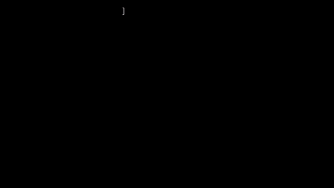
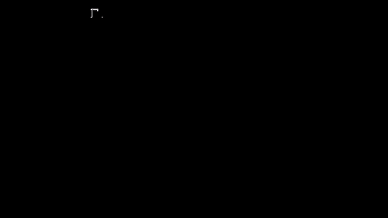
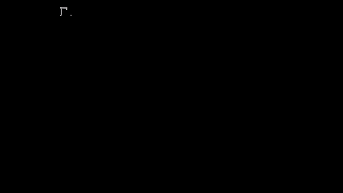
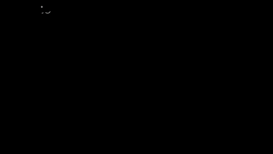
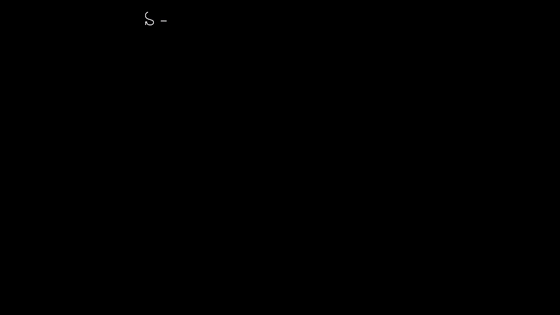

# Capítulo 1 · Qué es un sensor

**Pregunta guía.** ¿Qué siente de verdad el reloj cuando mueves la mano?

No siente tu mano. Siente dos cosas: lo que lo empuja y qué tan rápido gira, tres números cada una, con errores. Este
capítulo es qué miden esos números, en qué direcciones, y cómo se separa lo que pasó de lo que se inventó el sensor.

Las animaciones salen de [`animaciones/cap01.py`](../animaciones/cap01.py) (Manim). El ruido, el sesgo y las lecturas
con movimiento son los de `synth` de `server/web/mocapmath.js`, que corre
[`animaciones/datos_cap01.js`](../animaciones/datos_cap01.js): son inventados por ese modelo, no medidos en un reloj. El
reposo lo decide `Motion` de `tools/air_mouse.py`, importado tal cual, con grabaciones inventadas. Lo que dice el
capítulo se comprueba en [`tools/test_sensor.js`](../../../tools/test_sensor.js).

---

## 1. Los ejes del reloj

Cada sensor da tres números, uno por **eje**: tres direcciones pegadas al reloj, a 90° entre sí. **z** sale de la
pantalla. Si el reloj gira, los ejes giran con él: no son los del cuarto, y eso es lo que hace falta deshacer más
adelante.

**¿Hacia dónde apunta cada eje, y qué cambia si me lo pongo en la otra mano?** En la mano izquierda, $x$ apunta del codo a
la mano. En la derecha, con el reloj puesto igual (botones hacia el codo), $x$ apunta al codo e $y$ también sale al revés;
$z$ sigue saliendo de la pantalla. `watchOf` de `server/web/mocapmath.js` lo dice en dos líneas: `X` es el antebrazo o su contrario, e
`Y = cross(Z, X)` en las dos manos. Si no se avisa, arriba sale abajo. Por eso `server/web/wrist.js` pregunta en qué mano lo
llevas, y el ratón aéreo se ajusta con `--forearm`.

## 2. El acelerómetro

Piensa en un **acelerómetro** como una bolita con resortes dentro de una caja: mide cuánto tienen que tirar los resortes
para llevarla con la caja. Da tres números, en m/s².

**Con el reloj quieto sobre la mesa, ¿por qué no marca cero?** Porque no mide la aceleración sola. Mide lo que empuja al
reloj, y sobre la mesa la mesa lo sostiene. Es la cuenta de `synth`:

$$\text{acelerómetro} = \text{lo que acelera} + g \text{ hacia arriba}$$

Con la pantalla hacia arriba, quieto, $z$ marca +9.81. Si lo sueltas, cae con $-9.81$ y marca cero: nada lo sostiene. Si
la mano lo sube con $+3$, marca 12.81. Si lo ladeas, los 9.81 se reparten entre los ejes, pero el largo de los tres no
cambia:

$$|a| = \sqrt{x^2 + y^2 + z^2}$$

Ese largo es lo que guarda `Motion.feed_accel` de `tools/air_mouse.py` en `a_norm`, junto con cuánto saltó de una muestra
a la siguiente. Con la mano quieta da unos 9.81 en cualquier posición: es la primera pista de que está quieta.

## 3. El giroscopio

El **giroscopio** mide qué tan rápido gira el reloj alrededor de cada uno de sus ejes, en °/s. Si gira alrededor de $z$ a
90 °/s, solo marca $z$. El signo dice para qué lado: positivo es antihorario visto desde la punta del eje. Si el giro
va por una dirección intermedia, marcan varios ejes a la vez.

Lo importante es lo que no dice: cuando el reloj se detiene vuelve a cero, aunque haya quedado girado. Dice qué tan
rápido, no cuánto. `synth` lo saca de la diferencia entre la orientación de antes y la de después, y `Wrist.rates` de
`server/web/wrist.js` le resta el error antes de usarlo.

## 4. El sensor de gravedad

El reloj ofrece un **sensor de gravedad**, pero adentro no hay ningún sensor así. Es una cuenta interna de Samsung, hecha
con el acelerómetro y el giroscopio, que da la dirección de arriba en los ejes del reloj. Fíjate en el signo: apunta hacia
ARRIBA, porque es la parte del acelerómetro que se debe a estar sostenido. Con la pantalla hacia arriba, $z$ da +9.81.

**¿Por qué deberíamos creerle?** No hay por qué creerle a ciegas: no podemos ver esa cuenta ni auditarla, y está en el
apéndice como supuesto. Lo que sí se puede hacer es compararla. Con la mano quieta, el acelerómetro y la gravedad deben
coincidir. La animación los compara con el movimiento de apuntar del mocap: se separan una mediana de menos de 1° y hasta
más de 50° en un movimiento brusco. Ahí la gravedad de `synth` es la de verdad, un caso perfecto; la del reloj es
una estimación, y no sabemos cuánto se equivoca durante un movimiento.

Por eso el código se cuida. `Motion.gravity_measurement` de `tools/air_mouse.py` usa la gravedad mientras tenga una
de menos de 500 ms, y si no, la dirección del acelerómetro. `Motion.feed_gyro` solo se deja corregir por esa medida con
la mano tranquila.

## 5. Ruido

**¿Por qué dos medidas seguidas, sin mover nada, no dan el mismo número?** Porque cada una trae una pizca de azar. Esa
parte de la medida que cambia aunque nada se mueva es el **ruido**. No se puede predecir una medida, pero sí cómo se
reparten: se amontonan alrededor de un centro.

Los números de esta animación son los de `synth`, que suma ruido al azar: 0.3 °/s al giroscopio, 0.05 m/s² al
acelerómetro y 0.02 m/s² a la gravedad. Son inventados, y `normal` de `server/web/fusionmath.js` hace lo mismo. Lo que
mida tu reloj sale del experimento del final.

## 6. Tamaño típico: RMS y desviación estándar

**¿Cuánto ruido es "mucho"? ¿Con qué número lo mido?** El promedio no sirve: lo que va para un lado cancela lo que va
para el otro. Hay que quitar el signo. Se eleva cada muestra al cuadrado, se promedia, y se saca la raíz:

$$\mathrm{RMS} = \sqrt{\text{promedio de } x^2}$$

Es el **RMS** (raíz cuadrática media): el tamaño de algo que va y viene. Si antes se resta el promedio, lo que queda es
la **desviación estándar**, $\sigma$: cuánto se abre alrededor de su centro. Las dos se relacionan como los lados de un
triángulo:

$$\mathrm{RMS}^2 = \text{promedio}^2 + \sigma^2$$

Con 0.41 de centro y 0.29 de ruido, el RMS da 0.50. El ruido se mide con $\sigma$. Se podría usar el pico a pico, pero
crece cuanto más miras: 0.6, 1.3 y 1.8 °/s con 10, 100 y 800 muestras, mientras $\sigma$ se queda cerca de 0.29 en
cuanto hay suficientes muestras.

`analyze` de `server/web/sismomath.js` mide con RMS cuánto te alejaste de la línea. `window_features` y `event_features`
de `tools/analyze_dataset.py` resumen el giro y la aceleración de un tramo igual.

## 7. Sesgo

Con la mano quieta, a escala de un movimiento el giroscopio marca cero. Con zoom se ve otra cosa: tiembla, y alrededor de
algo que no es cero. Ese error que no se va es el **sesgo**. La medida se arma así:

$$\text{medida} = \text{verdad} + \text{sesgo} + \text{ruido}$$

`synth` usa sesgos de 0.6, −0.4 y 0.3 °/s. En un reloj real depende: la ayuda de `--bias-max` dice que el del reloj viene
compensado de fábrica, unos 0.07 °/s.

**Si marca 0.4 °/s, ¿es la Tierra que gira o es el sensor?** La Tierra da una vuelta al día: 0.0042 °/s, unas 96 veces
menos que 0.4. Y hay una prueba directa: da vuelta el reloj sobre la mesa. Lo de la Tierra cambia de signo, porque es
un giro de afuera; el sesgo no, porque es del sensor y se mueve con él.

## 8. Umbral

**Quieta, la mano nunca da cero. Entonces, ¿cómo sabe el programa que está quieta?** Con una línea: por debajo cuenta como
quieto, por encima pasó algo. Eso es un **umbral**. Si queda muy bajo, el ruido lo cruza todo el rato: con
$\sigma$ = 0.3 °/s en tres ejes, una línea en 0.4 °/s la cruza el 45% de las muestras. Muy alto, un movimiento lento pasa
por quieto. En 1.5 °/s, cinco veces $\sigma$, el ruido no llega.

El número no sale de una fórmula: se elige mirando el ruido y lo que quieres detectar. `Motion.feed_gyro` usa
`STILL_DEG` = 1.5 °/s en cada eje y pide 50 muestras seguidas por debajo. `DwellDetector.feed` hace algo parecido con `rho`,
qué tan rápido apuntas, para saber que la mano se detuvo.

## 9. Aprender el sesgo en reposo

Si el sesgo es el centro del temblor con la mano quieta, basta tomar la mediana de un segundo quieto. Lo difícil es
saber que estaba quieta, porque un giro lento y parejo también se ve tranquilo. `Motion._rest_window` de
`tools/air_mouse.py` (26 líneas sin su comentario) mira el último segundo cada 10 muestras, y pide todo esto:

| Prueba | Debe dar menos de | Qué descarta |
|---|---|---|
| Pico a pico del giroscopio, por eje | 2.5 °/s (`--calib-p2p`) | Movimiento |
| Mediana del giroscopio, en valor absoluto | 1.5 °/s (`--bias-max`) | Un giro lento y parejo |
| Diferencia entre $\|a\|$ y $g$ | 1 m/s² | Que algo esté acelerando el reloj |
| Salto del acelerómetro entre dos muestras | 0.6 m/s² | Sacudidas |
| Pico a pico de la dirección de la gravedad | 0.05 (unos 3°) | Que la mano se esté ladeando |

Hacen falta al menos 80 muestras en ese segundo. `Motion._calibrate` toma la primera ventana que pasa todo y guarda sus
medianas. Si ninguna pasa, no inventa: sigue esperando. (El comentario de la función todavía habla de 1 °/s, pero el valor
por defecto es 2.5: la ayuda explica que una muñeca apoyada late 1 o 2 °/s, y la mediana no se deja arrastrar por eso.)

**Si el sesgo cambia con la temperatura, ¿cada cuánto hay que volver a medirlo?** No hay que volver a medirlo: se sigue
solo. Cada rato quieto, `Motion.feed_gyro` lo corrige de a poco. Un error chico se cierra como un promedio de 20 s
(`--bias-tau`): en 20 s corrige el 63%. Y nunca se mueve más de 0.05 °/s por segundo, para que un movimiento lento no se
aprenda como sesgo. Si el error es tan grande que la mano ya no cuenta como quieta, `Motion._recover_bias` lo reemplaza
cuando el giroscopio crudo lleva 3 s pareciendo reposo.

Las páginas lo hacen más simple. `Wrist.rates` aprende con un promedio que olvida, $\alpha$ = 0.002, mientras el
giro corregido sea de menos de 2 °/s: llega al 63% en 5 s a 100 Hz. No mira nada más, así que un giro lento a propósito se
va borrando. Y `main` de `tools/reconstruct_drawing.py` toma la mediana de toda la grabación, que supone que casi todo
el tiempo la muñeca no gira. Las dos cosas son supuestos, y están en el apéndice.

Una limitación práctica: si la conexión se corta mal, el servicio de sensores del reloj se traba ("Listener is already
added") y hay que reiniciar el reloj.

---

## Experimento con tus datos

Deja el reloj un minuto quieto en la mesa y graba.

1. Haz el histograma del giroscopio en cada eje. Su mediana es el sesgo y su desviación estándar es el ruido.
2. ¿Tu ruido es mayor o menor que el 0.3 °/s de `synth`? ¿Y el sesgo, comparado con los 0.07 °/s de la ayuda?
3. Calcula $|a|$. ¿Da 9.81? ¿En cuánto se aleja?
4. Usa el reloj diez minutos, y repite con el reloj tibio. ¿Cuánto se movió el sesgo?
5. Da vuelta el reloj y repite. ¿Cambió de signo?

## Ejercicio que se comprueba

Escribe `primerReposo(giro, acel, grav)` en [`docs/curso/ejercicios/cap01.js`](../ejercicios/cap01.js) y córrelo con
`node tools/test_sensor.js --ejercicio`. La grabación de prueba es inventada y tiene una trampa para cada condición. Las
pruebas comprueban que:
- encuentras el mismo segundo que `Motion._calibrate`, después de todas las trampas;
- tu sesgo coincide con el de esa ventana y queda cerca del de verdad;
- si la grabación nunca descansa, devuelves `null` en vez de inventar un sesgo;
- repitiendo la grabación con `python tools/air_mouse.py --replay`, el programa toma ese mismo sesgo (si hay python).
