# Capítulo 2 · Vectores y marcos

**Pregunta guía.** El reloj dice "x, y, z". ¿x, y, z de quién?

Cada sensor del reloj manda tres números por muestra. Antes de hacer cuentas con ellos hay que saber qué son: una flecha,
escrita en unos ejes que se mueven con el reloj. Este capítulo son las herramientas para trabajar con flechas, y la
respuesta a la pregunta de arriba, que es la idea que más se repite en todo el curso.

Las animaciones salen de [`animaciones/cap02.py`](../animaciones/cap02.py) (Manim), con flechas inventadas y números de
reloj de verdad. Su cuenta es la de [`server/web/mocapmath.js`](../../../server/web/mocapmath.js), que
[`animaciones/datos_cap02.js`](../animaciones/datos_cap02.js) corre para comprobar que el dibujo dice lo mismo, y
`wrap_deg` es la de [`tools/air_mouse.py`](../../../tools/air_mouse.py), importada tal cual. Las pruebas están en
[`tools/test_marcos.js`](../../../tools/test_marcos.js).

---

## 1. Un vector

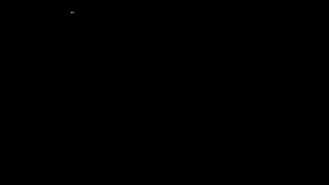

Un **vector** es una flecha: tiene dirección y largo. Tres números alcanzan para decirla porque el espacio tiene tres
direcciones independientes: cuánto avanzar en x, cuánto en y, cuánto en z.

$$v = (x, y, z)$$

Una flecha no tiene lugar: moverla entera no cambia sus números. Por eso se suman poniendo una a continuación de la
otra, número a número, y multiplicarla por 2 duplica los tres. Así arma `hand` de `mocapmath.js` la mano del muñeco:
cada nudillo es la muñeca, más 0.09 m a lo largo del antebrazo, más un poco de costado.

## 2. El largo

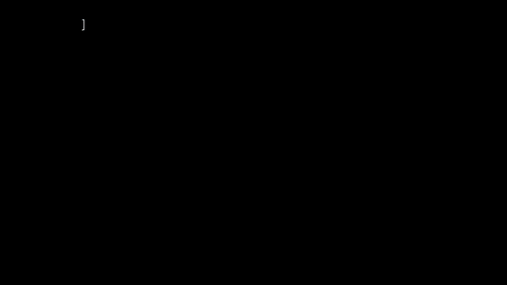

El largo sale de Pitágoras, dos veces: en el piso, $d = \sqrt{x^2+y^2}$; y de pie sobre esa diagonal, con la altura:

$$|v| = \sqrt{x^2+y^2+z^2}$$

$(2, 1, 2)$ tiene diagonal $\sqrt5 = 2.24$ y largo 3. El largo no depende de cómo estén los ejes, y eso lo vuelve muy útil:
`Motion.feed_accel` guarda el largo del acelerómetro: si se aleja de 9.81, seguro que algo empuja. Al revés no vale, porque un
empuje de lado casi no cambia el largo.
`ShakeDetector.feed` mira el largo del giroscopio para saber si la muñeca se sacude más de 600 °/s, sin importar en qué
eje, y `windows` de `tools/export_mocap.py` busca con él los tramos con más giro. El largo de una resta es la distancia
entre dos puntos: así decide `fromRescue` de `server/web/trazos.js` dónde se corta un trazo, y `Drawing.point` cuántas
bolitas faltan entre dos puntos.

## 3. Vector unitario

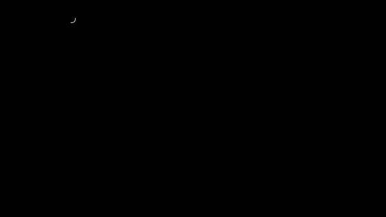

Dividir una flecha por su largo deja una de largo 1 que apunta igual. Se dice que queda **normalizada**, y a la flecha
de largo 1 se le dice **unitaria**:

$$\hat v = \frac{v}{|v|}$$

Es lo que hace `Wrist.rates` con la gravedad (`grav.map((x) => x / gn)`), y `Motion.feed_gravity` con `normalize`: de esa
lectura solo interesa hacia dónde apunta. Las dos se cuidan de un largo cero, porque ahí no hay nada que dividir.

¿Cuántos números hacen falta si solo importa la dirección? Dos. Con $x^2+y^2+z^2 = 1$, sabiendo $x$ e $y$ ya se sabe $z$,
salvo el signo. El tercer número de una flecha es su largo.

## 4. Seno, coseno, tangente y atan2

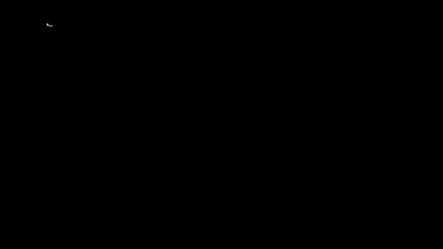

Una flecha de largo 1 con ángulo $\theta$ llega a $(\cos\theta, \sin\theta)$: el **coseno** es lo que avanza y el **seno**,
lo que sube. La **tangente** es cuánto sube por cada 1 que avanza:

$$\tan\theta = \frac{\sin\theta}{\cos\theta}$$

Una vuelta mide $2\pi$ en el círculo de radio 1, así que el ángulo también se mide en **radianes**: $\pi$ radianes son 180°.
Las funciones de JavaScript y de Python trabajan en radianes, y por eso `mocapmath.js` tiene `D2R = Math.PI / 180`.
`axesOf` usa esto directo: un cuerpo que mira con ángulo $H$ tiene su frente en $(-\sin H, 0, -\cos H)$.

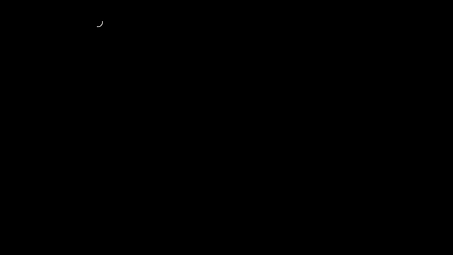

Para ir de vuelta, del punto al ángulo, la tentación es usar $y/x$. Pero $(1, 1)$ y $(-1, -1)$ dan el mismo $y/x$, y son
flechas opuestas. Al dividir se pierden los signos, y con $x = 0$ ni siquiera se puede. **atan2**$(y, x)$ recibe los dos
números por separado: dice 45° y −135°, y con $x = 0$ dice 90°. Lo usan `headingOf` de `mocapmath.js` y
`Motion.roll_from_gravity`, que saca de la gravedad cuánto está girado el dorso alrededor del antebrazo.

## 5. Ángulos que dan la vuelta

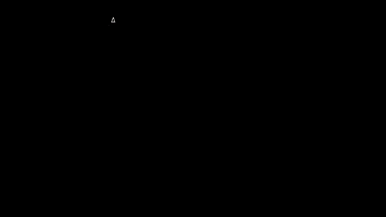

350° y −10° son la misma flecha. Promediados sin cuidado dan 170°, y 350° y 10°, que están a 20° uno del otro, dan 180°:
justo al revés. El error es tratar como recta algo que da la vuelta. El arreglo es llevar **las diferencias** a
$[-180°, 180°)$ antes de usarlas:

$$\mathrm{wrap}(a) = a - 360\left\lfloor\frac{a+180}{360}\right\rfloor$$

$10 - 350 = -340$, y `wrap_deg` dice 20: de 350° a 10° hay 20°. Sumando la mitad a 350° da 360°, que es 0°. Por lo mismo,
algo que gira parejo 10° por muestra no da un salto de −350° cuando la lectura pasa por 180°. `Motion.feed_gyro` usa
`wrap_deg` cada vez que resta dos ángulos.

## 6. Producto punto

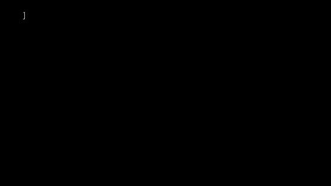

El **producto punto** multiplica número a número y suma. Y eso da, sin que sea obvio, los dos largos por el coseno:

$$a\cdot b = \sum_i a_i b_i = |a|\,|b|\cos\theta$$

Mide cuánto de una flecha va en la dirección de la otra. Si $b$ es unitaria, $a\cdot b$ es la sombra de $a$ sobre $b$, su
**proyección**. Con ángulo recto da cero porque no hay sombra: $a$ no tiene nada en la dirección de $b$. Esas flechas se
llaman **perpendiculares**. Pasados los 90° va en contra, y da negativo.

En el código aparece con esas tres caras. `onAccel` de `server/web/game.js` hace el producto punto del acelerómetro (sin
la gravedad) con el antebrazo: cuánto empuja la mano a lo largo del brazo. `metrics` de `server/web/calibrate.js` lo usa para
medir cuánto se pasó el cursor en la dirección del objetivo. Y `feasible` de `server/web/armfilter.js` compara `dot(u, f)`
con $\cos 150°$ para saber si el codo está muy doblado, sin calcular ningún ángulo.

## 7. Producto cruz

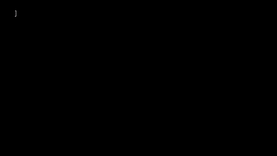

Para encontrar una flecha que forme ángulo recto con otras dos está el **producto cruz**:

$$a\times b = (a_y b_z - a_z b_y,\ \ a_z b_x - a_x b_z,\ \ a_x b_y - a_y b_x)$$

Es perpendicular a las dos, y su largo es el área del paralelogramo que forman:

$$|a\times b| = |a|\,|b|\sin\theta$$

Da cero si están alineadas. `hand` lo usa para sacar el costado de la mano, `S = cross(F, d)`, a partir del antebrazo y del
dorso. `feasible` lo usa como medidor: dos flechas de largo 1 a 15° dan $|f\times u| = 0.26$, y ese es su límite para
saber si el codo está doblado.

## 8. La regla de la mano derecha

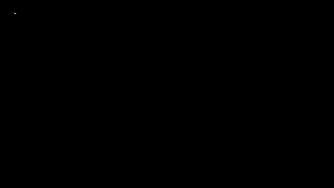

Hay dos flechas perpendiculares a $a$ y $b$, una para cada lado. ¿Cuál es $a\times b$? Lo decide un acuerdo: la **regla de la
mano derecha**. Los dedos van de $a$ hacia $b$, y el pulgar marca el resultado. Con eso $x\times y = z$, y $b\times a$ apunta al
revés que $a\times b$. No es una ley de la naturaleza, pero hay que cumplirla siempre: el reloj la cumple, y `watchOf` de
`mocapmath.js` arma su tercer eje así, `Y = cross(Z, X)`.

¿Ponerse el reloj en la otra mano es un espejo o un giro? **Un giro.** Un reloj no se puede volver su reflejo. Puesto igual,
sus ejes x e y se dan vuelta y z se queda: $(-x)\times(-y) = z$. Es un giro de 180° alrededor de z, y por eso `forearmOf` de
`server/web/wrist.js` solo cambia un signo. Dar vuelta **un solo** eje es otra cosa: $(-x)\times y = -z$. Eso no se consigue
girando. Es un espejo, y en un espejo los giros alrededor de los otros dos ejes van al revés: **cambian de signo**.

## 9. Marco de referencia

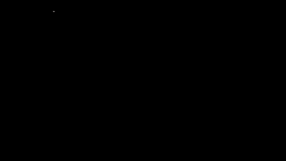

Si el reloj dice que la gravedad es $(0, 9.8, 0)$ y un rato después $(0, 0, 9.8)$, ¿qué se movió? El reloj. La gravedad sigue
apuntando igual; cambiaron los ejes con los que se la mide.

Tres ejes unitarios, en ángulo recto y con $x\times y = z$ son un **marco de referencia**: una regla para medir flechas. Esa
es la respuesta a la pregunta del capítulo: los números del reloj son **del reloj**. La misma flecha tiene unos números en
el marco del reloj y otros en el del mundo, y solo el largo es igual en los dos. `watchOf` da ese marco como tres flechas
$X$, $Y$ y $Z$, y `ArmFilter.step` guarda en el marco del reloj las dos que conoce de memoria: el antebrazo $(1, 0, 0)$ y la
normal de la pantalla $(0, 0, 1)$.

## 10. Coordenadas en una base

Escribir una flecha en unos ejes es escribirla como suma de múltiplos de ellos. Esos múltiplos son sus **coordenadas**. Si los
ejes son unitarios y en ángulo recto, cada coordenada es un producto punto, y ya: $v = (v\cdot e_1)\,e_1 + (v\cdot e_2)\,e_2$.

Si dos ejes $a$ y $b$ de largo 1 no forman ángulo recto, la sombra ya no sirve, porque una parte de $b$ también cae sobre $a$. Con
$v = 1.5\,a + 1.2\,b$ y 55° entre ellos, $v\cdot a$ da 2.19, no 1.5. Hay que resolver un sistema chico. Con $s = a\cdot b$:

$$v\cdot a = \alpha + \beta\,s, \qquad v\cdot b = \alpha\,s + \beta \quad\Rightarrow\quad \alpha = \frac{v\cdot a - (v\cdot b)\,s}{1-s^2}$$

Esa fórmula está en `Wrist.rates` y en `frame_rates` de `tools/reconstruct_drawing.py`: la gravedad y el antebrazo casi
nunca forman ángulo recto. El capítulo 6 entero sale de aquí.

## 11. Cambiar de marco

Si el reloj lee $(x, y, z)$, la flecha es $x$ de $X$, más $y$ de $Y$, más $z$ de $Z$. Escribiendo $X$, $Y$ y $Z$ con números del
mundo, como columnas, quedan nueve números: una **matriz**.

$$v_{\text{mundo}} = \begin{pmatrix} X & Y & Z \end{pmatrix} \begin{pmatrix} x\\ y\\ z \end{pmatrix} = x\,X + y\,Y + z\,Z$$

Cada número del resultado es un producto punto: una fila de la matriz por la flecha. Así pasa `ArmFilter.step` lo que mide
el giroscopio al mundo, `mulMV(R, omegaB)`, con los nueve números que le arma `rotationRows` en `server/web/avatar.js`.
Para volver del mundo al reloj no hace falta otra cuenta: cada número es el producto punto con $X$, con $Y$ y con $Z$. Así
fabrica `synth` lo que leería el reloj, `dot(cols[i], f)`.

---

## Experimento con tus datos

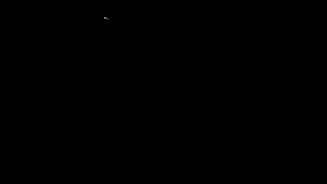

Deja el reloj quieto en seis posturas, cada cara hacia arriba, unos segundos en cada una, y graba:

1. Promedia la gravedad en cada postura. ¿Qué número cambia de una a otra?
2. Calcula su largo en las seis. ¿Da siempre 9.8?
3. Calcula el ángulo entre posturas. ¿Da 90° entre caras vecinas y 180° entre opuestas? ¿Cuánto se aleja?

La animación usa lecturas perfectas; las tuyas van a traer ruido.

## Ejercicio que se comprueba

Escribe `anguloPunto(a, b)` y `anguloAtan2(a, b)` en [`docs/curso/ejercicios/cap02.js`](../ejercicios/cap02.js) y córrelo con
`node tools/test_marcos.js --ejercicio`. Las pruebas comprueban, con lecturas inventadas con ruido, que:
- las dos dan 90° entre caras vecinas y 180° entre caras opuestas;
- una flecha consigo misma da 0°, sin que el redondeo saque a `acos` de su rango;
- las dos cuentas dan lo mismo en 200 pares de flechas al azar.
