# Capítulo 3 · Derivar e integrar con números

**Pregunta guía.** Si el giroscopio solo dice qué tan rápido giras, ¿cómo sabes cuánto giraste?

El reloj no da funciones: da una muestra cada 10 ms. Así que aquí derivar es restar, integrar es sumar, y casi todo lo
interesante es qué les pasa a los errores cuando se resta o se suma muchas veces.

Las animaciones salen de [`animaciones/cap03.py`](../animaciones/cap03.py) (Manim), con señales inventadas y números de
reloj de verdad; la media móvil es la de [`tools/analyze_dataset.py`](../../../tools/analyze_dataset.py), importada
tal cual. Lo que dice el capítulo se comprueba en [`tools/test_derivar.js`](../../../tools/test_derivar.js).

---

## 1. Derivar: cuánto cambia por segundo

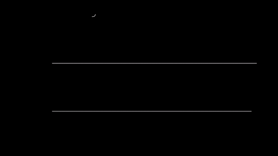

Con muestras, la derivada es una resta dividida por el tiempo. Hacia adelante, $(x[k+1]-x[k])/\Delta t$; o usando la
muestra anterior y la siguiente, la **diferencia central**:

$$\frac{x[k+1]-x[k-1]}{2\,\Delta t}$$

La central queda centrada en la muestra y cae mucho más cerca de la curva: en la prueba, con una onda de 0.25 Hz, su
error es unas 190 veces menor.

## 2. La segunda diferencia

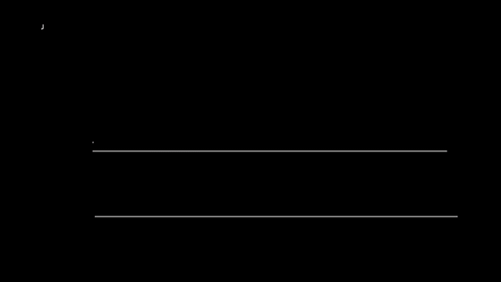

Si nada cambiara, la tercera muestra caería siguiendo la recta de las dos primeras. Lo que le falta, dividido por $\Delta t^2$, es la aceleración:

$$a[k] = \frac{x[k+1]-2x[k]+x[k-1]}{\Delta t^2}$$

Es derivar dos veces: la resta de dos rapideces seguidas, $(x[k+1]-x[k])/\Delta t$ menos $(x[k]-x[k-1])/\Delta t$,
dividida otra vez por $\Delta t$. De ahí el $\Delta t^2$. Así saca `synth` de `server/web/mocapmath.js` lo que leería el acelerómetro a partir de una animación.

## 3. Integrar: sumar tasa × Δt

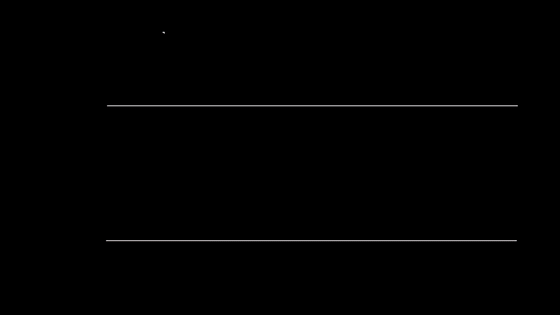

Cada muestra del giroscopio dice qué tan rápido, y entre una y otra pasó $\Delta t$. Sumando:

$$\theta \approx \sum_k \omega[k]\,\Delta t$$

10 °/s durante 3 s dan 30°. $\Delta t$ no se supone: sale del tiempo de cada muestra. Si se pierden muestras, un $\Delta t$
fijo se queda corto, y el tiempo del reloj cubre el hueco. Es lo que hace `onGyro` de `server/web/game.js`,
`dt = (t − S.lastGyroT) / 1000`, pero solo hasta 100 ms: con un hueco más largo usa 10 ms y ese tramo se pierde, como con el
$\Delta t$ fijo. `cursorTrack` de `mocapmath.js` hace la misma suma en 9 líneas, con $\Delta t$ fijo
porque sus muestras son inventadas y nunca se pierden.

## 4. Cómo se escriben la derivada y la integral

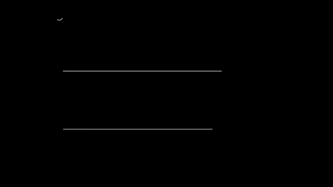

Con $\Delta t$ cada vez más chico, la resta sobre $\Delta t$ se acerca a un número: la pendiente de la curva en ese punto.
Esa es la derivada, y se escribe de tres formas que dicen lo mismo:

$$x' = \dot x = \frac{dx}{dt}$$

$dx$ y $dt$ se leen "un cambio muy chico de $x$" y "de $t$". Con dos marcas, $x''$, $\ddot x$ o $d^2x/dt^2$, es derivar dos
veces. La suma de tasa × $\Delta t$, con $\Delta t$ muy chico, se escribe con una S alargada, $\int$:

$$\int_0^T x\,dt \approx \sum_k x[k]\,\Delta t$$

El curso usa estas marcas con cualquier letra: si $e$ es un error, $e'$ y $\dot e$ dicen qué tan rápido cambia y
$\ddot e$ es su segunda derivada; $dv/dt$ es la derivada de la velocidad. Con muestras siempre se hace la resta o la
suma: la notación dice qué se busca. `cursorTrack` de `mocapmath.js` es $\int\omega\,dt$ hecha suma.

## 5. Integrar acumula error

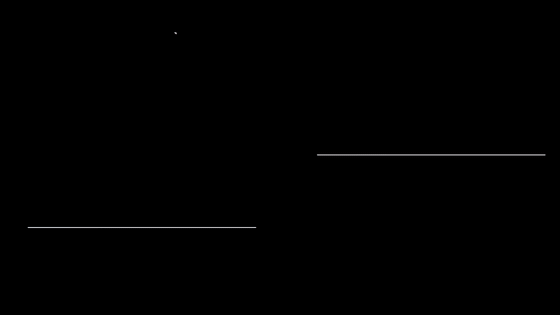

Un sesgo de $b$ = 0.3 °/s parece nada, pero se suma siempre para el mismo lado: el error es $b\,t$, 18° en un minuto
y 1080° (tres vueltas) en una hora. A eso se le dice **deriva**.

**El ruido va para un lado y para el otro. ¿Por qué al integrarlo también crece? ¿Crece igual que el sesgo?** En parte
se cancela, pero no del todo: la suma es un **paseo al azar**. Cada muestra suma $\omega\,\Delta t$, y su ruido es un
azar de tamaño $\sigma\,\Delta t$. Los azares que no dependen uno del otro suman sus varianzas (capítulo 1, sección 7), y
en $t$ segundos hay $t/\Delta t$ muestras: la varianza es $(t/\Delta t)(\sigma\,\Delta t)^2 = \sigma^2\,t\,\Delta t$, y el
tamaño típico, su raíz:

$$\sigma\sqrt{t\,\Delta t}$$

Con 2 °/s de ruido a 100 muestras por segundo son 1.5° en un minuto. El sesgo crece como $t$ y el ruido como
$\sqrt t$: a la larga manda el sesgo.

## 6. Integrar dos veces

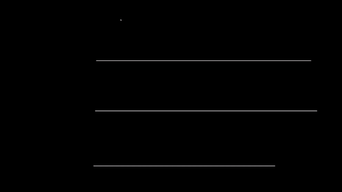

De la aceleración a la posición hay dos integrales, y cada una sube el exponente: un sesgo $b$ deja $b\,t$ en la
velocidad y $\tfrac12 b\,t^2$ en la posición. El $\tfrac12$ es el de un triángulo: integrar es sumar el área bajo la
curva, y bajo la recta $b\,t$ queda un triángulo de base $t$ y altura $b\,t$. Con 0.05 m/s² son 2.5 m en 10 s y 90 m en un minuto. Por eso el
reloj no puede decir dónde está tu mano solo con el acelerómetro.

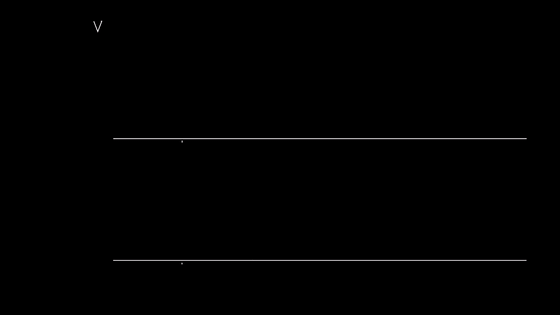

Lo que salva es algo que se sabe sin medirlo: **al apoyar y al levantar el dedo está quieto**. La velocidad al final
tiene que ser cero, así que lo que sobra es error, y se reparte a lo largo del trazo. Es la **velocidad cero** (ZUPT),
y son dos líneas en `watch_features` de `tools/analyze_drawing.py`. Un sesgo constante se va entero; el ruido, no todo.
`ArmFilter.step` usa la misma idea de otra forma: cada vez que el brazo se queda quieto, frena la velocidad y aprende el sesgo.

## 7. Suavizar

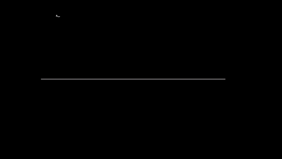

Suavizar es promediar con lo reciente. La **media móvil** promedia las últimas $n$ muestras (`movavg` de
`tools/analyze_dataset.py`, 8 líneas). El **promedio que olvida** no guarda la ventana, solo el valor anterior:

$$y \leftarrow y + \alpha\,(x - y)$$

En cada muestra se acerca una parte $\alpha$ de lo que le falta. Los dos dejan pasar lo lento y frenan lo rápido (es un
filtro **paso bajo**). Lo que se pierde es tiempo: con α = 0.2
un salto tarda 0.04 s en llegar al 63%, con α = 0.05, 0.19 s, y con α = 0.015, 0.65 s. `game.js` aprende el sesgo del
giroscopio así, con α = 0.002, solo mientras la mano está quieta. Por qué justo el 63% es la sección que sigue.

## 8. La exponencial y la constante de tiempo

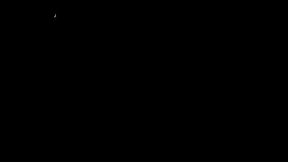

Ante un salto, cada vez que corre $y \leftarrow y + \alpha(x - y)$ se cierra una parte $\alpha$ de lo que falta y queda
$1-\alpha$. Después de $n$ muestras queda

$$(1-\alpha)^n$$

¿Cuánto queda después de $1/\alpha$ muestras? Con α = 0.2, cinco muestras dejan 0.328; con α = 0.05, veinte dejan 0.358;
con α = 0.002, quinientas dejan 0.3675. Cuanto más chico $\alpha$, más se acerca a un número fijo, 0.3679 = $1/e$. **e** =
2.718... es un número como $\pi$: no se elige, aparece solo. Si cada muestra dura $\Delta t$, esas $1/\alpha$ muestras
son la **constante de tiempo**

$$\tau = \frac{\Delta t}{\alpha}$$

y lo que falta se apaga como una **exponencial**:

$$(1-\alpha)^{t/\Delta t} \approx e^{-t/\tau}$$

En un $\tau$ se cierra el 63% ($1 - 1/e$), en dos el 86% y en tres el 95%. De ahí sale el 63% del capítulo 1:
`Wrist.rates`, con α = 0.002 a 100 Hz, tiene τ = 5 s, y `Motion.feed_gyro`, que se acerca $\Delta t$ / 20 s por muestra,
τ = 20 s. Contando muestras, con α = 0.2 el 63% llega a los 0.04 s y no a los 0.05 de $\tau$: $(1-\alpha)^n$ y
$e^{-t/\tau}$ se parecen tanto más cuanto más chico es $\alpha$. `OneEuro.alpha` de `tools/air_mouse.py` va al revés:
recibe un $f_c$ y devuelve $\alpha = \Delta t / (\Delta t + \tfrac{1}{2\pi f_c})$, un $\tau$ de $\Delta t + 1/(2\pi f_c)$
(capítulo 7).

## 9. Derivar amplifica el ruido

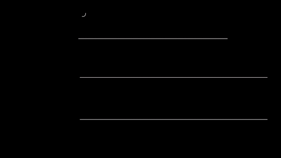

Derivar es dividir por un $\Delta t$ chico, y eso agranda cada temblor: con la diferencia central, el ruido pasa de
$\sigma$ a $\sigma/(\sqrt2\,\Delta t)$. ¿Por qué? $x[k+1]$ y $x[k-1]$ traen cada una su ruido, y no dependen uno del
otro: la resta tiene varianza $2\sigma^2$ y mide $\sigma\sqrt2$. Dividida por $2\Delta t$ queda $\sigma\sqrt2/(2\Delta t) =
\sigma/(\sqrt2\,\Delta t)$. Un ruido de 0.01, que no se ve, se vuelve 0.7, más o menos lo mismo que la señal. Por eso
antes de derivar hay que suavizar, pagando un poco de atraso. Integrar hace lo contrario: frena lo rápido y acumula lo
lento.

## 10. Quitar lo lento

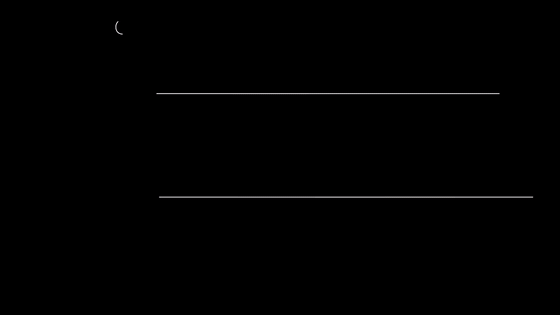

Al revés de suavizar: la señal menos su promedio reciente deja solo lo rápido (un filtro **paso alto**). Un golpe en la
mesa se ve aunque la mano se esté moviendo. En `signals` de `tools/analyze_dataset.py` es una línea,
`hp = la - movavg(la, 4)`: lo que cambió en 40 ms.

## 11. Una curva suave

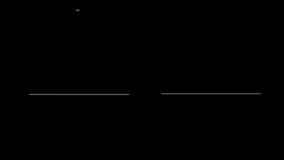

Para ir de 0 a 1 sin golpes, $3u^2 - 2u^3$ (*smoothstep*) empieza y termina con pendiente cero. Es `smooth` en
`mocapmath.js`, y `targetAt` en `server/web/sismomath.js` la usa para que la línea del Sismógrafo entre sin saltos.

## 12. Una onda

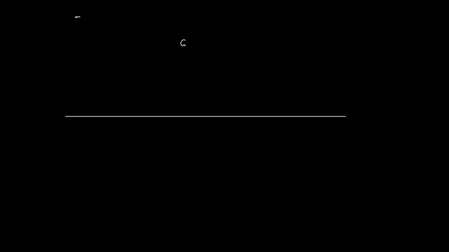

Lo más simple que va y viene es $a\sin(2\pi f t + \varphi)$: la **amplitud** $a$ dice qué tan lejos va, la
**frecuencia** $f$ cuántas vueltas por segundo, y la **fase** $\varphi$ dónde empieza. El $2\pi$ está porque $\sin$
pide el ángulo en radianes (capítulo 2): una vuelta son $2\pi$, así que $f$ vueltas por segundo son $2\pi f$ radianes
por segundo.

## 13. Integrar una onda

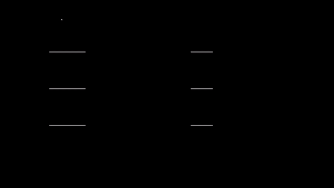

Si la muñeca va y viene, la tasa sube y baja y lo que se suma en una mitad se resta en la otra. Integrar
$a\sin(2\pi f t)$ da una onda de amplitud

$$\frac{a}{2\pi f}$$

¿De dónde sale? Un ángulo que va y viene $\pm A$, $f$ veces por segundo, es la sombra de un punto que da $f$ vueltas por
segundo en un círculo de radio $A$. Ese punto recorre $2\pi A$ en cada vuelta, $2\pi f A$ por segundo, y su sombra va así
de rápido al pasar por el centro: esa es la tasa más alta. Si la tasa llega a $a$, entonces $A = a/(2\pi f)$.

A 100 °/s el ángulo oscila alrededor de su centro ±31.8° a 0.5 Hz, ±8° a 2 Hz y ±2° a 8 Hz. Por eso un temblor rápido se ve enorme en el giroscopio y
casi no mueve el ángulo.

---

## Experimento con tus datos

Deja el reloj quieto en la mesa 60 s y graba:

1. Integra el giroscopio tal cual. ¿Cuánto giró algo que no se movió?
2. Mide el sesgo con el promedio de los primeros 10 s, réstalo e integra otra vez. ¿Qué queda?
3. Predice la deriva con $b\,t$ y compárala con lo que mediste.
4. Integra dos veces el acelerómetro, menos su promedio. ¿Cuánto "se movió"?

## Ejercicio que se comprueba

Escribe `integrar(t, tasa)` en [`docs/curso/ejercicios/cap03.js`](../ejercicios/cap03.js) y córrelo con
`node tools/test_derivar.js --ejercicio`. Las pruebas comprueban que:
- 10 °/s durante 3 s dan 30°, también si se pierden muestras;
- un sesgo da $b\,t$, el ruido $\sigma\sqrt{t\,\Delta t}$ e integrar dos veces $\tfrac12 b\,t^2$;
- una onda da amplitud $a/(2\pi f)$;
- la velocidad cero baja el error de un trazo.
