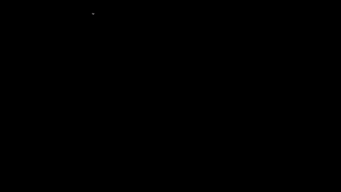
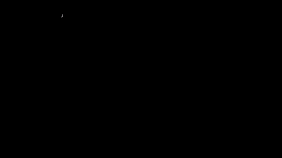
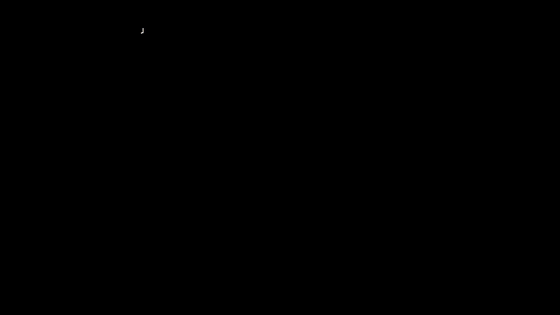
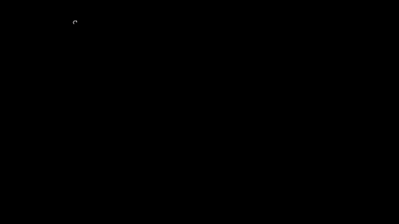
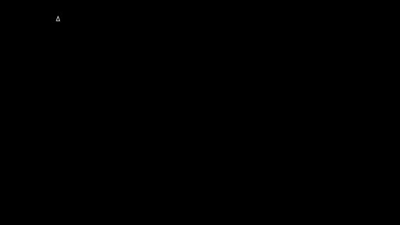
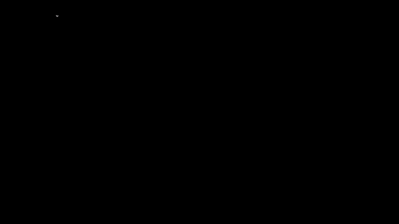
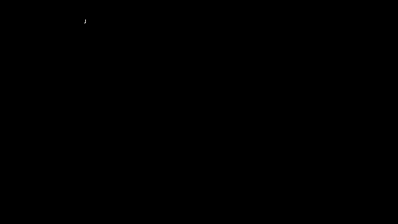

# Capítulo 4 · La gravedad dice dónde es arriba

**Pregunta guía.** Con la mano quieta, ¿cómo sabe el reloj hacia dónde está inclinado?

Después del capítulo 3 da un poco de miedo sumar cosas: todo lo que se integra se va. Este capítulo es la buena noticia:
hay una medida que no se integra y no se va. Y también tiene un límite, que es la mitad de lo que viene después.

Las animaciones salen de [`animaciones/cap04.py`](../animaciones/cap04.py) (Manim). Lo que leen los sensores en el mocap
sale de `synth` en [`server/web/mocapmath.js`](../../../server/web/mocapmath.js), y las pruebas están en
[`tools/test_gravedad.js`](../../../tools/test_gravedad.js).

---

## 1. Lo que mide el acelerómetro

Se esperaría que un acelerómetro quieto marcara cero. Marca 9.81 m/s² **hacia arriba**. Adentro hay una masita sostenida
por algo parecido a un resorte, y lo que se mide es cuánto se estira:

$$\text{lectura} = \vec a + \vec g$$

En este curso $\vec g$ son 9.81 m/s² **hacia arriba**, igual que la lee el sensor de gravedad del reloj. (En un libro de
física suele apuntar hacia abajo, y por eso allá la cuenta aparece con resta.) Quieto ($\vec a = 0$) da 9.81 hacia arriba.
Cayendo ($\vec a = -\vec g$) da 0: nada sostiene a la masita. Subiendo con 3 m/s² da 12.81. Siente lo que lo sostiene, no la caída: es la **fuerza específica**.
Así arma `synth` lo que leería el reloj: suma a la aceleración de la animación los 9.81 hacia arriba.

## 2. Arriba, sin integrar nada

Con la mano quieta, esos 9.81 apuntan hacia arriba, y el reloj los ve en sus propios ejes. Dividiendo por el largo queda la
dirección de arriba, vista desde el reloj:

$$\hat g = \frac{\vec g}{|\vec g|}$$

Es una medida **absoluta**: cada lectura vale por sí sola, así que no hay nada que se acumule. En un minuto, el
giroscopio sumado con un sesgo de 0.3 °/s se va 18°; la gravedad sigue donde estaba.

El reloj además trae un sensor de gravedad, que no es un sensor sino una cuenta interna de Samsung. Intenta dar esa misma
dirección también con la mano en movimiento, aunque cuánto se equivoca entonces no lo sabemos (capítulo 1), y apunta hacia
arriba igual que el acelerómetro quieto. `Motion.gravity_measurement` de
`tools/air_mouse.py` lo usa si llegó hace menos de 500 ms; si no, normaliza el acelerómetro.

## 3. La inclinación

La **inclinación** de un eje del reloj es su ángulo con la vertical, y sale de un producto punto:

$$\text{inclinación} = \arccos(\hat g \cdot \text{eje})$$

¿Por qué un arccos? $\hat g$ y el eje miden 1, así que su producto punto (capítulo 2) es $1\cdot 1\cdot\cos\theta$: el
coseno del ángulo entre ellos. **arccos** va al revés, del coseno al ángulo: arccos 1 = 0°, arccos 0 = 90° y
arccos −1 = 180°. Con z arriba toda la gravedad cae en z y la inclinación es 0°; boca abajo es 180°; acostado, 90°.

El arccos da lo mismo si te inclinas a la derecha o a la izquierda. Para saber para qué lado, se usan dos componentes:
$\operatorname{atan2}(g_y, g_z)$. Es lo que hace `Motion.roll_from_gravity` de `tools/air_mouse.py`, según en qué eje del
reloj quede el antebrazo.

## 4. La aceleración lineal

Cuando mueves la mano, el acelerómetro mezcla dos cosas: los 9.81 y lo que empujas. Restando la gravedad queda lo
que empuja de verdad, sin el peso:

$$\text{aceleración lineal} = \text{acelerómetro} - \text{gravedad}$$

Es la primera línea de `onAccel` en `server/web/avatar.js`, y `la = acc - grv` en `signals` de `tools/analyze_dataset.py`.

Por eso el acelerómetro solo dice dónde es arriba cuando no empujas. En la animación de apuntar se aparta de arriba
0.4° de mediana, pero hasta 53° en los movimientos bruscos. Por eso `Motion._rest_window` solo cree que la muñeca
descansa si el largo del acelerómetro está a menos de 1 m/s² de los 9.81, entre otras condiciones.

## 5. Reconocer el brazo colgando

El producto punto también sirve para reconocer posturas. Con $a = -\hat g \cdot \text{antebrazo}$, el brazo colgando da
$a = 1$ y el brazo horizontal, $a = 0$. `AirMouse._pose_gate` pausa el cursor si $a > 0.87$ durante 300 ms (más de 60° bajo
la horizontal) y lo suelta si $a < 0.80$ durante 300 ms (menos de 53°). Son dos umbrales distintos, y entre ellos
se queda como estaba, para que no parpadee.

## 6. Lo que la gravedad nunca va a decir

El **rumbo** es hacia dónde apunta algo en horizontal, como la aguja de una brújula. Si giras el reloj alrededor de la
vertical, la flecha de arriba no cambia: una flecha no cambia si giras alrededor de ella. Las tres cifras quedan
quietas, **la gravedad no ve el rumbo**. `gravedadLeida` de `server/web/fusionmath.js` da lo mismo con cualquier rumbo, y las
pruebas lo comprueban. Para el rumbo hace falta otra cosa: el capítulo 8 cuenta qué pasa con eso.

---

## Experimento con tus datos

1. Gira el reloj despacio por las seis posturas y compara el acelerómetro con la gravedad. ¿Coinciden?
2. Muévelo de golpe. ¿Dónde dejan de coincidir, y cuánto?
3. Déjalo plano y gíralo sobre la mesa. ¿Cambia alguna cifra de la gravedad?

## Ejercicio que se comprueba

Escribe `inclinacion(g, eje)` en [`docs/curso/ejercicios/cap04.js`](../ejercicios/cap04.js) y córrelo con
`node tools/test_gravedad.js --ejercicio`. Las pruebas comprueban que:
- las seis posturas dan 0°, 180° y cuatro veces 90°;
- da igual el largo de la gravedad y del eje;
- no da `NaN` por el redondeo;
- girar el reloj sobre la mesa no la cambia.
