# Capítulo 5 · Rotar

**Pregunta guía.** ¿Cómo se describe un giro en 3D, y por qué los ángulos a veces se rompen?

El reloj no sabe dónde está, pero sabe muy bien cómo gira: el giroscopio da tres números por muestra, y con ellos
el mocap y el avatar siguen la orientación del antebrazo. Este capítulo es la matemática de esos giros, en el orden en
que aparecen las preguntas.

Las animaciones salen de [`animaciones/cap05.py`](../animaciones/cap05.py) (Manim). Su cuenta es la del mocap:
`rot`, `qmul` y `qcols` de [`server/web/mocapmath.js`](../../../server/web/mocapmath.js), que
[`animaciones/datos_cap05.js`](../animaciones/datos_cap05.js) corre para comprobar que el dibujo dice lo mismo. Las
pruebas están en [`tools/test_rotar.js`](../../../tools/test_rotar.js).

---

## 1. Girar en el plano

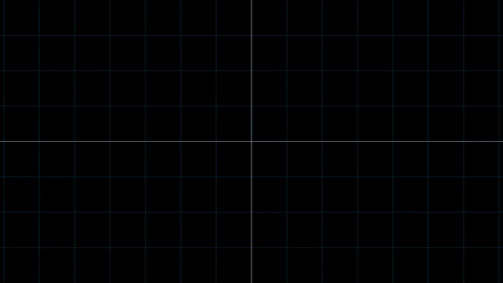

Para girar una flecha basta mirar adónde van las dos flechas de base: $\hat\imath$ va a $(\cos\theta, \sin\theta)$
y $\hat\jmath$ a $(-\sin\theta, \cos\theta)$. Cualquier $v = x\,\hat\imath + y\,\hat\jmath$ sigue siendo $x$ de la
primera más $y$ de la segunda:

$$x' = x\cos\theta - y\sin\theta, \qquad y' = x\sin\theta + y\cos\theta$$

El largo no cambia. En el código, `ArmFilter.rotateY` de `server/web/armfilter.js` hace esto mismo en el piso, con el par $(z, x)$ en vez de $(x, y)$.

## 2. Un eje y un ángulo (Rodrigues)

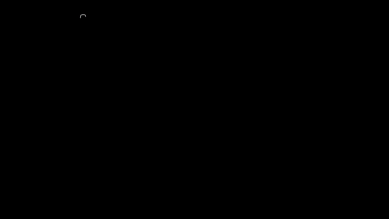

En 3D se gira alrededor de un eje $k$ (de largo 1). La parte de $v$ a lo largo de $k$, $k\,(k\cdot v)$, no se mueve;
la otra gira en el plano perpendicular a $k$, y ese plano tiene sus propias flechas de base: lo perpendicular de $v$
y $k \times v$. Juntando las dos partes:

$$v' = v\cos\theta + (k\times v)\sin\theta + k\,(k\cdot v)(1-\cos\theta)$$

Es la fórmula de Rodrigues, y es `rot` en `mocapmath.js`: 3 líneas.

Y no hace falta más: **todo giro en 3D, por raro que sea, es girar un ángulo alrededor de un solo eje**. Para
encontrarlo se busca la flecha que el giro deja quieta, $R\,k = k$.

## 3. La matriz de rotación

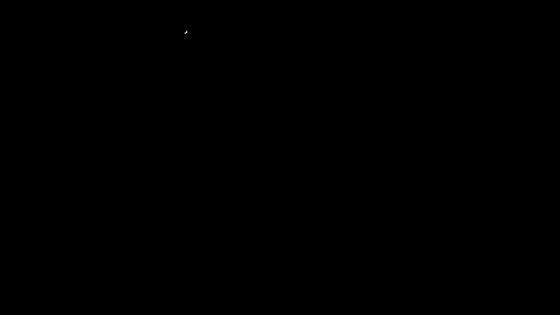

Si el giro se escribe como matriz, sus **columnas son los ejes del reloj vistos en el mundo**: la primera es hacia
dónde quedó apuntando su x, y así. Como son tres flechas de largo 1 perpendiculares entre sí, la matriz es
ortonormal: $R^{\mathsf T} R = I$, y deshacer el giro (pasar del mundo al reloj) es solo usar la transpuesta. En el
código, `qcols` arma esas columnas desde un cuaternión y `qfromCols` hace el camino de vuelta.

## 4. El orden importa

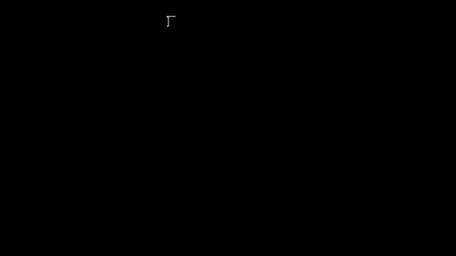

90° en x y luego 90° en y no deja el cubo igual que al revés: $R_y R_x \neq R_x R_y$. Los giros en 3D **no
conmutan**; en el plano sí. Por eso el orden en que `build` aplica cada giro del cuerpo no es un detalle.

## 5. La velocidad angular es una flecha

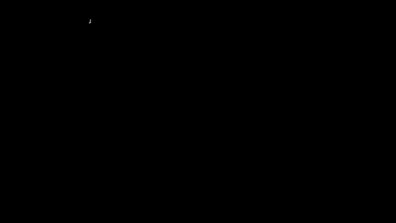

La velocidad angular $\omega$ no es un número: hace falta decir alrededor de qué. Su **dirección es el eje del giro y
su largo, la rapidez** (en rad/s). El giroscopio da sus tres componentes, pero en los ejes del reloj, $R^{\mathsf T}\omega$;
si el reloj gira quieto alrededor de un eje, lee siempre lo mismo.

## 6. Un punto que gira

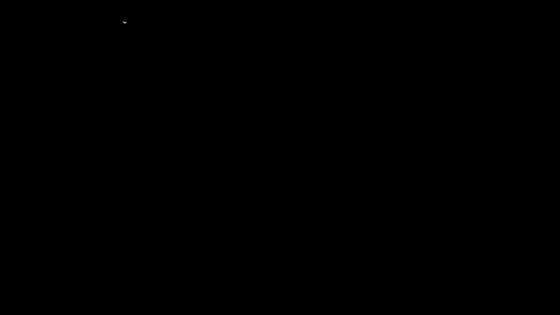

Un punto pegado a algo que gira con $\omega$ se mueve a $\omega \times r$: perpendicular al eje y a $r$, y tanto más
rápido cuanto más lejos del eje, $|\omega \times r| = |\omega|\,|r| \sin\varphi$.

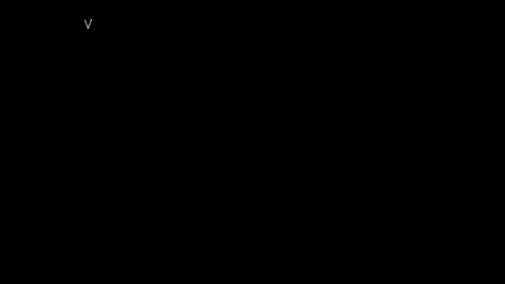

Al revés también sirve: una flecha quieta en el mundo, como la gravedad, vista desde el reloj que gira, cambia a
$-\omega \times v$. Así sigue la gravedad entre lectura y lectura `Motion.feed_gyro` del ratón aéreo
(`tools/air_mouse.py`).

## 7. Tres ángulos: rumbo, inclinación y giro

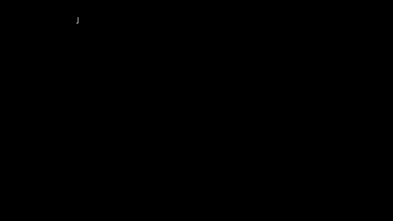

La forma más fácil de leer una orientación es con tres giros seguidos, cada uno alrededor de un eje que dejó el
anterior: los **ángulos de Euler**.

$$R = R_z(\text{rumbo})\,R_y(-\text{inclinación})\,R_x(\text{giro})$$

Aquí $z$ es la vertical y la inclinación positiva sube el antebrazo; por eso el signo, porque $R_y$ positivo baja el eje $x$.
Son fáciles de leer, pero el orden y el punto de partida importan (sección 4).

## 8. Cuando un ángulo se come al otro

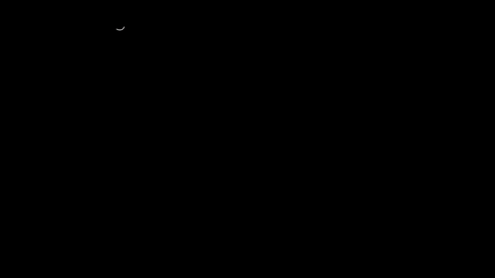

Con el antebrazo colgando, su eje queda sobre la vertical, y **el rumbo y el giro hacen lo mismo, con signo contrario**: solo cuenta
su resta, y se perdió una forma de girar. Es el bloqueo del cardán, una singularidad de los tres ángulos (no del giro: el brazo
puede moverse igual). Cerca de ahí, un movimiento suave hace saltar el rumbo 180° en un instante. Por eso
`Wrist.rates` de `server/web/wrist.js` y `AirMouse._pose_gate` tienen cuidado cuando el antebrazo se acerca a la
vertical.

## 9. El cuaternión

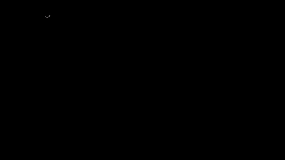

Un giro de $\theta$ alrededor de $k$ se guarda en cuatro números:

$$q = \left(\cos\tfrac{\theta}{2},\ k\,\sin\tfrac{\theta}{2}\right)$$

Cuatro números de largo 1: tres libres, como el giro, y **nunca se traban**. Va la mitad del ángulo porque $q$ entra
dos veces al girar una flecha, una a cada lado; por eso $q$ y $-q$ son el mismo giro: una vuelta entera lleva $q$ a $-q$, y hacen falta dos para volver. Componer giros es
multiplicarlos, `qmul`: $q_y \otimes q_x$ es lo mismo que $R_y R_x$.

¿Cuándo conviene cada uno? La matriz, para usar el giro (girar flechas, leer los ejes del reloj); el cuaternión,
para guardarlo y sumarle giros, porque son 4 números en vez de 9 y es fácil devolverlo a largo 1.

## 10. Integrar la orientación

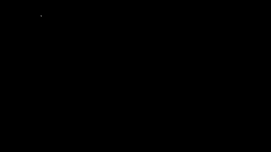

Cada muestra del giroscopio gira el cuaternión un poquito, el giro de $|\omega|\Delta t$ alrededor de $\hat\omega$:

$$q \leftarrow q \otimes \left(\cos\tfrac{|\omega|\Delta t}{2},\ \hat\omega\,\sin\tfrac{|\omega|\Delta t}{2}\right)$$

y después se divide por su largo. Lo nuevo va a la derecha porque el giroscopio da $\omega$ en los ejes del reloj; con ejes
del mundo iría a la izquierda, como en la sección 4. Si en vez de girar se suma (la cuenta de la derivada, $q + \tfrac12 q \otimes (0, \omega)\Delta t$),
$|q|$ crece en cada paso y la matriz que sale ya no es un giro: el cubo se deforma. Así integra `reconstruct` en
`mocapmath.js` y `onGyro` en el avatar.

---

## Experimento con tus datos

Graba unos segundos con el reloj, apuntando adelante y después dejando colgar el brazo. Integra el giroscopio de
dos formas, con cuaterniones (sección 10) y sumando los tres ángulos, y compáralas justo cuando el brazo cuelga.
¿Cuál se pierde, y en cuál de los tres ángulos se nota?

## Ejercicio que se comprueba

Escribe `cuaternion(eje, angulo)` en [`docs/curso/ejercicios/cap05.js`](../ejercicios/cap05.js) y córrelo con
`node tools/test_rotar.js --ejercicio`. Las pruebas comprueban que:
- tu cuaternión tiene largo 1 y gira igual que `rot`;
- `qcols(q_y ⊗ q_x)` es $R_y R_x$, y 90° en x y luego en y no da lo mismo que al revés;
- una vuelta entera da $-q$, que es el mismo giro;
- 100 giros chiquitos de $\omega$ dan el giro de $|\omega| t$.
