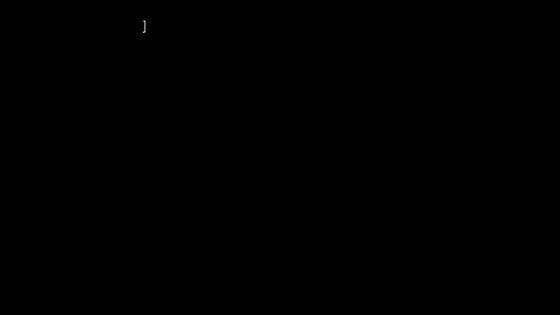
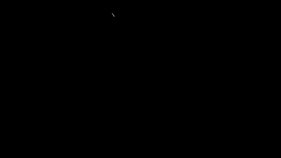
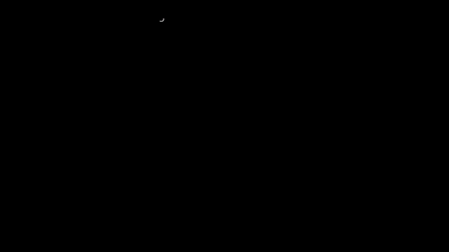
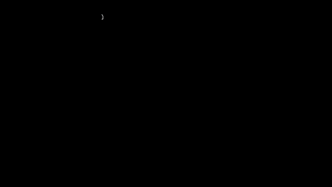
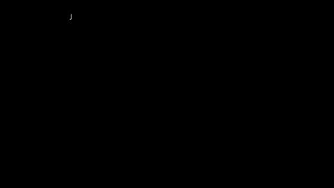
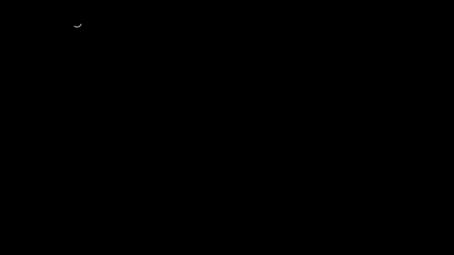
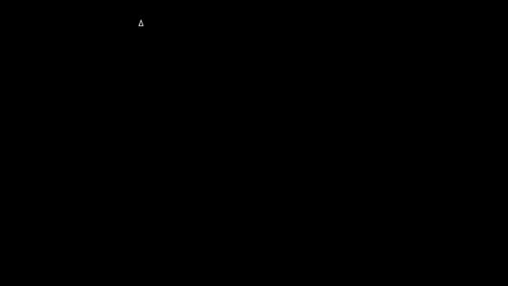
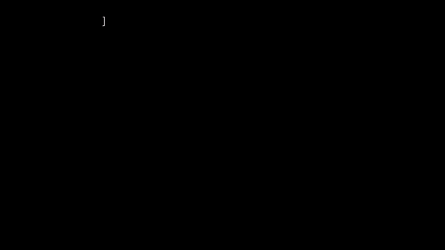

# Capítulo 6 · Del reloj al antebrazo: roll, yaw y pitch

**Pregunta guía.** El giroscopio gira con el reloj. ¿Cómo se convierte eso en "apunté a la izquierda" o "atornillé"?

El giroscopio da $\omega$ en los ejes del reloj, y esos ejes se mueven con la mano. Lo que le importa al cursor es otra cosa:
cuánto giró hacia los lados, cuánto hacia arriba y cuánto se atornilló. Este capítulo son las 13 líneas que hacen esa
traducción, `Wrist.rates` de [`server/web/wrist.js`](../../../server/web/wrist.js), y lo que tienen de delicado.

Las animaciones salen de [`animaciones/cap06.py`](../animaciones/cap06.py) (Manim), con movimientos inventados. Antes de
dibujar nada, ese archivo compara su cuenta con `Wrist.rates` en 600 casos que le da
[`animaciones/datos_cap06.js`](../animaciones/datos_cap06.js). Las pruebas están en
[`tools/test_antebrazo.js`](../../../tools/test_antebrazo.js).

En todo el capítulo $\omega$ es lo que lee el giroscopio, sin sesgo; $g$ es arriba, leído en el reloj y de largo 1; y $f$ es el
antebrazo, del codo a la mano. Los tres están escritos en los ejes del reloj.

---

## 1. El antebrazo es un eje del reloj



El reloj va sobre el dorso de la muñeca, y la correa lo obliga a quedar alineado con el brazo. Por eso uno de sus ejes es el
antebrazo, y no hay que medirlo: en la **muñeca izquierda** es $+x$, y en la **muñeca derecha**, con el reloj puesto igual,
es $-x$. Es el giro de 180° del capítulo 2. `forearmOf` de `wrist.js` es esa línea, y `watchOf` de `mocapmath.js` arma los ejes
así.

Eso es un supuesto, no una medida. Con el reloj girado 10° sobre su propio eje $z$, $x$ ya no es el antebrazo, y 100 °/s de atornillar
dejan al menos 17.4 °/s que el cursor ve, y más con el antebrazo inclinado, hasta unos 65°: más arriba el cursor deja
de leer yaw y pitch. Y si el reloj se pone al revés, la izquierda se comporta como la derecha.

Para averiguar el eje, `AirMouse._calib_forearm` usa algo que sí se sabe: con el brazo colgando, el antebrazo apunta abajo, y
la gravedad queda sobre él. Marca $x = -9.81$ en la izquierda, y dice `usa --forearm +x`.

## 2. Roll: atornillar



La parte del giro alrededor del antebrazo es un producto punto:

$$\text{roll} = \omega\cdot f$$

Positivo es horario visto desde el codo, como apretar un tornillo. Es la regla de la mano derecha con el pulgar hacia la mano.
Como $f$ está pegado al reloj, no hace falta saber nada del mundo. Por eso `FlickDetector.update` de `server/web/flick.js`
toma directamente $\pm\omega_x$, y `point3` de `server/web/dibuja.js` usa lo acumulado para alejar el lápiz.

## 3. Pitch: subir y bajar



Subir la mano es girar alrededor de un eje horizontal, de costado. Ese eje forma ángulo recto con el antebrazo y con la
vertical, y eso es justo lo que da el producto cruz:

$$p = \frac{f\times g}{|f\times g|}, \qquad \text{pitch} = \omega\cdot p$$

Positivo: la mano sube. Hay que dividir por el largo porque $|f\times g|$ es el coseno de la elevación, y se acorta al levantar el
brazo. `wrist.js` deja de calcularlo cuando $|f\times g| \le 0.3$. `subida` de `server/web/fusionmath.js` es esta misma cuenta.

## 4. Yaw: izquierda y derecha



"Girar alrededor de la vertical" necesita saber dónde es la vertical, y el reloj lo sabe: es la gravedad, y llega en sus propios
ejes (capítulo 4). No hay que convertir nada.

La tentación es $\omega\cdot g$, y no alcanza. Si atornillas con el antebrazo a 45°, $\omega$ va por $f$, y $f$ tiene algo de vertical:
$\omega\cdot g$ da 70.7 °/s de cada 100, y el cursor se iría de lado. Hay que quitarle lo que ya es roll:

$$\text{yaw} = \frac{\omega\cdot g - \text{roll}\,(g\cdot f)}{1 - (g\cdot f)^2}$$

Positivo: hacia la izquierda. La división es lo que hace que 100 °/s alrededor de la vertical sigan dando 100 a cualquier
elevación. Y el movimiento al revés también pasa: con el antebrazo a 30°, girar 60 °/s alrededor de la vertical marca 30 °/s de
roll. No es un error: $\omega$ de verdad tiene esa parte a lo largo del antebrazo. Pero tampoco es atornillar: una vuelta entera suma 180° de roll y el antebrazo vuelve igual. Por eso sumar el roll no da un ángulo de atornillado.

## 5. Una base torcida



¿Son el roll, el yaw y el pitch tres giros perpendiculares? **No.** $p$ forma ángulo recto con $f$ y con $g$, pero $f$ y $g$ entre sí
solo cuando el antebrazo está horizontal. Es el caso de los ejes torcidos del capítulo 2. Escribiendo $\omega$ en la base
$\{g, f, p\}$:

$$\omega = a\,g + b\,f + c\,p$$

$c$ sale con una sombra, porque $p$ no se mezcla con nadie: es el pitch. Para los otros dos, con $s = g\cdot f$, hay dos ecuaciones:

$$\omega\cdot g = a + b\,s, \qquad \omega\cdot f = a\,s + b$$

Despejando $a$ sale la fórmula del yaw, y por eso **el yaw es un coeficiente y no una sombra**. ¿Importa? Sí, y de un modo que no
es simétrico: el yaw es $a$ exacto, pero el roll es la sombra $\omega\cdot f = b + a\,s$, no el coeficiente $b$. Con el antebrazo a
45°, $a = 100$ y $b = 50$, el roll da 120.7. Con el antebrazo inclinado un yaw se ve en el roll; un roll no se ve nunca en el yaw.

## 6. Cerca de la vertical



¿Por qué se divide por $1 - (g\cdot f)^2$? Porque es lo que queda al resolver el sistema, y tiene un sentido: es
$|f\times g|^2$, el área al cuadrado del paralelogramo de $f$ y $g$. Con el antebrazo casi vertical, $f$ y $g$ casi caen sobre la misma recta,
la base se aplasta y ya no se pueden separar: atornillar y girar alrededor de la vertical son casi lo mismo. Es la singularidad
del capítulo 5, ahora dentro de una división.

Un ruido en $\omega$ se agranda $1/\cos(\text{elevación})$, y sin freno crecería sin límite. Por eso el código divide por
`Math.max(1 - gpf * gpf, 0.09)`. Ese mínimo empieza a mandar a 72.5° de elevación, a 17.5° de la vertical, el mismo lugar donde
$|f\times g|$ cae por debajo de 0.3 y el pitch queda en cero. Con eso:

- el ruido se agranda 3.3 veces como mucho;
- el yaw se apaga en vez de explotar: 100 °/s alrededor de la vertical dan 100 a 70° de elevación y 34 a 80°;
- se pierde información: ahí el reloj no puede decir hacia qué lado giraste.

## 7. Atornillar no mueve el cursor



Si atornillas sin mover la mano, $\omega = b\,f$. El pitch da cero porque $p$ forma ángulo recto con $f$. Y el numerador del yaw da

$$\omega\cdot g - (\omega\cdot f)(g\cdot f) = b\,(f\cdot g) - b\,(g\cdot f) = 0$$

Da cero **por construcción**: no depende de la elevación, y tampoco de que $g$ sea exacta. La prueba lo comprueba de −89° a 89° en
las dos manos, y con 400 verticales equivocadas a propósito. Hasta el mínimo de 0.09 da igual: cero dividido por lo que sea es cero.
Por eso `Motion.feed_gyro` del ratón aéreo (`tools/air_mouse.py`) puede usar el roll para hacer scroll sin que el cursor se mueva.

Hay dos condiciones, y son las de la sección 1: que $f$ sea de verdad el antebrazo, y que el giro real sea alrededor de él. Una
muñeca de verdad nunca atornilla perfecto, y lo que tenga de otro eje el cursor lo ve.

## 8. La mano equivocada



En la muñeca derecha el antebrazo es $-x$. Si el programa no lo sabe y usa $+x$, tiene $f$ al revés, y mirando las fórmulas:

- roll $= \omega\cdot f$ cambia de signo: atornillar sale desatornillar;
- pitch $= \omega\cdot(f\times g)/|f\times g|$ cambia de signo: arriba sale abajo;
- el yaw no cambia: roll y $g\cdot f$ cambian de signo los dos, y su producto no.

Con $f$ bien puesto, las dos manos dicen lo mismo, porque las fórmulas hablan del brazo y no del reloj. Las páginas guardan la
mano elegida con `saveHand`; en el ratón aéreo es `--forearm=-x`.

## 9. Las tres juntas


Todo el capítulo es esto, en `Wrist.rates`, sin contar el sesgo:

```js
const g = grav.map((x) => x / gn), f = this.forearm;
const roll = dot(w, f), gpf = dot(g, f);
let yaw = (dot(w, g) - roll * gpf) / Math.max(1 - gpf * gpf, 0.09);
const c = cross(f, g), cn = norm(c);
let pitch = cn > 0.3 ? dot(w, c) / cn : 0;
if (Math.hypot(yaw, pitch) < 0.6) { yaw = 0; pitch = 0; }
```

La última línea apaga el yaw y el pitch juntos por debajo de 0.6 °/s, para que el temblor de una mano quieta no mueva nada. El roll
sigue.

## 10. La misma cuenta, varias veces

Esta cuenta está escrita por separado en varios lugares del repo, y no es del todo la misma:

| Dónde | Arriba | Antebrazo | Casi vertical | Muy lento |
|---|---|---|---|---|
| `Wrist.rates` (Dibuja, Sismógrafo, mocap) | la gravedad | $\pm x$ según la mano | pitch 0 | se apaga bajo 0.6 °/s |
| `onGyro` de `game.js` | la gravedad | $\pm x$ según la mano | pitch 0 | se apaga bajo 0.8 °/s |
| `Motion.feed_gyro` | la suya: giroscopio, corregido con la gravedad | `--forearm`: $+y$ si no se dice, y el lanzador pasa $+x$ | sigue con el último $p$ | no se apaga aquí |
| `frame_rates`, `watch_features` | la gravedad | $+x$ siempre | divide casi por cero | no se apaga |
| `onGyro` de `avatar.js` (solo las cifras en pantalla) | la de su orientación | el que se elija | yaw sin corregir | no se apaga |

Lo más llamativo es la última fila: el avatar muestra $\omega\cdot g$ como yaw, sin quitarle el roll, y arma el eje de costado como
$g\times f$, así que su pitch tiene el signo contrario. Solo son cifras en pantalla, y no mueven nada.

¿Qué haría falta para confiar en que dan lo mismo? Pasarles los mismos números y comparar. Eso hacen `cap06.py` y la prueba para
las que se pueden cargar: con $|f\times g| > 0.3$ y por encima del apagado, `Motion.feed_gyro`, `frame_rates` (solo en la izquierda)
y `subida` coinciden con `Wrist.rates`, hasta el redondeo, en los 590 casos de 600 al azar que cumplen eso. `game.js` y `avatar.js` no se pueden cargar sin navegador: aquí están leídos,
no probados, y la cuenta del avatar está copiada en la prueba. Lo que de verdad lo arreglaría es que hubiera una sola función.

---

## Experimento con tus datos

Toma tu sesión del dataset de gestos y calcula los tres giros con `Wrist.rates`, muestra a muestra:

1. En los pasos de muñeca lenta y rápida, ¿cuál de los tres manda en cada uno?
2. Busca un tramo en que solo atornillaste. ¿Cuánto se escapa al yaw y al pitch? Con la sección 1, ¿cuántos grados de reloj girado
   explicarían eso?
3. Busca un tramo con el antebrazo cerca de la vertical. ¿Qué le pasa al yaw?

## Ejercicio que se comprueba

Escribe `fabricar(a, b, c, g, f)` y `rollQueSale(a, b, g, f)` en [`docs/curso/ejercicios/cap06.js`](../ejercicios/cap06.js) y córrelo
con `node tools/test_antebrazo.js --ejercicio`. Las pruebas comprueban que:
- tu $\omega = a\,g + b\,f + c\,p$, pasado por `rates`, devuelve $a$ en el yaw y $c$ en el pitch, exactos, de −70° a 70° y en las dos manos;
- el roll es el que dijiste, y no es $b$ cuando $g\cdot f \ne 0$;
- con el antebrazo horizontal, el roll sí es $b$.
