# Capítulo 7 · De 3D a 2D: el cursor

**Pregunta guía.** ¿Cuántos píxeles tiene que moverse el cursor cuando giras la muñeca un grado?

La muñeca gira en 3D y el cursor vive en un plano, en píxeles enteros. Entre las dos cosas hay una cadena corta de
cuentas: un arco, un número que convierte grados en píxeles, un filtro, una zona muerta, una curva y unos topes.
Este capítulo las recorre una por una, y termina con la forma de medir si un ajuste es mejor que otro.

Las animaciones salen de [`animaciones/cap07.py`](../animaciones/cap07.py) (Manim). La cadena del cursor es la de
[`tools/air_mouse.py`](../../../tools/air_mouse.py), importada tal cual: `Motion.feed_gyro` corre de verdad, con tasas
inventadas. El rayo y el cursor de la simulación salen de
[`animaciones/datos_cap07.js`](../animaciones/datos_cap07.js). Los datos de Fitts son inventados, y la escena lo dice.
Lo que afirma el capítulo se comprueba en [`tools/test_cursor.js`](../../../tools/test_cursor.js).

---

## 1. Girar es recorrer un arco

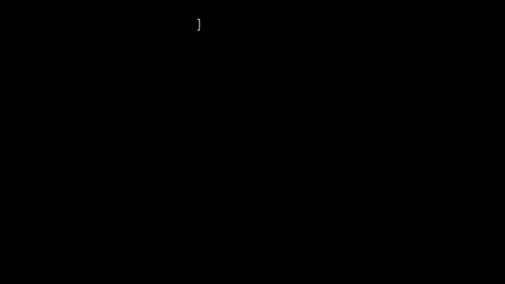

Si apuntas con un láser a 2.4 m y giras, la punta del rayo recorre un **arco**. Su largo es la distancia por el ángulo:

$$s = D\,\theta$$

con $\theta$ en radianes. Por eso existen los radianes: un radián es el ángulo cuyo arco mide lo mismo que el radio.
Un grado son $\pi/180$ radianes, así que un grado de giro recorre $D\cdot\pi/180$: a 2.4 m, 4.19 cm.

`cursorTrack` de `server/web/mocapmath.js` es esa cuenta. Suma el yaw y el pitch de cada muestra y multiplica por $K$
metros por grado: con $K = D\cdot\pi/180$, el cursor recorre el arco.

## 2. En una pared plana, el rayo pega en D·tan θ

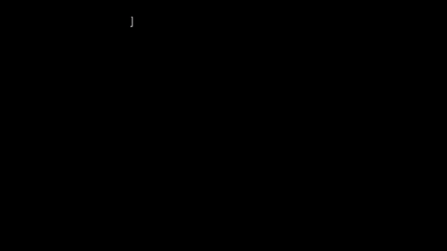

La pantalla no es un arco: es plana. El rayo pega en

$$y = D\tan\theta$$

Con 10°, 42.3 cm. Con 40°, 2.01 m, cuando el arco va por 1.68 m. Para un **ángulo pequeño**, $\tan\theta \approx \theta$ y
los dos coinciden. Lo que los separa es $\tan\theta - \theta \approx \theta^3/3$: con $D$ = 2.4 m, 1 cm a los 13°.

¿De dónde sale? El rayo mide $D/\cos\theta$ hasta la pared, y la pared le queda inclinada $\theta$: girar un poquito
$\Delta\theta$ mueve el punto $D\,\Delta\theta/\cos^2\theta = D(1 + \tan^2\theta)\,\Delta\theta$ (porque
$\sin^2 + \cos^2 = 1$), y el cursor solo $D\,\Delta\theta$. La diferencia crece a $D\tan^2\theta \approx D\theta^2$ por
radián, y sumar $\theta^2\,\Delta\theta$ desde 0 da $\theta^3/3$, igual que sumar $t$ da $t^2/2$ (capítulo 3).

Entonces, ¿por qué el ratón aéreo usa $D\theta$, si $D\tan\theta$ es lo "correcto"? Por tres razones:

- $D\tan\theta$ necesita conocer $D$ y el ángulo absoluto hacia la pantalla. El reloj no sabe ninguno de los dos: solo
  sabe cuánto giró desde hace un rato.
- Con $D\theta$, un grado mueve lo mismo en toda la pantalla. Con $D\tan\theta$ movería más cerca de los bordes.
- A las distancias y ángulos de un monitor, la diferencia es chica. En la animación de apuntar (`aimPath`, con el codo
  a 2.32 m) el cursor y el rayo se separan 3.4 y 2.4 cm en los íconos de la derecha, y 0.7 y 0.2 cm en los de la
  izquierda. No es igual en las cuatro esquinas porque el reloj va en el brazo izquierdo: el codo no está frente al
  centro de la pantalla, y los íconos de la derecha le quedan a 19° y los de la izquierda a 8°.

## 3. De dos ángulos a una dirección

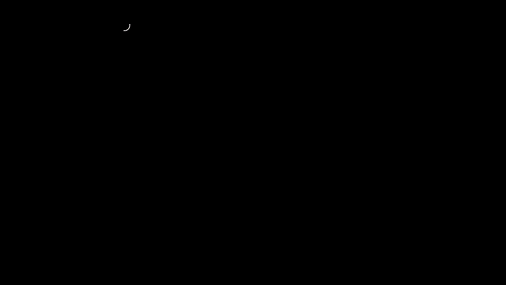

Para ir al revés, de dos ángulos a una flecha en 3D, se usan las **coordenadas esféricas**. En el mundo de `game.js` y `dibuja.js`
$+x$ es la derecha, $+y$ arriba y $-z$ adelante:

$$d = (\sin\text{yaw}\,\cos\text{pitch},\ \ \sin\text{pitch},\ \ -\cos\text{yaw}\,\cos\text{pitch})$$

El pitch levanta la flecha: sube $\sin p$ y su sombra en el piso se achica a $\cos p$. El yaw reparte esa sombra entre
el costado y el frente. Por eso $x$ y $z$ llevan $\cos p$, y por eso $d$ mide 1 siempre. Es `aimDir` de
`server/web/game.js` (la dirección del dardo) y la flecha de `point3` de `server/web/dibuja.js`, que después la
multiplica por una profundidad. (Aquí el yaw positivo va a la derecha, al revés que el de `Wrist.rates` en el capítulo 6, y
por eso `onGyro` lo resta al acumularlo.)

## 4. Ganancia: píxeles por grado

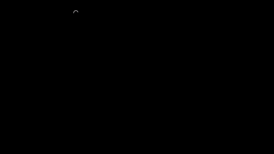

La respuesta a la pregunta guía es un número que hay que elegir: la **ganancia**, en píxeles por grado.

| Dónde | Ganancia | Cruzar 1920 px |
|---|---|---|
| Ratón aéreo, despacio (`g_lo`) | 12 px/° | 160° |
| Dibuja en 2D (`PX_PER_DEG` en `point2`) | 16 px/° | 120° |
| Ratón aéreo, rápido (`g_hi`) | 30 px/° | 64° |

Un láser de verdad no elige: su ganancia sale de la distancia y de los píxeles por metro de la pantalla,
$g = (D\pi/180)\cdot(\text{px/m})$. Con un monitor inventado de 53 cm y 1920 px, a 60 cm, son 38 px/°; a 2.4 m, 152 px/°.
El ratón aéreo no mide la distancia: sus 12 a 30 px/° la suponen. Ganancia alta cruza la pantalla con poco giro, pero
cada temblor se ve más grande. En `Motion.feed_gyro`, el paso del cursor es la ganancia por la tasa por $\Delta t$,
con `gain`, `gain_x` y `gain_y` como multiplicadores.

## 5. Recortar a un rango

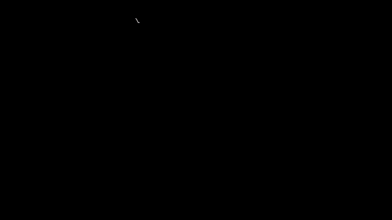

**Recortar** es dejar un valor entre un mínimo y un máximo: `clamp` de `tools/air_mouse.py`, que además convierte un
`NaN` en el mínimo para que nunca pase. Aparece en cinco lugares:

- El **borde de la pantalla**: `AirMouse._clamp`.
- La **velocidad máxima**: 4000 px/s en `feed_gyro`. Achica los dos ejes por igual, así que la dirección no cambia.
  `AirMouse._apply_delta` pone otro **tope**, contra el reloj de la laptop.
- La **mira del juego**: ±30° de yaw y ±18° de pitch en `onGyro` de `server/web/game.js`.
- Una **pausa de la red**: `feed_gyro` sube a 5 ms los intervalos más cortos, y una pausa de más de 100 ms la descarta: esa muestra no mueve el cursor.
- Una **pausa al reproducir**: `timeline` de `server/web/trazos.js` acorta a 400 ms las pausas de un dibujo.

Recortar algo que se va sumando tiene una consecuencia. Si la muñeca sigue 10° contra el tope y vuelve, la mira no
vuelve al mismo lugar: queda corrida 10°, porque lo recortado no se guarda en ninguna parte.

## 6. Movimientos de menos de un píxel

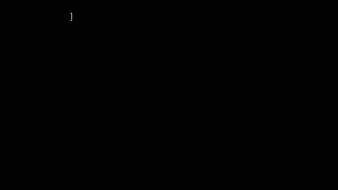

El cursor vive en píxeles enteros. Si la muñeca gira a 3 °/s, cada muestra mueve 0.264 px (ya con la zona muerta de la sección 7). Si cada paso se redondeara,
sería siempre 0 y el cursor no se movería; a 5 °/s, cada paso de 0.504 se volvería 1 y el cursor iría casi al doble.

Por eso los movimientos de **subpíxeles** no se tiran. `AirMouse._apply_delta` suma los decimales en `self.P`, y lo que
se manda es el redondeo de esa suma: en modo absoluto, `round(self.P)`, que `norm` pasa a la escala 0 a 65535 de
Windows; en modo relativo, la diferencia entre dos redondeos. En 2 s a 3 °/s, 52.8 px en vez de 0. Cuando la mano lleva
150 ms quieta, `P` se redondea y los decimales que sobraban se olvidan.

## 7. Zona muerta

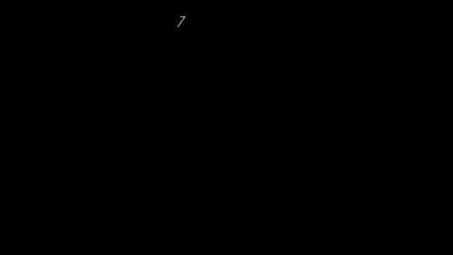

Quieta, la mano nunca da cero: queda temblor y queda el sesgo que no se restó. Si todo eso pasara, el cursor se
arrastraría solo. Por eso hay una rapidez por debajo de la cual no se mueve: la **zona muerta**. Con 0.3 °/s de sesgo
sobrante son 72 px en 20 s sin ella, y ni uno con ella.

Hay dos formas de hacerla, y el repo tiene las dos:

- **Cortar**: bajo el borde cero, y sobre el borde lo que venga. Es lo que hacen `Wrist.rates` (0.6 °/s) y `onGyro` del
  juego (0.8 °/s). Justo en el borde hay un salto: de 0 a 0.6 °/s.
- **Restar**: bajo el borde cero, y sobre el borde lo que sobra. Es lo que hace `Motion.feed_gyro` con `deadzone`
  (0.8 °/s): $k = (\rho - dz)/\rho$, con $\rho$ la rapidez de yaw y pitch juntos. Sale de cero sin saltar.

No puede ser grande porque se come los movimientos lentos, que son los de atinar: restar 0.8 °/s quita 40 % a 2 °/s y
4 % a 20 °/s. `suggest` de `server/web/calibrate.js`, cuando propone más zona muerta, no pasa de 2 °/s.

## 8. Curva de aceleración


¿Por qué el cursor avanza más cuando giras rápido, aunque gires los mismos grados? Porque la ganancia no es fija: crece
con la rapidez $v$, con la curva suave del capítulo 3 entre `v_lo` y `v_hi`:

$$u = \frac{v - v_{lo}}{v_{hi} - v_{lo}}\ \text{(recortado a 0..1)}, \qquad g = g_{lo} + (g_{hi} - g_{lo})\,(3u^2 - 2u^3)$$

Bajo 10 °/s son 12 px/°, para atinar; sobre 120 °/s, 30 px/°, para cruzar la pantalla. Esa es la **curva de
aceleración** de `feed_gyro`. Los mismos 20° mueven el cursor 202 px si tardas 4 s, y 539 px si tardas 0.25 s. En el
caso lento, parte de los 20° se la queda la zona muerta. El precio es que el cursor y la muñeca dejan de estar
atados: volver los mismos grados a otra rapidez no te deja en el mismo píxel.

## 9. El filtro 1€

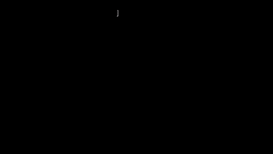

Si la mano tiembla, se puede suavizar. Pero el promedio que olvida del capítulo 3 tiene un precio fijo: cuanto más
suaviza, más tarde llega. Lo que hace falta es suavizar mucho cuando no pasa nada y casi nada cuando algo cambia. Eso
hace el **filtro 1€** (*One Euro*), que es un promedio que olvida con el $\alpha$ variable:

$$\alpha = \frac{1}{1 + \dfrac{1}{2\pi f_c \Delta t}}, \qquad f_c = f_{min} + \beta\,|\dot x|$$

$f_c$ es la **frecuencia de corte**: lo que oscila más lento que $f_c$ pasa casi entero, y lo más rápido se achica. Es
otra forma de dar la constante de tiempo del capítulo 3, $\tau = 1/(2\pi f_c)$, y la fórmula de $\alpha$ es
$\alpha = \Delta t/(\tau + \Delta t)$: con $\Delta t$ chico, casi el $\Delta t/\tau$ del capítulo 3, y nunca pasa de 1.
Con 2 Hz, $\tau$ = 80 ms: en un $\tau$ se cierra el 63 % (capítulo 3). Con $f_c$ alto, $\alpha$ se acerca a 1 y el filtro
casi no toca nada. A 100 muestras por segundo, $\alpha$ = 0.112 con 2 Hz y 0.430 con 12 Hz. Y $\dot x$ es el salto desde la última salida filtrada, $(x - \hat x)/\Delta t$, suavizado por su cuenta para que
el ruido no lo dispare (derivar agranda el ruido).

Esta es la clase, sin su `reset`, `OneEuro` de `tools/air_mouse.py`:

```python
class OneEuro:
    def __init__(self, mincutoff, beta, dcutoff):
        self.mincutoff, self.beta, self.dcutoff = mincutoff, beta, dcutoff
        self.x = None
        self.dx = 0.0

    @staticmethod
    def alpha(fc, dt):
        return 1.0 / (1.0 + 1.0 / (2 * math.pi * fc * dt))

    def __call__(self, x, dt):
        if self.mincutoff <= 0:
            return x
        if self.x is None:
            self.x, self.dx = x, 0.0
            return x
        d = (x - self.x) / dt
        ad = self.alpha(self.dcutoff, dt)
        self.dx = ad * d + (1 - ad) * self.dx
        a = self.alpha(self.mincutoff + self.beta * abs(self.dx), dt)
        self.x = a * x + (1 - a) * self.x
        return self.x
```

Un detalle que importa: `feed_gyro` lo aplica a las **tasas** de yaw y pitch, no a la posición. Entonces $\dot x$ no es
qué tan rápido giras, sino qué tan rápido *cambia* tu giro, y un giro parejo, por rápido que sea, se queda con el corte
bajo: 2 Hz, o un poco más por el temblor. No hace daño, porque una tasa pareja no tiene nada que atrasar. En la prueba, con un temblor inventado de
1.5 °/s, el corte fijo de 2 Hz y el 1€ lo dejan igual (0.38 y 0.40 °/s), y al arrancar a 100 °/s el corte fijo tarda
80 ms en llegar a 63 % y el 1€, 20 ms. Los valores por omisión son `mincutoff` = 2 Hz, `beta` = 0.01 y `dcutoff` = 1 Hz.

El temblor se resuelve entre dos: el 1€ baja lo que temblaría el cursor en movimiento, y la zona muerta se encarga de
lo que queda con la mano quieta.

## 10. Calibrar los dos ejes

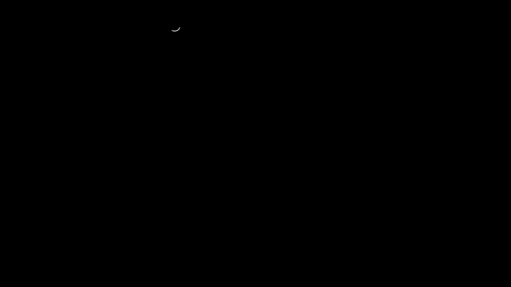

¿Por qué cuesta más mover el cursor en vertical? Porque la muñeca no es un par de ejes iguales y perpendiculares.
Medido con el trackpad en postura de escritura (`README.md`), un grado de yaw mueve 5.3 mm de trazo y uno de pitch
6.9 mm, y las dos direcciones se cruzan a 75°, no a 90°. Es decir: la vertical pide ×1.3 de ganancia.

Una **matriz 2×2** guarda esa medida. Cada columna es adónde va un grado:

$$\begin{pmatrix}x\\y\end{pmatrix} = M\begin{pmatrix}\text{yaw}\\\text{pitch}\end{pmatrix}, \qquad M = \begin{pmatrix}5.30 & 1.79\\0 & 6.66\end{pmatrix}\ \text{mm/°}$$

(Aquí la primera columna se acostó sobre $x$; lo que importa son los largos y el ángulo entre las dos.) Con eso, un
círculo de la muñeca sale torcido, con radios de 4.9 a 7.2 mm por grado. Y al revés: hoy el cursor recibe yaw y
pitch tal cual, así que un círculo hecho con el dedo sale elipse en la pantalla, con ejes a razón 1.46. Para copiar lo que
hace el dedo, el cursor tendría que usar esa misma matriz, $(x, y) = g\,M\,(\text{yaw}, \text{pitch})$: un cambio a unos ejes
que no forman ángulo recto. La inversa $M^{-1}$ sirve para lo contrario, pasar de un trazo a los ángulos que lo producen.
`tools/analyze_drawing.py` imprime los mm por grado; los 75° vienen del `README.md`.

Esto **todavía no está aplicado**. El ratón aéreo tiene `gain_x` y `gain_y`, que arreglan la diagonal pero no el cruce,
y `suggest` de `server/web/calibrate.js` propone subir `gain_y` cuando la vertical tarda más de ×1.3 sin pasarse.

## 11. Potencias y logaritmos

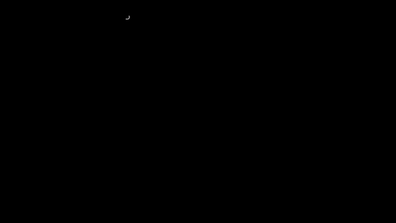

Antes de medir, hace falta una herramienta. $2^k$ es duplicar $k$ veces. El **logaritmo** es la pregunta al revés:
$\log_2 x$ cuenta cuántas veces hay que duplicar para llegar a $x$. $\log_2 1024 = 10$, y no hace falta que dé entero:
$\log_2 3 = 1.585$.

Como multiplicar por 8 y por 4 es duplicar 3 veces y después 2, los logaritmos convierten productos en sumas:
$\log_2(8\cdot 4) = 3 + 2$. Y crecen muy despacio: de 1 a 1000 hay menos de 10 duplicaciones. Los logaritmos sirven
para todo lo que va por proporción y no por diferencia. En el repo también los usan `midiHz` y `Musica.pulse` de
`server/web/musica.js`, que se ven en el capítulo 11.

Los exponentes no tienen que ser enteros: la curva $2^x$ llena lo que hay entre las barras. $2^{1/2}$ = 1.414 es media
duplicación, porque dos seguidas dan 2; $2^{1/12}$ = 1.0595 es lo que, doce veces seguido, da 2 (el capítulo 11 lo usa).
Hacia atrás se divide: $2^{-1} = \tfrac12$. Con base $e$ = 2.718, el número del capítulo 3, se escribe $e^x$, y su
pregunta al revés es $\ln x$: $\ln 2$ = 0.693, porque $e^{0.693}$ = 2. Cambiar de base es multiplicar por un número
fijo, $\ln x = 0.693\,\log_2 x$. El capítulo 9 usa $\ln$.

## 12. Ley de Fitts: medir con un número

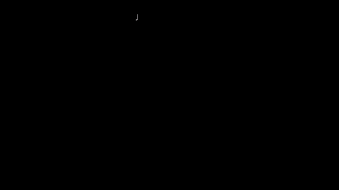

¿Cómo sé si un ajuste es mejor, sin decir "se siente mejor"? Atinar a un blanco lejano y chico cuesta más que a uno
cercano y grande. La **ley de Fitts** dice que el tiempo crece con el logaritmo de esa proporción, el **índice de
dificultad**:

$$ID = \log_2\!\left(\frac{D}{W} + 1\right) \text{ bits}, \qquad \text{tiempo} \approx a + b\cdot ID$$

Solo importa $D/W$: agrandar todo por igual no cambia nada. Y duplicar $D/W + 1$ suma un bit: con $D/W$ = 3, 7 y 15
son 2, 3 y 4 bits. Dividiendo el índice por el tiempo sale un número por blanco, en **bits por segundo**, que es
`TP` en `metrics` de `server/web/calibrate.js`:

```js
const ID = Math.log2(trial.D / W + 1);
// ... TP: ID / (MT / 1000)
```

Más bits por segundo es mejor. Además de eso `metrics` guarda cuánto te pasaste del blanco (`overshoot`) y cuántas
veces saliste y volviste a entrar (`reentries`), y con eso `suggest` propone los cambios.

---

## La cadena completa

Lo que le pasa a una muestra del giroscopio en `Motion.feed_gyro`, en orden:

1. Se le resta el sesgo y se saca el yaw y el pitch (capítulo 6).
2. El filtro 1€ suaviza cada tasa.
3. La zona muerta le resta 0.8 °/s a la rapidez.
4. La curva de aceleración elige la ganancia, entre 12 y 30 px/°.
5. Ganancia × tasa × $\Delta t$ da el paso en píxeles, con su tope de 4000 px/s.

Y `AirMouse._apply_delta` lo suma en `P`, con decimales, recorta contra el borde y manda el redondeo.

## Experimento con tus datos

Abre `calibrate.html` con el ratón aéreo andando y haz la prueba de objetivos con dos ajustes distintos: por ejemplo,
`g_hi` en 30 y en 60. Compara los tiempos, cuánto te pasas del blanco y los bits por segundo. ¿Cuál gana en los blancos
chicos? ¿Y en los lejanos? ¿La diferencia es mayor que la que hay entre dos repeticiones del mismo ajuste?

## Ejercicio que se comprueba

Escribe `anguloDeSeparacion(D, sep)` en [`docs/curso/ejercicios/cap07.js`](../ejercicios/cap07.js) y córrelo con
`node tools/test_cursor.js --ejercicio`: ¿a qué ángulo se separan 1 cm $D\theta$ y $D\tan\theta$ con $D$ = 2.4 m? Con
$\tan\theta - \theta \approx \theta^3/3$ salen unos 13°. Las pruebas comprueban que:
- con $D$ = 2.4 m y 1 cm salen unos 13°;
- tu ángulo coincide, en varios casos, con el que da girar `cursorTrack` hasta que se separa del rayo (13.2° en el primero);
- el doble de distancia separa antes: el ángulo se divide por $\sqrt[3]{2}$.
