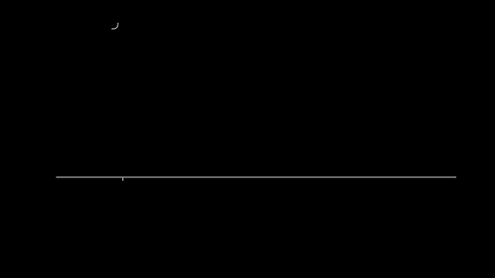
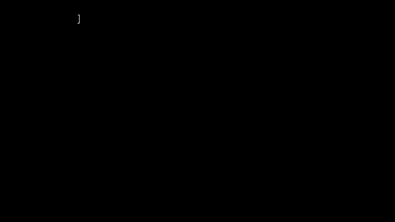
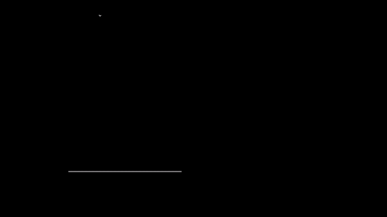
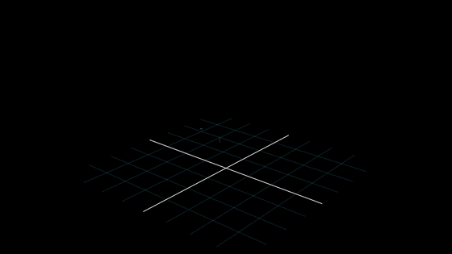
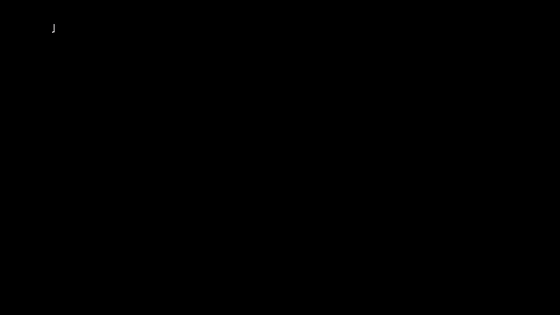
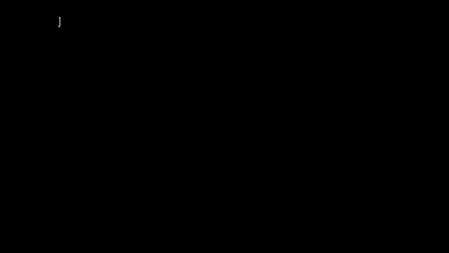
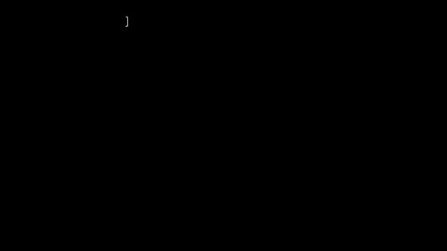
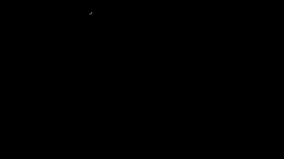
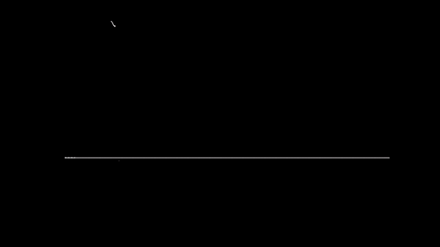

# Capítulo 8 · Fusión de sensores, y por qué el rumbo se va

El capítulo es una página: [`server/web/fusion.html`](../../../server/web/fusion.html), en `http://localhost:8765/fusion.html` con el servidor de GearStream andando. Este archivo es su guion: lo que cuenta cada escena, la frase que tiene que quedar y cómo se comprueba. Es el piloto del curso: el primer capítulo hecho entero, para saber cuánto cuesta uno.

**Pregunta guía.** El giroscopio es rápido pero se desvía; la gravedad no se desvía pero no lo ve todo. ¿Cómo se juntan los dos?

## Las escenas

Cada escena tiene una frase que, una vez vista la figura, tiene que parecer obvia.

| # | Escena | La frase | La figura | Se comprueba en |
|---|---|---|---|---|
| 1 | Dos testigos que mienten | El giroscopio es bueno en lo rápido y malo en lo lento; el acelerómetro, al revés. | Un minuto de una muñeca inventada: la verdad, el giroscopio sumado (se va b·t) y el acelerómetro (salta con cada sacudida). Controles: sesgo y sacudidas. | `test_fusion.js`: 29.7° a los 60 s con b = 0.5 °/s; el acelerómetro promedia 0.01° pero salta 36°. |
| 2 | Un resorte | El error no crece: se queda quieto en b/k. | Los antebrazos de costado, el filtro atado al acelerómetro por un resorte que engorda con k; abajo, el error contra la punteada b/k. | Con la mano quieta, el error a los 30 s y a los 60 s es b/k (cuatro pares de b y k). |
| 3 | El valle | No hay un k bueno para todo: depende de cuánto miente cada testigo. | El error rms para k de 0.01 a 50 por segundo; la punteada b/k es el lado izquierdo. | El fondo está cerca de k = 1/s (0.70°); sin sacudidas se corre a 11.5/s. |
| 4 | Lo que la gravedad no ve | Una flecha no cambia si giras alrededor de ella: la gravedad no ve el rumbo. | El antebrazo con el reloj, tres controles (inclinar, atornillar, rumbo) y las tres cifras que lee el reloj. Con el reloj de verdad, las cifras en vivo. | Para varias poses, cambiar el rumbo no cambia ninguna cifra. |
| 5 | En 3D: Mahony | El mismo resorte en 3D endereza la inclinación y deja el rumbo irse ∫ b·ĝ dt, ni más ni menos. | Un minuto de la animación de apuntar del mocap, con ruido y sesgo: error de inclinación, error de rumbo y la punteada ∫ b·ĝ dt. Control Kp y animación. | Kp = 0: la inclinación se va 26°. Kp = 2: 0.19° de inclinación y 23.2° de rumbo, contra 22.9° predichos. |
| 6 | Con tu reloj | Lo mismo, con tu muñeca. | Los últimos 20 s: la gravedad del reloj (ya fusionada por Samsung), el acelerómetro crudo, el giroscopio sumado y el filtro. Un control suma sesgo, porque el reloj ya resta casi todo el suyo. Y la prueba de la mesa: 10 s para medir el sesgo vertical, 50 s para ver si el rumbo se va sesgo × 50 s. | A mano, con el reloj. Con `tools/fake_watch.py` se comprobó que los datos llegan y se dibujan. |

## Las animaciones

Una por concepto, para ver la idea antes de mover los controles de la página. Salen de
[`animaciones/cap08.py`](../animaciones/cap08.py) (Manim), con los números de `fusionmath.js` y `mocapmath.js`:
[`animaciones/datos_cap08.js`](../animaciones/datos_cap08.js) los calcula con la misma cuenta que la página y las pruebas.

**Fusión de sensores.** El giroscopio sumado se va b·t (30° en un minuto); el acelerómetro no se va, pero salta con
cada sacudida. Juntos, ni se va ni salta.

**El filtro complementario.** La estimación está atada a la medida con un resorte de rigidez k; el sesgo la corre y
el resorte tira más cuanto más se aleja, hasta que los dos se igualan en e = b/k.

**Qué tan fuerte tirar.** A la izquierda del valle manda el giroscopio y el error es b/k; a la derecha manda el
acelerómetro y salta con él. Sin sacudidas, el fondo se corre a la derecha.

**Lo que la gravedad no ve.** Inclinar y atornillar cambian lo que lee el reloj; girar alrededor de arriba, no.

**TRIAD.** Arriba y el antebrazo, conocidos en el reloj y en el mundo, arman la orientación entera, con un rumbo
supuesto porque arriba no dice hacia qué lado apunta el antebrazo.

**El método de proyección.** El rumbo es hacia dónde apunta la sombra del antebrazo en el piso; con el brazo
colgando la sombra es un punto, y caminando el método se pierde: 16° de mediana contra menos de 1° de la fusión.

**Mahony.** El mismo resorte en 3D: e = arriba medido × arriba predicho es el eje del giro que falta, y girar
alrededor de él Kp·|e| por segundo junta las dos flechas. Sin resorte la inclinación se va 26° en un minuto; con
Kp = 2 no pasa de unas décimas.

**Por qué el rumbo se va.** Con Kp = 2 el rumbo se va igual, y exactamente ∫ b·ĝ dt: la parte del sesgo que gira
alrededor de la vertical. Unas décimas de °/s son unos 12 cm de cursor en 10 s, con la pantalla a 2.4 m.

**Recentrar.** El rumbo es relativo: se fija un frente y se vuelve a él, con un botón o de a poco. De a poco no hace
falta botón, pero también se come los giros que dejas puestos mucho rato.

## La matemática

- El filtro complementario: `θ ← θ + ω·Δt + k·Δt·(θ_acel − θ)`.
- Por qué b/k: `e′ = b − k·e`, que deja de crecer cuando `e = b/k`.
- El acelerómetro se inclina con cada tirón: una muñeca a r del codo que acelera su giro a α empuja de costado con r·α, y el acelerómetro cree que arriba se inclinó `atan(r·α / g)`.
- Mahony: `e = ĝ_medido × ĝ_predicho` y `q ← q ⊗ exp((ω + Kp·e)·Δt/2)`.
- La deriva del rumbo: `∫ b·ĝ dt`, la parte del sesgo que gira alrededor de la vertical.

## El código

- `paso`, `complementario`, `inclinacion`, `valle`, `gravedadLeida` y `derivaPredicha` en `server/web/fusionmath.js`: la cuenta de la página, sin nada de dibujo.
- La rama de fusión de `reconstruct` en `server/web/mocapmath.js`. La página muestra los dos trozos leyendo los archivos de verdad, así que no se desactualizan.
- Las figuras y la conexión al reloj, en `server/web/fusion.js`.

## El ejercicio

Escribir el filtro en `docs/curso/ejercicios/cap08.js` y correr `node tools/test_fusion.js --ejercicio`. Corre las mismas pruebas que el filtro del curso: con k = 0 integra; con sesgo b el error se queda en b/k; con k grande sigue a la medida; con la muñeca inventada le gana por 5× a cada testigo solo. Da igual si el arreglo guarda la estimación antes o después de usar cada muestra.

## Lo que dejó el piloto

- **Lo que más rindió:** empezar por números que se comprueban (b/k, el valle, ∫ b·ĝ dt) antes de dibujar nada. Las frases de las escenas salieron de las pruebas, no al revés.
- **Lo que costó:** la figura 3D a mano, sin bibliotecas. Para los capítulos 5 y 9 conviene usar three.js como el mocap.
- **Lo que no se pudo comprobar sin el reloj:** que en vivo las curvas tengan el signo correcto con una muñeca de verdad. La cuenta de signos está probada contra `wrist.js`, pero falta mirarlo con el reloj puesto.
- **Para los otros capítulos:** la misma forma (una página, su cuenta en un archivo aparte con pruebas, este guion) y la marca `<meta name="curso-capitulo">` para que `check_curso.py` revise su texto con el glosario.
