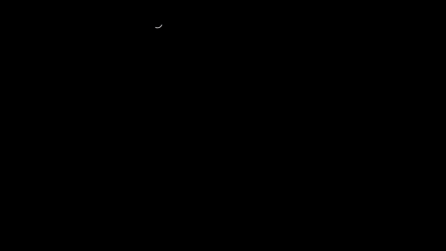
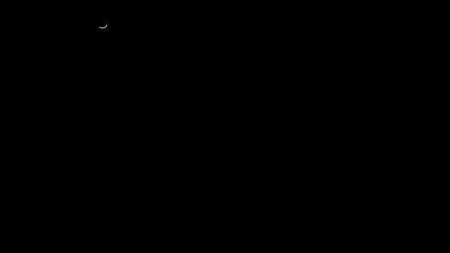
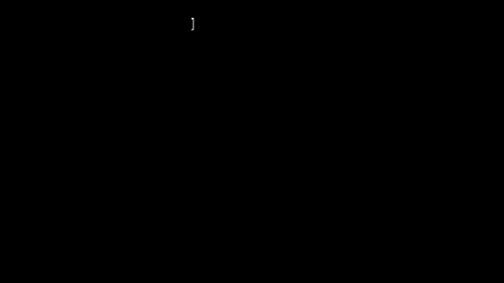
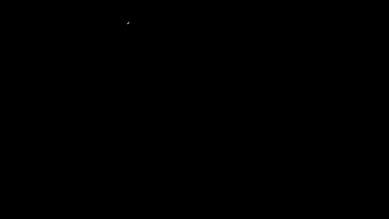
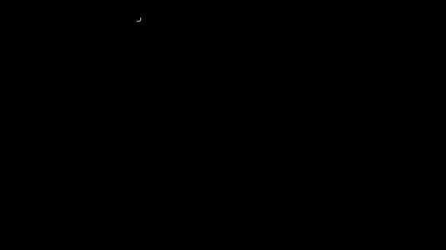
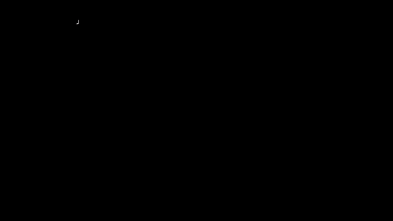
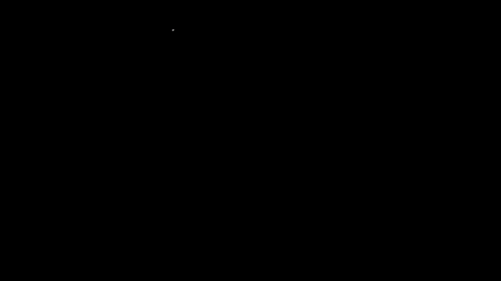
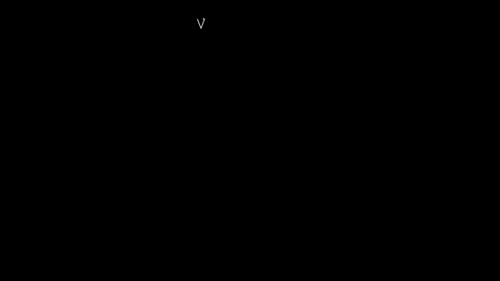
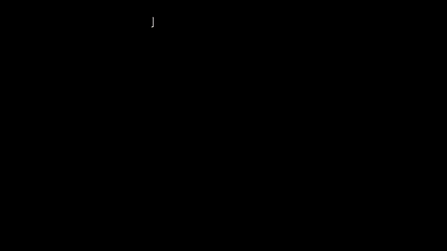
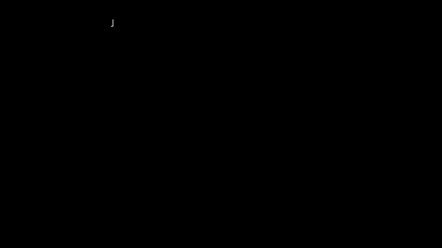

# Capítulo 9 · El cuerpo en 3D

**Pregunta guía.** Con un solo reloj en la muñeca, ¿se puede saber dónde está todo el brazo?

El reloj ve bien una cosa: hacia dónde apunta el antebrazo. Todo lo demás hay que deducirlo o suponerlo. Este capítulo
va en tres pasos: cómo se describe un cuerpo con números, cómo se fabrica lo que leería un reloj para probar la cuenta,
y qué se puede saber del brazo de arriba, que el reloj no toca.

Las animaciones salen de [`animaciones/cap09.py`](../animaciones/cap09.py) (Manim). Sus números son los de
[`server/web/mocapmath.js`](../../../server/web/mocapmath.js) y
[`server/web/armfilter.js`](../../../server/web/armfilter.js), que
[`animaciones/datos_cap09.js`](../animaciones/datos_cap09.js) corre con node. Todo el movimiento es inventado: es la
animación del mocap o el brazo de prueba de `tools/test_armfilter.js`. Lo que afirma el capítulo se comprueba en
[`tools/test_cuerpo.js`](../../../tools/test_cuerpo.js).

Un aviso sobre los marcos: en el mocap $y$ es arriba, el cuerpo mira hacia $-z$ y su derecha es $+x$. En el filtro del
codo $Y$ también es arriba, pero el frente es $+Z$ y la izquierda es $+X$. Son mundos distintos, y las medidas también.

---

## 1. El esqueleto


Un **esqueleto** es una lista de huesos de largo fijo unidos por **articulaciones**. Como los largos no cambian, lo
único que hay que decir para fijar una pose son los ángulos. En `LEN` de `mocapmath.js` el brazo mide 0.29 m y el
antebrazo 0.27 m; `build` arma los puntos y `hand` agrega cuatro dedos y un pulgar, solo para dibujarlos. El filtro del
codo y el avatar usan 0.30 y 0.25 m.

Que los huesos sean rígidos es un supuesto: el antebrazo no se dobla, y el reloj no se mueve sobre la piel.

## 2. Cinemática directa



Si sé los ángulos del hombro y del codo, ¿dónde está la mano? Se va del tronco hacia la mano, y cada hueso parte de
donde terminó el anterior. Eso es la **cinemática directa**:

$$\text{codo} = \text{hombro} + L_1\,u, \qquad \text{muñeca} = \text{codo} + L_2\,f$$

$u$ y $f$ son flechas de largo 1: hacia dónde apuntan el brazo y el antebrazo. Salen de encadenar giros. En `build`,
$u$ es la flecha "abajo" girada `flex` alrededor de la derecha del cuerpo y después `abd` alrededor del frente, y $f$ es
$u$ girada `elbow` alrededor de la bisagra del codo. Como vimos en el capítulo 5, el orden importa: 60° y 40° en el
orden contrario dejan el codo 11 cm más allá.

## 3. La pose en el tiempo


Una animación es una pose que depende de $t$. En `ANIMS` hay tres ideas:

- **Una fase que da vueltas.** Caminar es una función de $2\pi t/T$, con $T$ = 1.10 s: cada brazo se mueve
  $20°\cdot\sin(\text{fase})$, opuestos entre sí. El cuerpo camina un círculo de 1.4 m de radio a 1 m/s, ocho ciclos por
  vuelta de 8.80 s.
- **Curvas suaves.** `aimPath` va de ícono en ícono con $3u^2 - 2u^3$, la curva del capítulo 3, que llega y sale sin
  golpe. Importa más de lo que parece: un quiebre en la posición sería una aceleración enorme en lo que sigue.
- **Un círculo.** Después dibuja un círculo de 20 cm de radio, con un ángulo que arranca y frena suave.

## 4. La ley de los cosenos


Para ir al revés hace falta una herramienta. Pitágoras vale solo con ángulo recto; la **ley de los cosenos** vale
siempre:

$$c^2 = a^2 + b^2 - 2ab\cos C$$

Sale del producto punto: si $c = a - b$ como flechas, $|c|^2 = |a|^2 + |b|^2 - 2\,a\cdot b$. Con $C$ = 90° el coseno vale
cero y queda Pitágoras. Y dice algo fuerte: **con los tres lados se saben los ángulos**. Con un brazo de 0.29 m, un
antebrazo de 0.27 m y 0.40 m del hombro a la muñeca, el codo abre 91°.

## 5. Cinemática inversa



Y al revés: si sé dónde quiero la muñeca, ¿dónde queda el codo? Es la **cinemática inversa**. Hombro, codo y muñeca
forman un triángulo de lados $L_1$, $L_2$ y $d$. Con la ley de los cosenos sale cuánto avanza el codo a lo largo de la
recta hombro-muñeca, y con Pitágoras cuánto se separa de ella:

$$x = \frac{L_1^2 - L_2^2 + d^2}{2d}, \qquad h = \sqrt{L_1^2 - x^2}$$

¿De cuántas maneras se puede doblar el codo? **De infinitas.** Con el hombro y la muñeca fijos, el codo todavía puede
dar la vuelta alrededor de esa recta: los codos posibles forman un círculo de radio $h$. Hace falta un dato más, un
**polo**: un punto hacia el que se dobla. Esta es la función entera, `ik` de `mocapmath.js`:

```js
function ik(a, t, l1, l2, pole) {
  const v = sub(t, a);
  let d = len(v);
  const dir = d > 1e-9 ? mul(v, 1 / d) : [0, -1, 0];
  d = Math.min(Math.max(d, Math.abs(l1 - l2) + 1e-4), l1 + l2 - 1e-4);
  const x = (l1 * l1 - l2 * l2 + d * d) / (2 * d), h = Math.sqrt(Math.max(0, l1 * l1 - x * x));
  const pv = sub(pole, a), pd = unit(sub(pv, mul(dir, dot(pv, dir))));
  return { el: add(add(a, mul(dir, x)), mul(pd, h)), wr: add(a, mul(dir, d)) };
}
```

La cuarta línea recorta $d$: si el objetivo está lejos, la muñeca llega hasta donde puede, en esa dirección. `pd` es el
polo sin la parte que va a lo largo de la recta, de largo 1. La animación de la tablet usa `ik`.

## 6. Fabricar ruido



Para probar la cuenta sin reloj hay que fabricar también su ruido. El ruido real se parece a una **campana de Gauss**,
pero la computadora solo da números parejos entre 0 y 1. **Box–Muller** convierte dos de esos, $u$ y $v$, en uno
**gaussiano**:

$$z = \sqrt{-2\ln u}\,\cos(2\pi v)$$

En 100 000 números salen media 0, tamaño típico 1, y 68 % a menos de $1\sigma$. Es `ArmFilter.randn`, y `rng` de
`mocapmath.js` hace lo mismo.

Esos números no son azar de verdad: salen de una cuenta, `mulberry32`, que parte de una **semilla**. Con la misma
semilla sale la misma lista, número por número. Por eso una prueba con ruido da siempre lo mismo y se puede repetir.

## 7. Lo que leería el reloj



¿Qué leería el reloj en la muñeca de un muñeco que camina? Se puede **sintetizar**. `watchOf` da dónde está el reloj y
cómo está girado en cada instante, y `synth` saca de ahí lo que mediría:

- **Acelerómetro:** la segunda diferencia del capítulo 3, más la gravedad, en los ejes del reloj. Con la convención de
  siempre, en reposo marca 9.81 hacia arriba:

$$a = \frac{p_+ - 2p + p_-}{\Delta t^2} + g$$

- **Giroscopio:** el giro relativo entre la muestra anterior y la siguiente. Se saca su eje y su ángulo de los ejes del
  reloj en esos dos instantes (la matriz de rotación), y $\omega$ es el eje por el ángulo sobre $2\Delta t$.
- **Gravedad:** "arriba" en los ejes del reloj, de largo 9.81.

Encima van el ruido y el sesgo: $(0.6, -0.4, 0.3)$ °/s de sesgo y 0.3 °/s de ruido en el giroscopio, 0.05 m/s² en el
acelerómetro y 0.02 m/s² en la gravedad. Hay dos comprobaciones fáciles. En una vuelta caminando, el acelerómetro
llevado al mundo promedia $(0, 9.81, 0)$, porque lo demás se cancela. Y sumando solo el $\omega$ fabricado, el antebrazo
no se aparta de la animación más de 1.7° en toda la vuelta.

## 8. Probar contra la verdad



Ahora hay una verdad contra la cual comparar. `reconstruct` toma solo las lecturas y rearma el antebrazo con la
fusión del capítulo 8. Caminando, cae a 0.7° de la animación sin ruido y a 0.9° con ruido, de mediana.

¿Eso prueba que funciona en el mundo real? **No.** Las lecturas salieron del mismo modelo que usa la cuenta: el reloj
pegado al hueso, el brazo rígido, un ruido gaussiano bien portado. La prueba dice que la matemática es coherente, y
eso sirve: atrapa signos cambiados y ejes mal puestos. Lo que no ve es lo que el modelo no tiene. Si a las lecturas se
les agrega un reloj flojo que se mece ±8° sobre la piel una vez por segundo, el error sube a unos 6° de mediana, y hasta 9°.
Tus grabaciones, además, no tienen verdad: nada dice dónde estaba tu brazo. Al reproducirlas, `build` toma el antebrazo
de los datos (`over`) y deja el brazo de arriba en una pose fija.

## 9. La aceleración de un punto que gira



¿Qué se puede deducir del brazo de arriba? Empecemos por lo que el reloj sí mide. En el capítulo 5, un punto que gira
va a $\omega \times r$. Derivando otra vez sale su aceleración, en dos partes:

$$\ddot f = \alpha \times f + \omega \times (\omega \times f)$$

La primera es **tangencial**: aparece si el giro cambia de rapidez ($\alpha$ es la derivada de $\omega$) y va a lo largo
del círculo. La segunda es **centrípeta**: apunta hacia el eje, y está aunque la rapidez sea pareja, porque la velocidad
cambia de dirección. Crece con $\omega^2$: a 200 °/s, un punto a 25 cm siente 3.05 m/s².

Con esto el filtro hace algo lindo. El reloj está en $p = e + L_w f$, donde $e$ es el codo. Derivando dos veces:

$$\ddot e = \ddot p - L_w\,\ddot f$$

El acelerómetro da $\ddot p$, y el giroscopio da $\ddot f$. Lo que queda, $z$ en `ArmFilter.step`, es **la aceleración del
codo, medida sin ver el codo**. Y el codo se mueve en una esfera alrededor del hombro, así que su parte a lo largo del
brazo tiene que ser su propia centrípeta: $\ddot e \cdot u = -|\dot e|^2/L_u$. Esa ecuación es la pista. Como $\alpha$
sale de derivar $\omega$, el filtro suaviza $\omega$ antes (`omegaSmooth`), porque derivar agranda el ruido.

## 10. Límites del cuerpo



¿De qué sirve saber que el codo no se dobla hacia atrás? Para descartar. Conocido el antebrazo, la dirección del brazo
$u$ tiene dos grados de libertad: toda una esfera. Pero `feasible` de `armfilter.js` rechaza buena parte:

- el codo doblado más de 150°;
- la bisagra del codo a más de unos 105° de la pantalla del reloj, que es una torsión del antebrazo que no existe; es
  la forma que tiene el código de decir que el codo no se dobla al revés;
- el brazo muy hacia atrás, o atrás y cruzando hacia el cuerpo;
- el codo o la muñeca dentro del torso.

En el mapa de la animación, con el antebrazo al frente, solo queda posible un poco más de un tercio de los cuadritos del mapa. Esos
**límites articulares** no borran nada: lo imposible pesa 0.02 de lo que pesaría, por si el modelo se equivoca.
`ArmFilter._init` reparte las primeras hipótesis alrededor de `defaultPrior`, la postura de reposo: el codo cuelga y se
adelanta un poco con el antebrazo.

## 11. Verosimilitud



Si una hipótesis fuera cierta, ¿qué tan probable sería la medida que vi? Eso es la **verosimilitud**. La hipótesis
predice algo, la medida dice otra cosa, y la diferencia es el residuo $r$. Con ruido gaussiano de tamaño $\sigma$:

$$p = e^{-r^2/2\sigma^2}$$

Con $r = \sigma$ vale 0.607; con $r = 2\sigma$, 0.135; con $r = 3\sigma$, 0.011. En `ArmFilter.step`, $r$ es lo que le
falla a cada hipótesis en la ecuación del codo, $r = z\cdot u + |v|^2/L_u$, y su tamaño crece con el movimiento porque
el modelo se equivoca más: $\sigma = 0.3 + 0.3\,|z|$ m/s². Los pesos se multiplican muestra a muestra, y por eso una
diferencia chica, repetida cien veces por segundo, termina decidiendo.

## 12. Filtro de partículas



¿Por qué seguir 400 brazos posibles en vez de uno solo? Porque no sabemos cuál es, y la información llega de a poco.
Un **filtro de partículas** guarda muchas hipótesis, cada una con su peso. En cada muestra, `ArmFilter.step` hace tres
cosas con cada **partícula**:

1. **Pesar:** multiplica su peso por la verosimilitud.
2. **Mover:** la parte de $z$ perpendicular a $u$ mueve su codo por la esfera, con un poco de ruido, un frenado y un
   tirón débil hacia la postura de reposo.
3. **Revisar:** si quedó en un lugar imposible, le baja el peso.

La respuesta es el promedio con pesos, en `_estimate`, y lo disperso de la nube da `spread`. Con una sola hipótesis no
hay nada que pesar: en la prueba, una se equivoca 32 cm y 400, 10 cm. Contra la regla de reposo, moviendo el brazo a la
velocidad media el filtro se equivoca 9.7 cm y la regla 14.4 cm. A la velocidad más lenta la mejora casi desaparece:
11.8 contra 12.8 cm. Es una mejora, no una solución. El filtro también supone el torso quieto y el hombro fijo.

¿Y con la muñeca quieta? Entonces $z \approx 0$: no hay aceleración que distinga una hipótesis de otra, y el codo puede
estar en cualquier lugar compatible con el antebrazo. El filtro detecta la quietud, aplica la velocidad cero del
capítulo 3 (`zupt`) y deja que el resorte lleve todo hacia la postura de reposo, que es lo mejor que se puede decir sin
datos.

Aquí hay que tener cuidado con lo que se ve. Uno esperaría que la nube se abriera al no saber nada, y **no se abre: se
junta**. Pasa de 8 cm moviendo el brazo a menos de 2 cm tras 25 s quieto, porque el resorte tira de todas las partículas
hacia el mismo punto. Y esa nube chica no es certeza: el error de verdad sigue en unos 10 cm. El ancho de la nube dice
qué tan de acuerdo están las partículas entre sí, y solo mientras el brazo se mueve se parece a lo que sabemos.

## 13. Tamaño efectivo y remuestreo



Después de muchas multiplicaciones pasa algo malo: unas pocas partículas se llevan casi todo el peso y las demás se
calculan para nada. Se mide con el **tamaño efectivo**:

$$N_{ef} = \frac{1}{\sum_i w_i^2}$$

Con pesos iguales vale $n$; con dos que mandan, 2; con una sola, 1. Cuando baja de la mitad (200 de 400), `ArmFilter.step`
llama a `_resample`, que hace un **remuestreo sistemático**. Pone las partículas en fila, cada una tan ancha como su
peso, y pasa un peine de $n$ dientes parejos, con un solo número al azar para correrlo. Cada diente clona la partícula
que toca. Así cada una queda con $n\,w$ clones, redondeado a uno de los dos enteros vecinos: las buenas se multiplican,
las malas se olvidan y todas vuelven a pesar $1/n$. A los clones se les agrega una pizca de ruido (`roughen`) para que no
sean idénticos. En la corrida de la animación se remuestrea 116 veces, casi todas con el brazo en movimiento.

---

## Entonces, ¿se puede?

El antebrazo, sí: su inclinación y su giro salen bien, y su rumbo se va despacio (capítulo 8). El brazo de arriba, solo a
medias: mientras te mueves hay una pista débil, y con los límites del cuerpo se mejora algo la regla de reposo. Quieto,
no: el reloj no tiene de dónde saberlo.

## Experimento con tus datos

Corta tus sesiones en tomas con `python tools/export_mocap.py` y mira tu antebrazo en el stickman. Después abre el
avatar con el filtro: mueve el brazo y déjalo quieto, y mira la nube de codos. ¿Sigue a tu codo cuando te mueves? ¿Hacia
dónde va cuando paras, y qué tan cerca queda de tu codo de verdad si lo dejas en una postura rara?

## Ejercicio que se comprueba

Escribe `ik(hombro, objetivo, l1, l2, polo)` en [`docs/curso/ejercicios/cap09.js`](../ejercicios/cap09.js) y córrelo con
`node tools/test_cuerpo.js --ejercicio`. Las pruebas comprueban, con mil objetivos al azar, que:
- el codo queda a $L_1$ del hombro y la muñeca a $L_2$ del codo;
- llega al objetivo cuando está a su alcance, y si no, se acerca lo que puede;
- da el mismo codo que `build` de `mocapmath.js`.
