# Capítulo 10 · Gestos

**Pregunta guía.** ¿Cómo distingue el reloj un clic a propósito de todo lo demás que hace tu mano?

El reloj no sabe qué quieres. Solo ve números que cambian, y tu mano nunca está quieta del todo. Un gesto es una regla
que dice "esto cuenta y esto no". Este capítulo es la matemática de esas reglas, y de cómo se sabe si una regla es buena.

Las animaciones salen de [`animaciones/cap10.py`](../animaciones/cap10.py) (Manim). Las señales son inventadas, con
números de reloj de verdad, pero los detectores no: [`animaciones/datos_cap10.js`](../animaciones/datos_cap10.js) corre
`FlickDetector` de `server/web/flick.js` y la animación de apuntar del mocap, y
[`animaciones/datos_cap10.py`](../animaciones/datos_cap10.py) corre los detectores de `tools/air_mouse.py` con sus
valores por defecto. Lo que dice el capítulo se comprueba en [`tools/test_gestos.js`](../../../tools/test_gestos.js).

---

## 1. Un pico es un evento

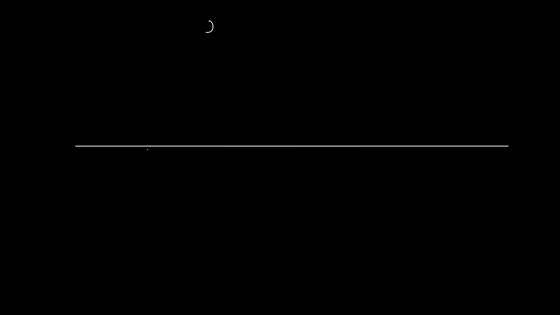

Girar la muñeca como con un destornillador es $\omega_x$: el antebrazo es el eje x del reloj. Un giro rápido se ve como
un pico, y un **detector de picos** tiene tres pasos:

1. La señal pasa el umbral: empieza un pico.
2. Mientras sube, guarda el máximo y su instante.
3. Baja: se cierra, y sale un evento.

Lo que sale ya no es una muestra: es un **evento** con instante, signo y tamaño. En la animación, $t$ = 0.80 s, signo +
y 693 °/s. En este giro el detector se entera unos 80 ms después del máximo, cuando la señal baja.

Es `FlickDetector.update` de `server/web/flick.js`, 27 líneas. Cierra el pico también si la señal cambia de signo o si
pasaron 600 ms. Con la misma forma, `onAccel` de `server/web/game.js` detecta empujones y `TapDetector.feed_accel` de
`tools/air_mouse.py` detecta golpes. `event_features` de `tools/analyze_dataset.py` busca el máximo después de cada
pitido, para estudiar los gestos del dataset.

## 2. Dos umbrales

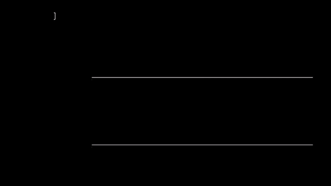

¿Por qué hay dos, uno para empezar y otro para terminar? Porque la señal tiembla. Si un giro se pasea por el borde del
umbral, cada temblor lo saca y lo vuelve a meter. En la animación, un solo umbral de 100 °/s cuenta 3 giros donde hubo 1.

La solución es la **histéresis**: entrar en un valor y salir en otro más bajo. Entre los dos, el estado no cambia.
Para salir hay que bajar hasta el segundo, y el temblor no alcanza. En `FlickDetector.update`, salir es la mitad de entrar:

$$\text{entra si } |\omega_x| > u, \qquad \text{sale si } |\omega_x| < u/2$$

La misma idea aparece en todo el repo. `onAccel` entra en 4 m/s² y sale en 1.6. `RollScroller.feed` entra en 25° y
sale en 15°. `AirMouse._pose_gate` pausa con el brazo colgando más de 60.5° bajo la horizontal y reanuda por debajo de 53.1°
(son los umbrales 0.87 y 0.80 de $-\text{gf}$), y además pide que dure 300 ms.

## 3. Periodo refractario

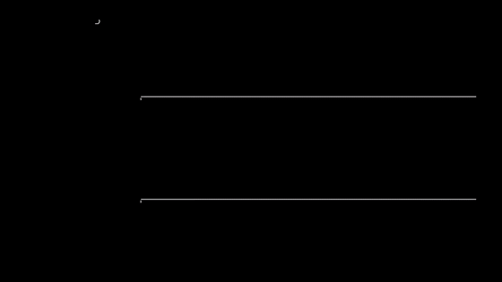

Una muñeca que gira rápido frena, y al frenar rebota. El rebote va al revés y también es un pico. El **periodo
refractario** es no aceptar otro evento por un rato, para no contar dos veces lo mismo.

En `FlickDetector.update` son 90 ms, contados desde el máximo y no desde el cierre. Hay que mirarlo con cuidado: no es una
garantía. Si el rebote sigue fuerte pasados los 90 ms, cuenta, y la animación lo muestra. `onAccel` espera 350 ms entre
empujones y `TapDetector.feed_accel`, 150 ms entre candidatos.

## 4. Un umbral que se adapta

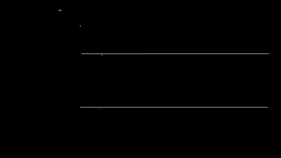

Si una persona gira más fuerte que otra, ¿cómo se adapta el detector sin calibrar? Mirando tus picos recientes:

$$u = \max(70,\ 0.35\cdot\text{mediana de tus últimos 12 picos})$$

Es un **umbral adaptativo**: `FlickDetector.threshold`, 3 líneas. Empieza en 70 °/s, y cada giro aceptado entra en la
cuenta. Se usa la mediana porque un giro raro no la mueve. El mínimo de 70 evita que unos giros flojos dejen el umbral
casi en cero.

En la animación, dos personas con 12 giros cada una y un giro de vuelta más chico después de cada uno. A la fuerte (900 °/s)
el umbral le sube a 310 °/s y deja fuera sus giros de vuelta. Fijo en 70, le sobrarían 12. A la suave (230 °/s) le queda
en 83 °/s. Fijo en 300, no le contaría ninguno.

Tiene un límite que conviene saber: el umbral solo se mueve con los giros aceptados. Después de 13 giros fuertes queda en
315 °/s, y si luego giras a 230 °/s ninguno pasa, así que nada lo baja. Se destraba girando fuerte o abriendo otra vez la
página, que crea un detector nuevo.

`onAccel` adapta otra cosa: el umbral del empujón sigue fijo en 4 m/s², y lo que se ajusta es la escala de la fuerza. Es
1.1 veces el **percentil** 80 de tus últimos 12 picos, con un mínimo de 12 m/s². El percentil 80 es el valor que deja
por debajo al 80 % de ellos. Con empujones de 30 m/s², la escala queda en 33.

## 5. ¿Fue la muñeca o todo el brazo?

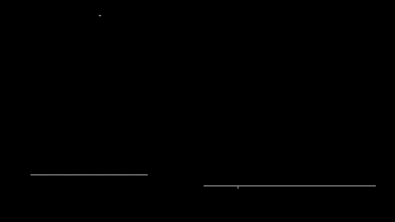

Girar la muñeca mueve casi solo $\omega_x$. Si se mueve todo el brazo, los otros dos ejes también crecen. Eso es la
**dominancia** de un eje, y es una comparación, no un umbral:

$$|\omega_x| > 1.3\cdot\max(|\omega_y|, |\omega_z|)$$

`FlickDetector.update` la mira en la muestra del máximo, al cerrar el pico. En la animación pasan los 16 giros de muñeca y
ninguno de los 16 del brazo. Son inventados: la separación tan limpia es porque los generamos así, y lo que sí se
comprueba es que el detector usa esa recta, la de 1.3. Un pico rechazado no cuenta para nada: no entra en la mediana ni
abre el periodo refractario.

`RollScroller.feed` hace lo mismo con otros números: el giro del antebrazo debe ser al menos 1.5 veces el movimiento del
puntero. `ShakeDetector.feed` no compara: elige el eje dominante y cuenta solo ahí.

## 6. El clic de tornillo

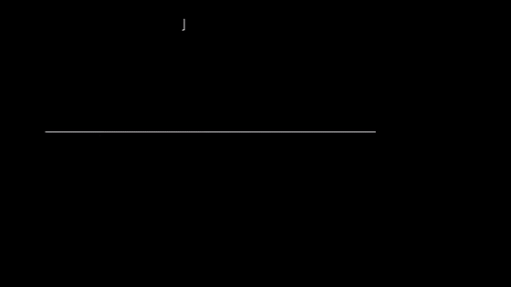

¿Qué tiene un giro de muñeca para hacer clic que no tenga un movimiento normal al apuntar? Tamaño. Un **clic de tornillo**
llega a unos 700 °/s, y en el dataset, apuntando con el ratón, los giros accidentales nunca pasaron de 117 °/s. Son unas seis
veces. Por eso `server/web/tempo.js` pide 200 °/s (`COMMAND_DPS`) para tomar un giro como comando: queda lejos de los dos.

El mocap lo puede fabricar. `aimPath` de `server/web/mocapmath.js` hace un clic girando 35° en 70 ms y volviendo en
90 ms. Si esa animación se lee como la leería el reloj y se le pasa `FlickDetector`, salen 714 °/s de ida, 567 de vuelta y
68 en los otros ejes. Cada clic da **dos** giros, uno de ida y otro de vuelta: 8 giros en 4 clics. La vuelta llega a más de
90 ms del máximo, así que no es un rebote para el detector.

Una aclaración: 700 y 117 son mediciones de una persona en una sesión. Otra mano puede dar otra cosa.

## 7. El toque en la esfera

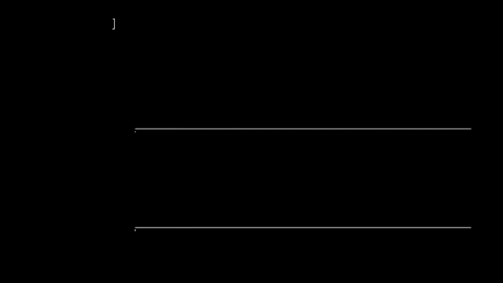

Tocar la esfera con un dedo da un salto brusco del acelerómetro z. `TapDetector.feed_accel` mira la resta entre muestras
seguidas, llevada a 10 ms, y marca un candidato si pasa de 2.5 m/s². Esa resta es una derivada: no ve lo lento, solo el golpe.

Pero mover la mano también golpea. Lo que separa a un **toque en la esfera** es que la muñeca está quieta antes y después.
`TapDetector.decide` pide todo esto:

- giro por debajo de 15 °/s entre 200 y 20 ms antes;
- giro por debajo de 20 °/s entre 80 y 250 ms después;
- que el acelerómetro vuelva adonde estaba: la diferencia entre el promedio de antes y el de después, menor que 0.8 m/s²;
- que el golpe sea angosto: como mucho 6 muestras grandes en ±80 ms.

¿Por qué se decide 250 ms tarde? Porque lo que falta saber todavía no pasó. Nadie puede afirmar que la mano siguió quieta
sin esperar a verlo. El giro, en cambio, se decide menos de 100 ms después del máximo.

¿Y qué cuesta esa espera? El clic llega un cuarto de segundo tarde. Mientras tanto el cursor no puede seguir moviéndose,
porque el clic iría a otro lado: `AirMouse._feed_accel` lo devuelve adonde estaba 80 ms antes del golpe, y `AirMouse.frozen`
lo deja quieto hasta decidir. Si el golpe no era un toque, el cursor perdió ese rato para nada. Por eso
el giro de antes se revisa en el acto: con la mano en movimiento, el candidato ni siquiera congela el cursor.

## 8. El empujón

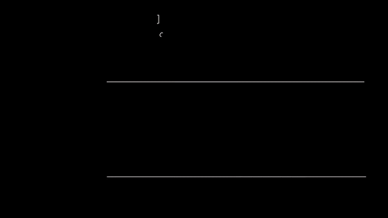

En el juego de los globos, empujas la mano hacia la pantalla para lanzar. Lo que interesa es la aceleración lineal a lo
largo del antebrazo, que es un producto punto:

$$a_f = (\vec a_{\text{acelerómetro}} - \vec g)\cdot\hat x$$

El sensor de gravedad apunta hacia arriba y, quieto, el acelerómetro dice lo mismo: $a_f$ da cero. El comentario de
`game.js` dice además que un giro brusco de muñeca da centrípeta hacia el codo, o sea $a_f$ negativa, y no dispara.

El **empujón** es otro pico: `onAccel` entra en 4 m/s², sale en 1.6, se corta a los 220 ms y espera 350 ms. Por
la latencia, un empujón que llega atrasado más de 400 ms no lanza.

Hay un detalle. Empujar también gira la muñeca, así que la mira se corre justo cuando importa. En la animación, con
números inventados, la mira buena es 8°: al pasar el umbral ya va en 8.9° y al terminar en 14.9°. Por eso `aimAt` toma
la mira de **120 ms antes** de que empiece el empujón. Es una suposición: que empujar tarda eso en empezar a girar la muñeca.

## 9. La sacudida

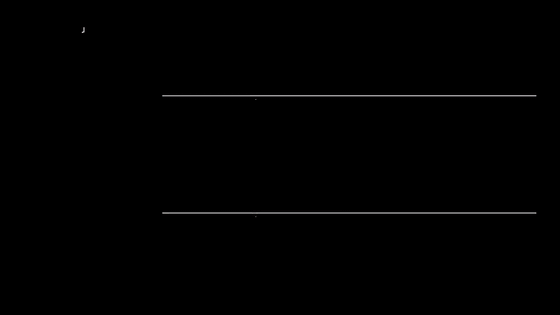

Para pausar hace falta algo que nunca pase por accidente. Una **sacudida** no es un pico, son muchos: `ShakeDetector.feed`
pide más de 600 °/s y al menos 4 cambios de signo en 700 ms, contando solo lo que pasa de 200 °/s en el eje dominante.

Con ±800 °/s, a 2 idas y vueltas por segundo no alcanza, y desde 2.5 sí. Un giro solo, por fuerte que sea, nunca dispara.
Después espera 1 s. Se revisa incluso en pausa, porque es la forma de reanudar, y el cursor vuelve adonde estaba 100 ms
antes de empezar a sacudir.

## 10. Clic por permanencia

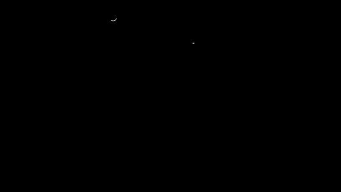

Quedarse quieto sobre un punto también puede ser un clic: es la **permanencia**. `DwellDetector.feed` pide 0.7 s
a menos de 1.5 °/s y sin salir de un círculo de 6 px.

Pero la mano descansa todo el tiempo, y descansar no es hacer clic. Por eso pide haber viajado antes: 40 px de recorrido y
haber pasado de 4 °/s. Después de un clic el viaje vuelve a cero, así que seguir quieto no hace otro.

## 11. Scroll con el antebrazo

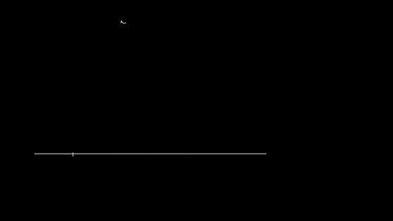

`RollScroller.feed` usa el roll: el giro del antebrazo desde la postura neutra, que `Motion.feed_gyro` llama `e`. Entra al pasar de
25°, si además el giro fue a propósito:

- venía de una pausa de al menos 150 ms, y empezó hace menos de 1 s;
- subió al menos 20° en el último medio segundo;
- en los últimos 300 ms no pasó de 120 °/s: más rápido es un movimiento, no un scroll;
- el roll domina al movimiento del puntero.

Adentro, cada 6° más es una muesca de la rueda, y volver no sube nada: en la animación son 3 muescas hasta 46°. Bajar una
muesca en la cuenta pide estar 2° por debajo de su borde, que es otra histéresis. Sale al bajar de 15°, al pasar de 90° o
a los 15 s.

La postura neutra no es fija. `Motion.feed_gyro` la recentra de a poco, con una constante de 5 s, cuando la muñeca anda
tranquila y no estás en scroll. Si se agotan los 15 s, la postura actual pasa a ser la neutra de golpe.

## 12. Tempo

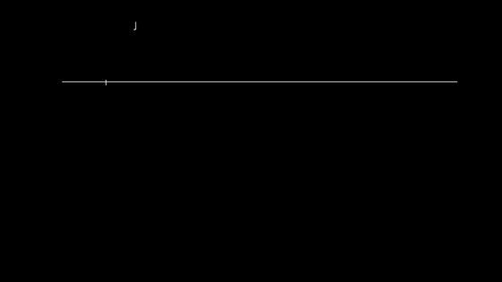

¿Cómo se mide un ritmo con giros de muñeca? Con el tiempo entre giros seguidos. Cada giro es un pulso, en cualquier
sentido, y el **tempo** es:

$$\text{BPM} = \frac{60000}{\text{intervalo mediano en ms}}$$

`FlickDetector.tempo` usa los últimos 6 intervalos, pide al menos 3 giros y se reinicia tras 2500 ms sin giros.

¿Por qué con la mediana y no con el promedio? Porque un giro que no se detecta deja un intervalo doble. En la animación
el ritmo es de 120 por minuto y falta un giro: el promedio de los intervalos da 583 ms, o sea 102.9 por minuto, y la mediana da
510 ms, o sea 117.6. Un error se lleva el promedio y a la mediana casi no la mueve. Los 2.4 que le faltan salen de dos cosas:
el intervalo doble corre el puesto del cuarto, que es el que toma el detector, y las muestras cada 10 ms lo redondean.

## 13. Aciertos contra falsas alarmas

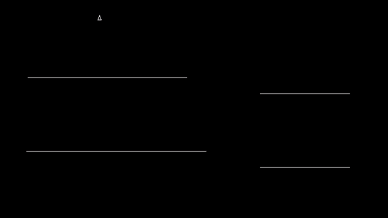

Si pongo el umbral muy bajo, ¿qué pasa? ¿Y muy alto? Muy alto no atrapa nada. Muy bajo dispara solo: eso es una **falsa
alarma**, y un clic que nadie pidió puede cerrar una ventana. Bajar el umbral solo suma: más
aciertos y más falsas alarmas. No hay un umbral correcto, hay un trato.

¿Con qué criterio se elige? Con dos números: cuántos gestos atrapa, y cuántas falsas alarmas da **por minuto de uso
normal**. Por minuto, y no en porcentaje, porque lo que molesta es cuántas veces falla mientras trabajas. Es lo
que barre `main` de `tools/analyze_dataset.py` para el pellizco, con umbrales de 1.5 a 5.

La animación usa datos inventados: 20 gestos y 2 minutos de uso normal. Sin ninguna falsa alarma, el pellizco da 10 de 20 y el
giro, 20 de 20. Con pellizcos de verdad, lo mejor de `tools/analyze_gesture.py` en la primera captura fue **12 de 20**, también sin
falsas alarmas: se perderían unos 4 de cada 10 clics, aunque con 20 gestos de una sola captura eso puede ser de 2 a 6. Por eso el pellizco no sirve como clic a 100 Hz, y el giro sí.

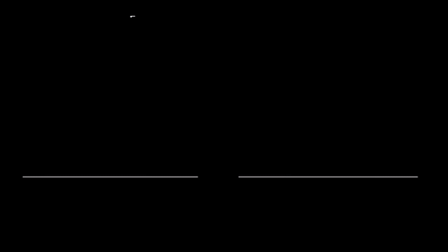

Una razón posible se puede calcular. El reloj no elige cuándo medir. Un golpe de 10 ms de base puede caer entre dos
muestras: se ve de él entre 0 % y 100 %. De un giro como los de este capítulo se ve al menos 98.6 %. Además el giro es
unas seis veces más grande que lo normal, y el pellizco se mezcla con el movimiento de la mano. Los 10 ms son una
suposición nuestra para hacer la cuenta, no una medición del pellizco.

## 14. AUC

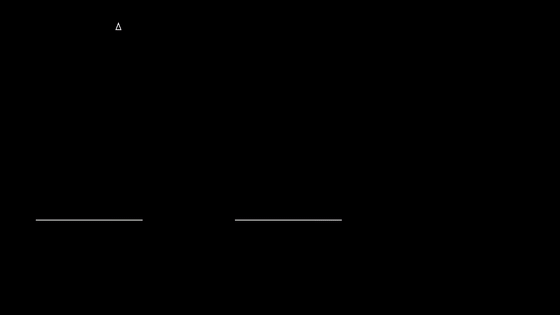

Para comparar dos señales sin elegir umbral, se mira toda la curva. Si cada eje va de 0 a 1, el área bajo la curva es el
**AUC**, y tiene una lectura mejor:

$$\text{AUC} = P(\text{positivo} > \text{negativo}) + \tfrac12\,P(\text{empate})$$

Saca un gesto y algo que no era gesto, al azar: el AUC es la probabilidad de que el gesto dé más señal. 0.5 es no
distinguir nada y 1 es separar todo. Con los datos inventados, el pellizco da 0.75 y el giro, 1.00. El área y la
probabilidad dan lo mismo, y las pruebas lo comprueban.

Es `auc` de `tools/analyze_drawing.py`: una línea, con los empates a la mitad. `main` lo usa para ver si el acelerómetro
distingue apoyar el dedo de la mitad de un trazo.

---

## Experimento con tus datos

Graba una sesión del dataset de gestos (`http://localhost:8765/dataset.html`):

1. Corre `node tools/test_flick.js recordings/<tu sesión>`. ¿Cuántos giros cuenta en cada paso? En reposo, ¿da cero?
2. En el paso de giro rápido, ¿los sentidos se alternan? ¿El tempo cuadra con lo que hiciste?
3. Corre `python tools/analyze_dataset.py recordings/<tu sesión>` y busca la tabla del pellizco.
4. Grafica aciertos contra falsas alarmas por minuto. ¿Qué umbral elegirías, y cuántos clics perderías?

## Ejercicio que se comprueba

Escribe `detectar(t, x, opc)` en [`docs/curso/ejercicios/cap10.js`](../ejercicios/cap10.js) y córrelo con
`node tools/test_gestos.js --ejercicio`. Las pruebas comprueban que:
- en una señal con 10 picos conocidos y ruido cuenta exactamente 10;
- cada pico sale con su instante, su signo y su tamaño;
- un temblor en el borde del umbral no cuenta dos veces;
- un rebote cuenta sin espera y no cuenta con 90 ms;
- si nada pasa el umbral, no hay picos.
