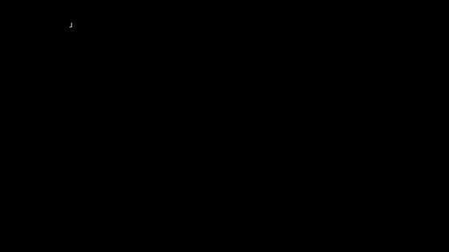
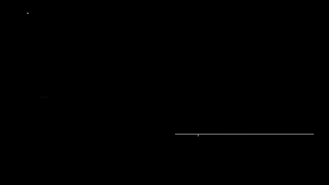
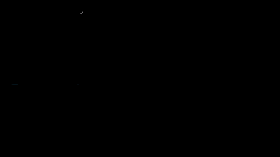
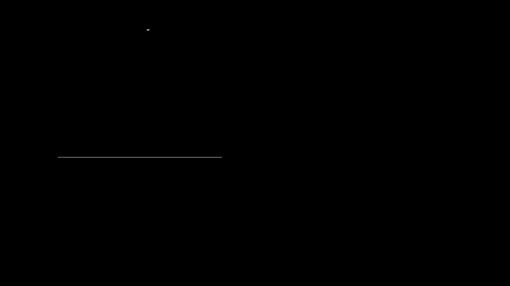

# Capítulo 11 · Frecuencia

**Pregunta guía.** ¿Se puede medir con cuánto retraso sigues algo, solo con una línea que se mueve y tu muñeca? (Ese retraso es
tuyo más el de la cadena del capítulo 0.)

En el Sismógrafo (`sismo.html`) una línea amarilla corre por el papel y tu muñeca mueve la aguja. Al final, el juego
no solo dice cuánto te saliste: dice **cuánto seguiste cada onda de la línea, con cuánto retraso, y cuánto de lo que
hiciste fue ruido**. Este capítulo es la matemática que hay detrás, en el orden en que aparecen las preguntas.

Las animaciones salen de [`animaciones/cap11.py`](../animaciones/cap11.py) (Manim); la cuenta de verdad está en
[`server/web/sismomath.js`](../../../server/web/sismomath.js) y sus pruebas en [`tools/test_sismo.js`](../../../tools/test_sismo.js).

---

## 1. Una línea que parece al azar y se repite

La línea es una **suma de senos**:

$$r(t) = \sum_k a_k \sin\left(2\pi \tfrac{k}{T} t + \varphi_k\right), \qquad T = 20\ \text{s}$$

Con fases $\varphi_k$ al azar no se ve ningún patrón. Pero cada onda da un número **entero** de vueltas ($k$) en
$T$, así que al cabo de 20 s todas vuelven a empezar a la vez: la línea entera se repite. En el código es
`makeTarget` (elige $k$, $a_k$ y $\varphi_k$) y `wave` (suma).

## 2. Flechas que giran

Un seno es la sombra de una flecha que gira: el **largo** es la amplitud y el **ángulo al empezar** es la fase. Esa
flecha es un número complejo, $a\,e^{i\varphi}$. La gracia está en multiplicar: los largos se multiplican y los
ángulos se suman. Por eso **dividir** la flecha de tu respuesta entre la flecha de la línea dice en un solo número
cuánto más chica fue tu onda y cuánto atrasada.

## 3. ¿Cuánto hay de cada onda? (la transformada de Fourier)

Para saber cuánto hay de la frecuencia $f$ en una señal, se **enrolla** la señal alrededor del círculo a esa
frecuencia (se multiplica por $e^{-2\pi i f t}$) y se mira el promedio. Si la señal tiene una onda a $f$, sus
crestas caen siempre del mismo lado y el promedio se aleja del centro; si no, se anulan.

$$X(f) = \frac{2}{N}\sum_n x_n\, e^{-2\pi i f t_n}$$

Si la onda da vueltas enteras y $f$ no es 0, el largo de $X(f)$ es su amplitud. Su ángulo es la fase menos 90°, porque aquí las
ondas se escriben con seno; en $H = Y/R$ ese corrimiento se cancela. En `analyze` es la función `dft`: 5 líneas.

## 4. Vueltas enteras, o fuga

Si una onda no da vueltas enteras en la ventana, el final no empalma suave con el comienzo y su energía **se fuga** a las
frecuencias vecinas. El remedio general es apagar los bordes con una ventana (Hann), que es lo que hace
`tools/analyze_dataset.py` con los gestos, aunque con ella el largo de $X$ sale más o menos a la mitad. El sismógrafo elige las
ondas de la línea para que cada una dé vueltas enteras en $T$, y la línea cae justo en sus casillas. Tu aguja no tiene esa
suerte: lo lento y lo que cae entre casillas se fuga a ellas.

## 5. Tu respuesta, onda por onda: $H = Y/R$

Para cada frecuencia de la línea, $H = Y/R$ (tu aguja entre la línea):

| | qué dice |
|---|---|
| $\lvert H \rvert$ | cuánto de esa onda seguiste (1 = toda) |
| $-\angle H / 2\pi f$ | tu retraso a esa frecuencia, si es de menos de media vuelta de la onda |
| $\lvert 1 - H \rvert$ | el error que te quedó, relativo a la onda (0 = la borraste) |

Si lo único que te pasa es llegar tarde $\tau$, sigues todo ($\lvert H\rvert = 1$) pero la flecha gira
$2\pi f\tau$. El error es la cuerda entre $H$ y 1 en el círculo:

$$\lvert 1 - H \rvert = 2\,\lvert \sin(\pi f \tau) \rvert$$

Con $\tau$ = 0.25 s, en la onda más lenta del nivel *tranquilo* (0.05 Hz) el error es 8 %; en la más rápida del nivel
*sismo* (0.85 Hz), 124 %: llegar tarde a una onda rápida es peor que no moverse. La tarjeta del final del juego
dibuja esa curva junto a tus barras.

## 6. Tu retraso global, por correlación

El retraso de todo el movimiento junto sale de **desplazar** la línea $\tau$ y quedarse con el $\tau$ que más se
parece a tu aguja. "Parecerse" es la **correlación**: el producto punto de las dos señales centradas, dividido por
sus tamaños (1 = misma forma). El juego prueba $\tau$ de −0.8 a 1.2 s cada 10 ms y afina el máximo con una parábola
por tres puntos. Un $\tau$ negativo quiere decir que te adelantas: pasa cuando ves la línea venir.

## 7. Tu ruido: el remanente

Lo que moviste que no está en ninguna frecuencia de la línea es tu **remanente**: temblor y correcciones. El
juego lo calcula como la parte de la varianza de tu aguja que no explican las ondas de la línea. Es un piso, no una medida
exacta: lo que se fuga a esas casillas cuenta como explicado, así que una deriva sola, sin seguir nada, no da 1: en el
nivel tranquilo, una deriva recta como la que deja un sesgo da unas 0.14, y una curva lenta casi 0.

## 8. Nyquist: lo rápido se disfraza de lento

Con $f_s$ muestras por segundo no se puede ver nada más rápido que $f_s/2$. Y lo más rápido no desaparece: **se
disfraza** de una onda más lenta (*aliasing*), porque deja exactamente las mismas muestras. El reloj da unas 100
muestras/s, así que su límite es 50 Hz; un movimiento voluntario de la mano rara vez pasa de unos pocos Hz, y el temblor fisiológico vive
entre 8 y 12 Hz.

## 9. Ritmo y armonía son lo mismo

**Con sonido:** [RitmoYArmonia.mp4](../media/cap11/RitmoYArmonia.mp4)

En Dibuja, el lápiz suena con pulsos `[1 ; 3 ; 2]`: tres voces a $f_0$, $3f_0$ y $2f_0$ que coinciden cada
$1/f_0$. A 2 Hz es un polirritmo de 3 contra 2. Doblando $f_0$ hasta pasar de unos 20 por segundo el oído deja de
contar golpes y oye una **nota**: do, con sus armónicos 2 (do, una octava arriba) y 3 (sol). La figura no cambió,
solo la velocidad (`server/web/musica.js`).

## 10. Octavas: el oído multiplica

**Con sonido:** [Octavas.mp4](../media/cap11/Octavas.mp4)

Subir una octava es **multiplicar** la frecuencia por 2, no sumarle algo: de 65 a 131 Hz hay 65 Hz, de 523 a
1046 Hz hay 523, y las dos suenan al mismo "salto". Un semitono es $\times 2^{1/12} \approx \times 1.0595$, y la
nota MIDI $m$ suena a

$$f(m) = 440 \cdot 2^{(m-69)/12}\ \text{Hz}$$

---

## Experimento con tus datos

Juega el Sismógrafo en los tres niveles (bisel), viendo la línea y a ciegas (V), y compara tu retraso global con el
de cada onda en la tarjeta del final. Preguntas para mirar en tus barras:

- ¿Tu retraso es el mismo en todas las ondas, o crece con la frecuencia?
- Viendo la línea venir, ¿tu retraso global se vuelve negativo? (El de cada onda solo se lee hasta media vuelta: más allá, salta de signo.)
- ¿Tu remanente baja con la práctica, o lo que baja es el retraso?

## Ejercicio que se comprueba

Fabrica una aguja que sigue la línea con 0.25 s exactos de retraso, $y(t) = r(t - 0.25)$, pásala por
`SismoMath.analyze` y comprueba que devuelve $\tau$ = 0.25 s y, en cada onda, $\lvert 1 - H\rvert = 2\lvert\sin(\pi f \cdot 0.25)\rvert$.

La solución está en [`tools/test_sismo.js`](../../../tools/test_sismo.js) (busca "el ejercicio del capítulo 11"):
`node tools/test_sismo.js` la corre.
