# Capítulo 12 · Aprender de datos

**Pregunta guía.** ¿Puede el reloj aprender a redibujar una letra que nunca vio?

Hasta aquí todo salió de una fórmula: la física dice qué mide el sensor y la cuenta lo deshace. Con la escritura eso no
alcanza, porque nadie tiene la fórmula que lleva de tu muñeca a la punta de tu dedo. Lo que sí hay son ejemplos: el
trackpad dice dónde estuvo el dedo mientras el reloj grababa. Aprender de datos es sacar la fórmula de esos ejemplos y
después medir con honestidad si sirve.

Las animaciones salen de [`animaciones/cap12.py`](../animaciones/cap12.py) (Manim). **Sus datos son inventados**: las
grabaciones de verdad son personales y no se publican. [`animaciones/datos_cap12.py`](../animaciones/datos_cap12.py)
inventa una sesión de 53 letras, la escribe en el formato de `draw_recorder.py` y se la pasa a
[`tools/reconstruct_drawing.py`](../../../tools/reconstruct_drawing.py) sin cambiarle nada. Sus parámetros se ajustaron a
mano para que esta sesión dé resultados del tamaño de los reales, así que sus números enseñan cómo se comporta la cuenta, no cómo es
tu mano. Cuando aparece un número de la grabación real es el que publica el README del proyecto, y se dice cada vez. Lo
general se comprueba en [`tools/test_aprender.js`](../../../tools/test_aprender.js).

---

## 1. Lo que el reloj ve y lo que no

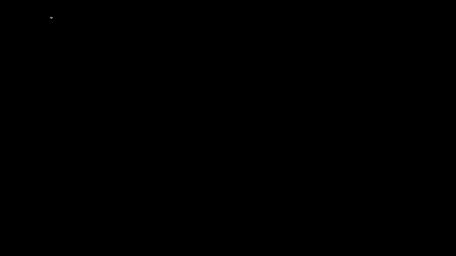

Cian es el dedo; coral, lo que redibuja un modelo que nunca vio esa letra. El número es su parecido (sección 14). Van de
la mejor a la peor, tomadas a intervalos iguales, sin escoger. Con los datos inventados la mediana es 0.77. Con la
grabación real, según el README, fue 0.74.

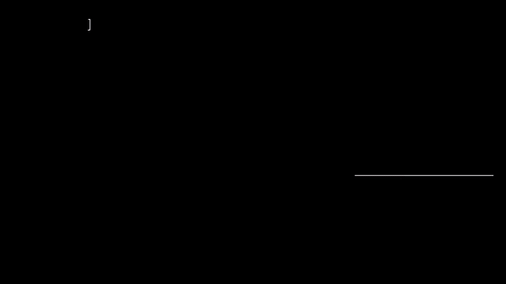

El reloj va en la muñeca. Ve lo que hacen la muñeca y el antebrazo: el giro, la aceleración y la postura. No ve los
dedos. La parte lenta y grande del trazo pasa por la muñeca; la parte fina la hacen los dedos, y esa no le llega. Por
eso es de esperar que una letra grande se redibuje mejor que una chica: en la grabación real, cuánto giraba la muñeca fue la
señal más alta de la calidad (r = 0.22), aunque 53 letras no alcanzan para afirmarlo. Tampoco ve cuándo apoyas el dedo (en el README, un AUC de 0.56 y 0.58, casi al azar), así que
`reconstruct_drawing.py` recibe del trackpad cuándo apoya, cuándo levanta y dónde empieza cada trazo. La forma la pone
el reloj; el comienzo y el final, no.

## 2. Rasgos

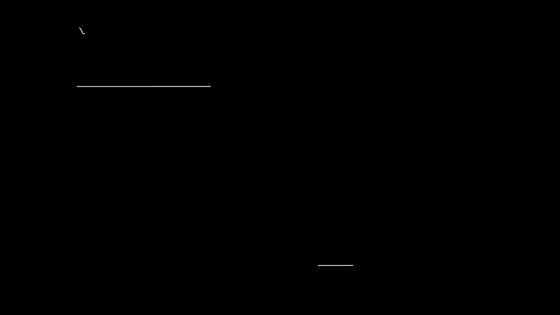

Un modelo no compara cien muestras una por una. Primero describe el trozo con pocos números: máximos, RMS, giros,
postura. Esos números se llaman **rasgos**. `window_features` de `tools/analyze_dataset.py` saca siete de cada ventana
de un segundo, y `event_features` trece de cada gesto. Sobre ellos dos trozos se pueden comparar, aunque sus muestras
no coincidan. Un detalle del código: la frecuencia dominante se saca del largo del giro, que es siempre positivo, así
que una muñeca que va y viene a 6 Hz sale en 12 Hz. Se ve en la animación.

## 3. Segmentar

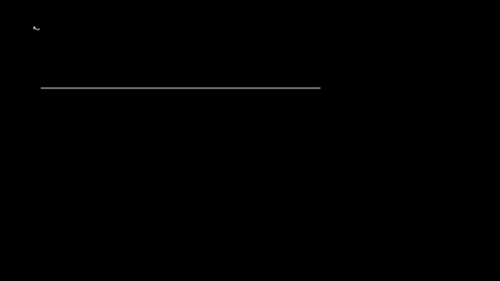

Antes de describir hay que cortar: **segmentar** es decidir dónde empieza y dónde termina cada cosa. Bastan dos
umbrales de tiempo. `strokes_from` de `tools/analyze_drawing.py` corta un trazo cuando el dedo levanta o cuando pasan
60 ms sin lecturas, y descarta los trazos de menos de 3 lecturas. `groups_by_pause` junta los trazos en una letra hasta
que hay una pausa de más de 0.9 s. El resto del repo hace lo mismo con otros números: `windows` de
`tools/export_mocap.py` elige tramos de 30 s con mucho giro, `gap_free` rechaza los que tienen huecos de 500 ms o más, y
`fromRescue` de `server/web/trazos.js` corta un dibujo rescatado cuando dos bolitas quedan a más de 3 pasos o cambia el
color.

## 4. Estandarizar

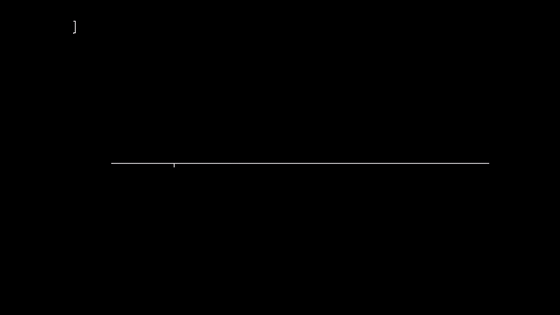

Un giro de 120 °/s y un golpe de 1 m/s² no se pueden sumar en una distancia: manda el que tiene números más grandes, y
cambiar de unidad cambia el resultado. **Estandarizar** es restar el promedio y dividir por la desviación estándar:

$$z = \frac{x - \bar x}{\sigma}$$

Cada rasgo queda con promedio 0 y desviación 1. En la prueba, pasar a otra unidad cambia 199 de 200 vecinos con los
datos crudos y ninguno con los estandarizados. `Ridge.fit`, `MLP.fit` y `knn_loo` empiezan así. Ridge y la red sacan
promedio y desviación del entrenamiento. `knn_loo` los saca de todo, incluida la toma que deja fuera: una fuga chica.

## 5. Mínimos cuadrados

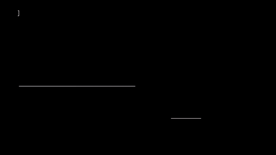

Un modelo lineal dice que lo que se quiere saber, $V$, es una suma de los rasgos, $X$, con unos pesos $W$. **Mínimos
cuadrados** elige los pesos que hacen más chica la suma de los errores al cuadrado:

$$\min_W \lVert XW - V \rVert^2$$

Al cuadrado para que un error grande pese mucho y para que el fondo sea fácil de hallar, como en una parábola. (Es uno solo si
ninguna columna de $X$ se puede armar con las otras. Aquí el roll repite a $\omega_x$, así que de los nueve números de cada mirada
solo ocho son independientes.)

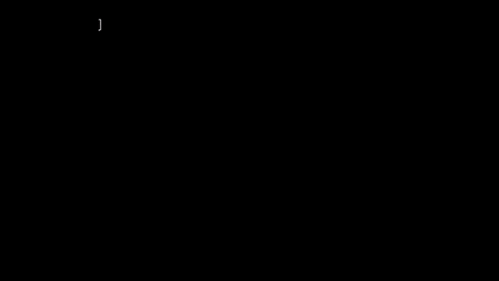

¿Dónde está el fondo? $X$ es una tabla: una fila por instante, una columna por rasgo. Cada columna $x_j$ es una flecha
de $N$ números, uno por instante, y $V$ es otra. $XW = w_1x_1 + w_2x_2 + \dots$ solo puede caer en el plano que forman
las columnas, y el punto de ese plano más cercano a $V$ es su sombra: el que deja lo que falta, $V - XW$,
perpendicular al plano. Cualquier otro punto queda más lejos, porque Pitágoras le suma un cateto. Perpendicular a cada
columna quiere decir producto punto cero, $x_j \cdot (V - XW) = 0$, y como las filas de $X^{\mathsf T}$ son las columnas
de $X$ (capítulo 5), todas juntas son $X^{\mathsf T}(V - XW) = 0$:

$$X^{\mathsf T}X\,W = X^{\mathsf T}V$$

Es un sistema chico, como el de las coordenadas en una base: tantas ecuaciones como rasgos, por muchos instantes que
haya. A esto también se le dice una **regresión**. En `tools/analyze_drawing.py` lo hace
`r2`, con `np.linalg.lstsq`, y con eso `main` saca la calibración del giro: en la grabación real, 5.3 mm de trazo por
grado de yaw y 6.9 por grado de pitch, según el README. En la animación los puntos se inventaron con 5.3 y el fondo cae
en 5.88: doce puntos con ruido no dan más.

## 6. R²

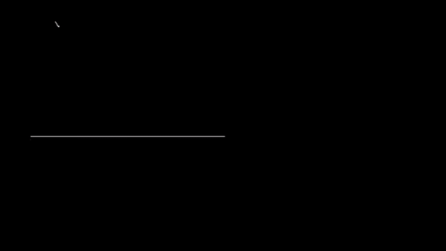

$$R^2 = 1 - \frac{\sum (v - \hat v)^2}{\sum (v - \bar v)^2}$$

Arriba, lo que queda sin explicar; abajo, lo que había que explicar. **R²** es 1 si el modelo acierta todo y 0 si no le
gana a decir siempre el promedio. En la animación da 0.98, 0.55 y 0.01. Con un solo rasgo es la correlación al cuadrado.
Con datos que el modelo no vio puede ser negativo: es peor que el promedio. Ojo: `r2` mide sobre los mismos datos con
que ajustó, así que su R² es el mejor caso.

## 7. Prueba justa

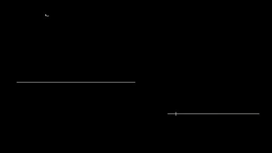

Un **polinomio** de **grado** $d$ es $c_0 + c_1x + c_2x^2 + \dots + c_dx^d$: $d + 1$ números que se eligen con mínimos
cuadrados, porque sigue siendo una suma de columnas ($1$, $x$, $x^2$…) con pesos. Con tantos números como puntos, un
modelo pasa por todos: grado 11 con 12 puntos deja error casi 0. Y no aprendió, se
los memorizó: con datos nuevos su error es 370, cuando el de grado 5, el mejor, es 0.2. Eso es **sobreajuste**. El error
con lo visto solo sabe bajar, así que no dice nada. Una **prueba justa** mide siempre con datos que el modelo no vio, y si
eliges algo mirando esa prueba, ya la viste. Separar los datos varias veces, de modo que cada parte sirva una vez para
medir, es la **validación cruzada**.

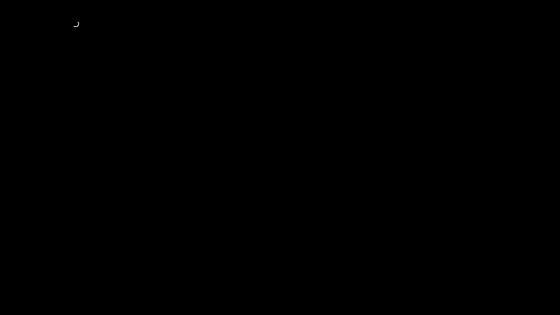

Pero "datos que no vio" es más difícil de lo que suena. Con rejilla de 10 ms y ventanas de ±240 ms, el instante de al
lado es casi el mismo dato. El mismo ridge, con los datos inventados, da 0.48 midiendo con lo visto, 0.47 con instantes
al azar, 0.43 con grupos de trazos y 0.40 con letras nunca vistas. Ridge casi no puede memorizar y aun así baja. Un
modelo que memoriza se delata más: en la prueba, uno que copia al instante más cercano da R² = 0.97 con instantes al
azar y −1.78 con trazos enteros afuera, sin haber aprendido nada.

Por eso `main` de `reconstruct_drawing.py` hace dos cosas. Redibuja las mayúsculas con un modelo entrenado sin
mayúsculas, y las minúsculas al revés. Y elige λ con 5 grupos de trazos dentro del entrenamiento. Aun así es generosa:
C y c, O y o, S y s se parecen, y todo sale de la misma sesión. `knn_loo` usa la forma más simple, **dejar uno fuera**:
cada gesto se prueba con todos los demás.

## 8. Rasgos con retardos

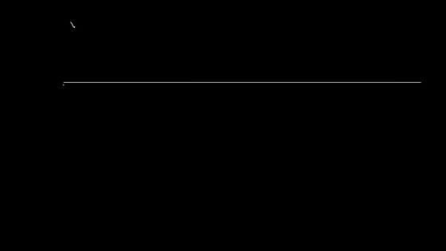

La muñeca no se mueve al mismo tiempo que el dedo, y un instante solo no dice hacia dónde va. Por eso `stroke_data` mira
alrededor: `LAGS` son 13 **retardos**, de −240 a +240 ms cada 40 ms, leídos con interpolación. En cada mirada toma nueve
números (yaw, pitch y roll; el giro crudo; la aceleración lineal, que es acelerómetro menos gravedad), y al final la
postura: $13 \times 9 + 3 = 120$ rasgos por instante. Mirar hacia adelante se puede porque se redibuja después de
escribir, no en vivo.

Con los datos inventados el parecido mediano es 0.60 sin retardos, 0.75 con ±80 ms, 0.76 con ±160 ms, 0.77 con ±240 ms
y 0.75 con ±400 ms. Lo grande es pasar de ninguna a alguna ventana; lo demás cabe en el ruido (sección 15).

## 9. Ridge

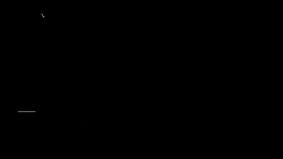

Con 120 rasgos muy parecidos entre sí, mínimos cuadrados los pone a pelear: coeficientes enormes y de signo contrario
que se cancelan, y que copian el ruido. La **regresión ridge** cobra por el tamaño de los coeficientes. Es una
**regularización**:

$$\min_W \lVert XW - V \rVert^2 + \lambda \lVert W \rVert^2 \quad\Longrightarrow\quad (X^{\mathsf T}X + \lambda I)\,W = X^{\mathsf T}V$$

¿De dónde sale el $+\lambda I$? El castigo es como agregarle a $X$ unas filas más, $\sqrt\lambda\,I$, que deben dar 0:
$\lVert XW - V\rVert^2 + \lambda\lVert W\rVert^2$ es la suma de cuadrados de esa tabla más larga. La misma sombra de la
sección 5 da $X^{\mathsf T}X + \sqrt\lambda I\cdot\sqrt\lambda I = X^{\mathsf T}X + \lambda I$ a la izquierda, y nada nuevo a la
derecha. Sigue siendo un sistema lineal, con una sola solución. Y es la clase `Ridge` de `tools/reconstruct_drawing.py`, entera:

```python
class Ridge:
    def __init__(self, lam):
        self.lam = lam

    def fit(self, X, Y):
        self.mu, self.sd = X.mean(0), X.std(0) + 1e-9
        Z = np.hstack([(X - self.mu) / self.sd, np.ones((len(X), 1))])
        I = np.eye(Z.shape[1]); I[-1, -1] = 0
        self.W = np.linalg.solve(Z.T @ Z + self.lam * I, Z.T @ Y)
        return self

    def predict(self, X):
        return np.hstack([(X - self.mu) / self.sd, np.ones((len(X), 1))]) @ self.W
```

Estandariza primero, porque el castigo trata igual a todos los rasgos. Agrega una columna de unos para el término
constante, y `I[-1, -1] = 0` deja ese término sin castigo. Por eso con $\lambda \to 0$ da mínimos cuadrados y con λ enorme
da solo el promedio.

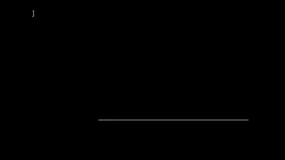

λ es un control. Entrenando con solo 3 letras (348 instantes para 120 rasgos), con λ = 0.001 el R² es 0.81 con lo visto y
−0.61 con letras nuevas: copia el ruido. Con λ cerca de 3000 el R² con letras nuevas llega a su mejor valor, 0.15, que no
da para más con tan pocas letras. Con λ enorme los coeficientes se van a 0 y queda una raya quieta, la velocidad
promedio. En la animación, lo que se sale de la casilla de cada letra no se dibuja. En la sesión entera, los 5 grupos de
trazos eligen λ = 1000 en los dos pliegues.

## 10. Predecir la velocidad e integrarla

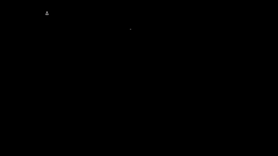

¿Por qué aprender la velocidad y no la posición? Porque el reloj no sabe dónde está el dedo sobre el trackpad. La misma
S en dos sitios se siente igual: distinta posición, misma velocidad. La velocidad depende de lo que el reloj siente en
ese momento. La posición depende además de toda la historia. En la prueba, con el mismo rasgo, R² = 1.00 para la
velocidad y 0.01 para la posición.

`stroke_data` deriva la posición del trackpad, suavizada con un filtro de 9 muestras, y ese es el objetivo $V$, en mm/s.
Después `main` integra la velocidad predicha desde el comienzo del trazo:

$$\text{trazo}[k] = \sum_{j<k} \hat v[j]\,\Delta t$$

Es el mismo costo de siempre: integrar acumula error, así que el final del trazo se va. Por eso ayuda que los trazos
sean cortos y empiecen en un punto conocido. Con los datos inventados, ridge sobre la posición relativa al apoyo da un
parecido de 0.68 y sobre la velocidad, 0.77. La calibración lineal de `analyze_drawing.py` da 0.47. En la grabación real
fueron 0.60 para la calibración y 0.74 para la velocidad.

## 11. Descenso por el gradiente

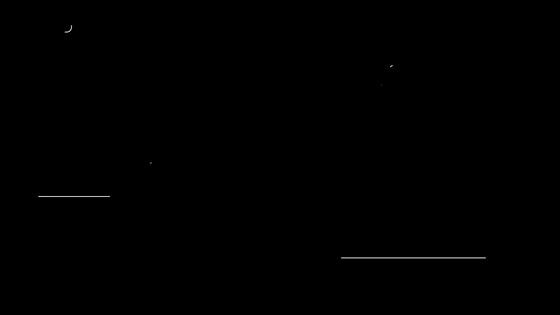

Ridge tiene fórmula. Casi ningún otro modelo la tiene. Lo que sirve para todos es bajar: el **gradiente** es la dirección
en que el error sube más rápido, una derivada por cada número del modelo, y se da un paso chico al revés. Aquí la
derivada no es respecto del tiempo sino de cada número de $W$: cuánto cambia el error $E$ si ese número se mueve un
poquito y los demás no.

$$W \leftarrow W - \alpha\,\nabla E$$

α es el tamaño del paso. Muy chico, no llega. ¿Y muy grande? En la dirección más empinada del valle, el error es una
parábola $E = \tfrac12 c\,u^2$, donde $u$ es lo que falta hasta el fondo y $c$ la curvatura, la segunda derivada. Su
derivada es $c\,u$, así que un paso deja $u - \alpha c\,u = (1 - \alpha c)\,u$. Se achica si $|1 - \alpha c| < 1$, o sea si
$\alpha < 2/c$. Si α pasa de 2/c con la curvatura más fuerte del valle (0.56 en la animación, donde c ≈ 3.6), cada paso se pasa
y el error crece. Con un valle largo hay que ir despacio por culpa de su lado empinado:
por eso se estandariza. La prueba comprueba que el **descenso por gradiente** llega al mismo $W$ que resolver el sistema.

## 12. Una red neuronal pequeña

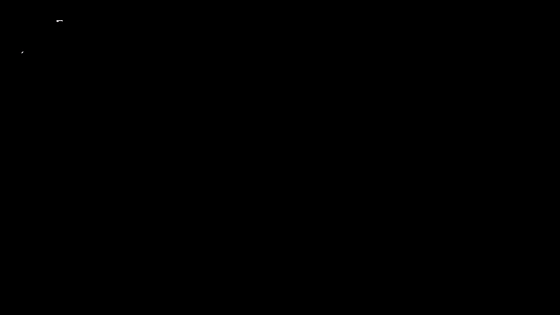

Un modelo lineal solo hace rectas. La **red neuronal** de `MLP` mete en medio una **capa oculta**: 64 **neuronas**, cada
una una suma de los rasgos pasada por **tanh**, una curva que se aplana en −1 y +1. Sumando esas curvas se hace casi
cualquier forma:

$$\hat v = W_2 \tanh(W_1 x + b_1) + b_2$$

Ya no hay sistema que resolver, así que `MLP.fit` baja por el gradiente. Lo saca hacia atrás, de la salida a la
entrada: es la **retropropagación**. El error depende de $W_1$ a través de la capa oculta, y cuánto cambia con $W_1$ es
cuánto cambia con la capa por cuánto cambia la capa con $W_1$ (la regla de la cadena); el $1 - h^2$ del código es la
derivada de tanh. Ese gradiente se lo da a **Adam**, un descenso que ajusta el paso de cada número: lleva un promedio
que olvida del gradiente y otro de su cuadrado, los de $y \leftarrow y + \alpha(x - y)$ del capítulo 3 con α = 0.1 y 0.001,
y avanza el primero dividido por la raíz del segundo, así que cada número se mueve más o menos lo mismo por paso,
tenga el gradiente grande o chico. Entrena por tandas de unos 256 instantes; una **época** es una pasada por todas.
Guarda una de cada 7 muestras para validar, se queda con la mejor época y para cuando pasan más de 25 sin mejora.

Tiene 7874 números; ridge, 242. La prueba comprueba que su gradiente coincide con mover cada número y medir.

## 13. ¿Por qué ganó ridge? ¿Y con más datos?

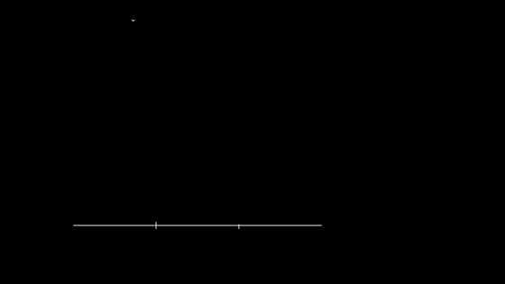

En la grabación real, ridge sacó 0.74 y la red 0.60. Con los datos inventados, 0.77 y 0.67. Hay tres razones, y las dos
últimas se pueden medir:

- **Pocos datos para tantos números.** Cada pliegue entrena con unos 2600 instantes para 7874 números, y esos instantes
  no son datos aparte: salen de 42 o 45 trazos, y los de al lado se parecen.
- **Una mala parada.** Las muestras de validación de `MLP.fit` son instantes al azar. Es la trampa de la sección 7: los
  de al lado se entrenaron, y la red cree que sigue mejorando. Dándole trazos enteros para validar, sin cambiar nada más,
  la red sube en las 5 semillas probadas, de 0.71 a 0.74 en promedio. En promedio sigue debajo de ridge.
- **La suerte.** Solo cambiando la semilla, la red va de 0.67 a 0.74. Ridge no tiene semilla.

¿Y con diez veces más datos? Con una sesión inventada diez veces más larga, ridge pasa de 0.78 a 0.80 y la red de 0.70 a
0.77. La red recorta casi toda la distancia, de 0.09 a 0.03, pero no gana. Eso es lo que hace esta sesión inventada, con
la curva que le pusimos a propósito, y no dice qué pasará con tu mano. Lo que sí vale es la forma del razonamiento: más
datos ayudan más al modelo con más números, y ridge ya casi no tiene qué aprender. En la grabación real no se sabe: hay
que grabar más.

## 14. ¿Qué número dice si dos letras se parecen?

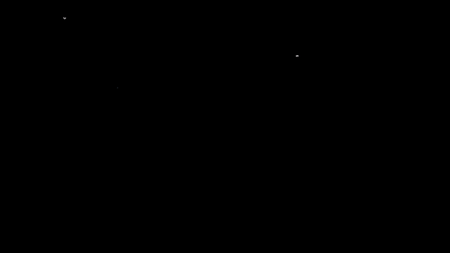

Comparar punto a punto no sirve: castiga dónde quedó la letra y qué tan grande salió, y eso no era la pregunta. Una S
corrida 16 mm está lejísimos y es la misma S. El **parecido de forma** de `shape_sim` es una correlación de las dos
formas, cada una menos su promedio:

$$\text{parecido} = \frac{a \cdot b}{|a|\,|b|}$$

No ve el sitio, porque resta el promedio. No ve el tamaño, porque divide por los largos. Sí ve lo demás: girada 30° da
$\cos 30° = 0.87$, y dada vuelta da −1. Compara punto con punto en el mismo orden, así que también le importa el ritmo.
Como no ve el tamaño, `main` informa aparte el largo redibujado sobre el real: 0.63 con ridge en los datos inventados y
0.58 en los reales. El reloj dibuja más chico, y es de esperar: ridge achica y la muñeca hace solo una parte.

Y una advertencia: **0 no es el piso**. Con λ enorme el modelo dibuja una raya quieta y aun así saca 0.45 con los datos
inventados, porque muchos trazos van para el mismo lado que la velocidad promedio. Un 0.74 hay que leerlo contra algo
así, no contra 0.

## 15. ¿Cuánto creo en una diferencia?

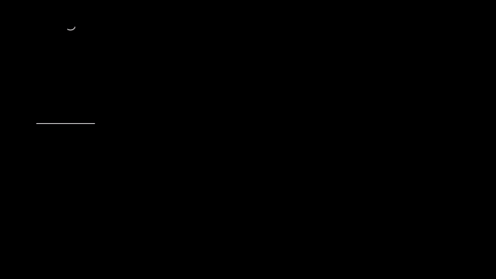

Con 53 letras de una sola sesión, ¿0.74 le gana a 0.70? La respuesta corta: no se sabe. Una letra sola varía mucho
(±0.20 en los datos inventados), y la mediana de 53 tiembla como $1.25\,\sigma/\sqrt{n}$, unos ±0.034. En la prueba, dos
modelos **iguales** medidos con letras distintas se separan 0.04 o más cerca del 40 % de las veces.

Para saberlo sin repetir la sesión se vuelven a sacar las letras al azar, con repetición, y se recalcula la diferencia.
Las dos ventanas usan las mismas letras, así que se comparan de a pares. Con los datos inventados, ±240 ms contra ±160 ms
da +0.007, y el 95 % de las veces cae entre −0.021 y +0.051: el cero está adentro. Ridge contra la red da +0.098, entre
−0.006 y +0.187, pero esa es la peor semilla de la red: con otras baja a +0.03, y el promedio de 5 semillas da +0.057. Ahí hay
dos azares, las letras y la semilla, y sacar letras solo mide el primero. Lo que en la vida real
no se puede, aquí sí: repetir la sesión entera 12 veces. La mediana da 0.82 ± 0.03, de 0.78 a 0.87. Nuestra sesión, con 0.77,
queda debajo de todas, y no es mala suerte: sus parámetros se eligieron mirándola a ella. ±240 ms contra ±160 ms queda entre
−0.012 y +0.019. Sacar las letras al azar había acertado el orden de ese temblor.

Eso coincide con lo que dice el README de la grabación real: las variantes quedan entre 0.67 y 0.75, y con 53 letras de
una sola sesión esas diferencias son ruido. Y remuestrear mide solo el azar de qué letras tocaron. No sabe nada de otra
tarde, otra postura u otra persona.

## 16. Vecinos más cercanos

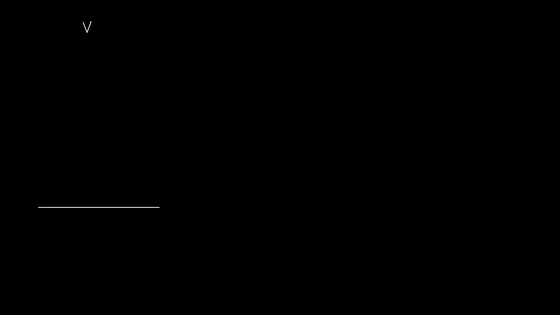

Para gestos, `analyze_dataset.py` usa un modelo que no tiene nada que ajustar: los **vecinos más cercanos** (k-NN). Un
gesto nuevo mide su distancia a todos los guardados, con los rasgos estandarizados, y los $k = 3$ más próximos votan.
`knn_loo` pesa cada voto con $1/(1 + d)$. En la animación un vecino de 5 dedos vota 0.85, pero dos de puño suman 1.51, y
gana puño. Su costo es guardar todo y comparar contra todo. Antes de llamarlo, `main` comprime los rasgos con
$\text{signo}(x)\log(1 + |x|)$ para que un golpe enorme no mande.

## 17. Matriz de confusión

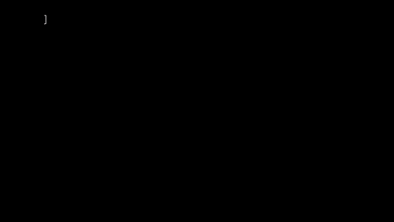

Un porcentaje solo no dice qué falla. La **matriz de confusión** de `confusion` pone en cada fila lo que era y en cada
columna lo que dijo el modelo. La diagonal son aciertos. Con estos gestos inventados acierta 66 de 90, el 73 % (al azar,
17 %), y la tabla dice dónde se pierde el resto: casi todo es 4 dedos contra 5 dedos. No hay que mejorar todo, sino
esa pareja.

## 18. ¿Qué medidas sirven?

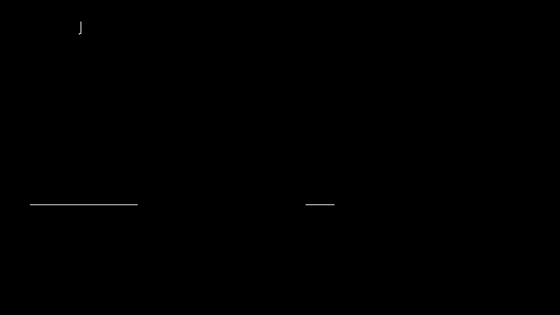

Una medida sirve si los gestos difieren entre sí más de lo que cada gesto varía consigo mismo. Esa razón es la **F** del
**ANOVA**, y es `fstat`:

$$F = \frac{\sum_g n_g(\bar x_g - \bar x)^2 / (G-1)}{\sum_g \sum_i (x_i - \bar x_g)^2 / (N-G)}$$

Arriba, cuánto se separan los promedios de los gestos; abajo, cuánto varía cada uno por dentro. Cada suma se divide
por cuántos números libres tiene: los $G$ promedios, alrededor del promedio total, tienen $G - 1$ (el último queda fijo
por los demás), y los $N$ datos, alrededor del promedio de su gesto, pierden uno por gesto, $N - G$. Así las dos son
promedios de lo mismo cuando la medida no separa nada, y F ronda 1. En la animación, el cambio de gravedad da 1292.6, el golpe 556.2, el giro 141.8 y el número de golpes
3.2. `fstat` no cambia con la unidad, pero `main` la calcula sobre los rasgos ya comprimidos, y ahí sí cambia, y el orden también;
la animación usa los rasgos crudos. F además crece con el número de tomas, así que sirve para comparar medidas de una misma
sesión. Y mide todos los gestos de una vez: el cambio de gravedad gana porque el gesto del brazo
se va lejos, y no ayuda en nada con 4 dedos contra 5 dedos. Para esa pareja hay que mirar la F de esa pareja.

## 19. Si acierta con mis datos, ¿acierta con otra persona?

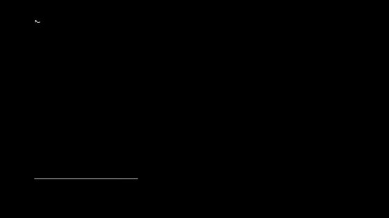

Un 95 % con dejar uno fuera dice algo sobre tus tomas de esa tarde, con tu fuerza, tu correa y tu postura. Las tomas de
una sesión se parecen entre ellas, y siempre queda alguna gemela adentro. Otra mano cae en otro sitio. En la animación
un modelo acierta 98 % dejando uno fuera. Con otra persona que tenga 0.9 veces tu fuerza acierta 95 %; con 0.8, 68 %; con
0.7, 37 %, en este sorteo (con tu sesión fija y 20 sorteos de la otra persona, 89 %, 64 % y 36 % de media). Aguanta hasta que los gestos cruzan a los vecinos, y
ahí cae rápido.

La prueba justa para eso es dejar afuera a la persona entera, o por lo menos la sesión entera. El repo no la tiene
todavía: todo sale de una persona. `tools/analyze_dataset.py` lo avisa en su encabezado.

---

## Experimento con tus datos

Con una grabación de letras en `recordings/dibujo-AAAAMMDD-HHMMSS` (y su `letters.json`):

1. Corre `python tools/reconstruct_drawing.py recordings/dibujo-AAAAMMDD-HHMMSS` y anota la mediana, las letras por encima
   de 0.8 y el largo de cada modelo.
2. Repite con ventanas de ±80 y ±160 ms. Sin tocar el archivo:
   ```python
   import sys; sys.path.insert(0, "tools")
   import numpy as np, reconstruct_drawing as rd
   rd.LAGS = np.arange(-80, 81, 40)
   sys.argv = ["", "recordings/dibujo-AAAAMMDD-HHMMSS"]
   rd.main()
   ```
3. ¿La diferencia es más que ruido? Saca el parecido de cada letra de `reconstruccion.npz` (cada corrida lo pisa: cópialo
   antes) y pásale las dos listas a `remuestrear` de `docs/curso/animaciones/datos_cap12.py`. ¿El cero queda adentro?
4. Graba otro abecedario otro día y prueba el modelo de hoy con él. ¿Cuánto cae?

## Ejercicio que se comprueba

Escribe `ridge(X, y, lam)` en [`docs/curso/ejercicios/cap12.js`](../ejercicios/cap12.js): resuelve ridge a mano para dos
rasgos. Córrelo con `node tools/test_aprender.js --ejercicio`. Las pruebas comprueban que:
- da lo mismo que `Ridge.fit` (los números de Python van pegados en la prueba);
- con $\lambda \to 0$ da mínimos cuadrados y con λ enorme, solo el promedio;
- el término constante no se castiga y el tamaño de $W$ baja cuando λ sube;
- con dos rasgos casi iguales, λ los calma.
