# Mapa de prerrequisitos

> Generado por `python -I tools/check_curso.py --escribir` a partir de [conceptos.json](conceptos.json) y del orden de [indice.md](indice.md). No lo edites a mano: cambia esos dos y vuelve a generarlo.

136 conceptos en 13 capítulos · 114 funciones de 17 archivos · 282 términos en el glosario.

En `conceptos.json` cada concepto dice qué necesita. En los diagramas la flecha va al revés, en el sentido en que se aprende: de lo que necesitas a lo que te deja entender. Para que se lean, solo están las flechas directas (si A lleva a B y B lleva a C, la de A a C no se dibuja). Los recuadros punteados son conceptos de capítulos anteriores.

## Los capítulos

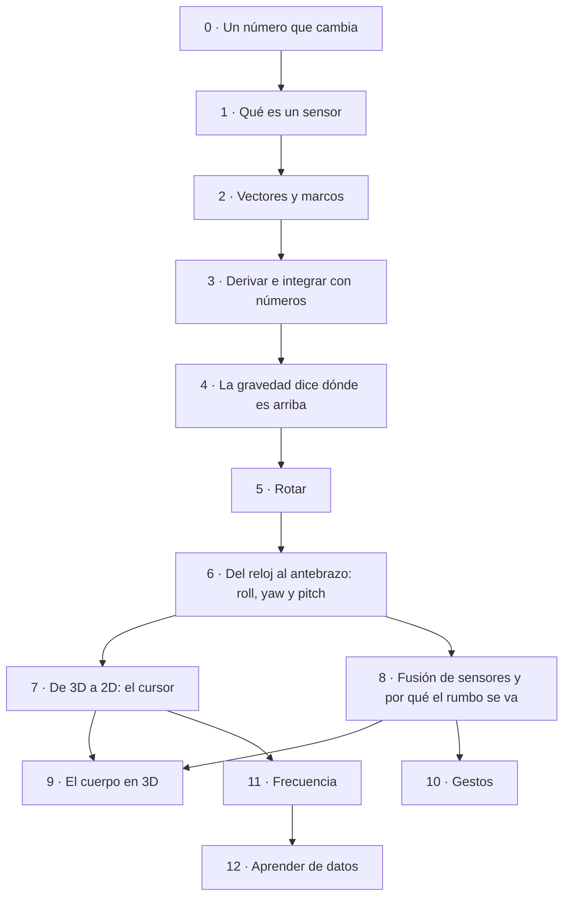

## Capítulo por capítulo

### 0 · Un número que cambia

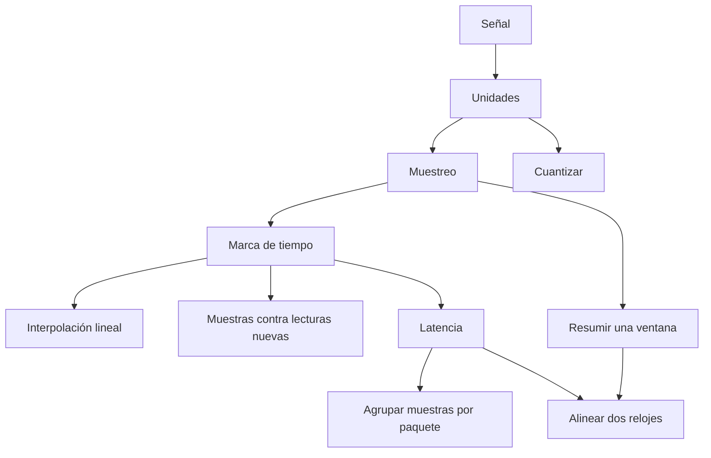

| Concepto | Qué es | Necesita | En el código |
|---|---|---|---|
| **Señal** `senal` | Un número que cambia con el tiempo, x(t): el giro de tu muñeca, la gravedad en un eje, la altura de la aguja. | — | `sismomath.js:wave` |
| **Unidades** `unidades` | Cada número viene con su medida (m/s², °/s, ms, Hz, px); cambiar de unidad es multiplicar por un factor. | `senal` | `sdb_bridge.py:Bridge.read_sensor`, `flick.js:FlickDetector.tempo`, `air_mouse.py:norm` |
| **Muestreo** `muestreo` | Medir la señal cada cierto tiempo; la frecuencia de muestreo (Hz) es cuántas muestras hay por segundo. | `senal`, `unidades` | `sdb_bridge.py:Bridge.report`, `analyze_dataset.py:load` |
| **Marca de tiempo** `marca_de_tiempo` | Cada muestra lleva el instante en que se midió; Δt es la diferencia entre dos marcas, y no siempre es la misma. | `muestreo` | `air_mouse.py:Motion.feed_gyro`, `flick.js:FlickDetector.update`, `dibuja.js:onGyro`, `trazos.js:timeline`, `export_mocap.py:gap_free` |
| **Interpolación lineal** `interpolacion_lineal` | Estimar el valor entre dos muestras con la recta que las une; sirve para llevar sensores distintos a una misma rejilla pareja. | `muestreo`, `marca_de_tiempo` | `analyze_drawing.py:interp3`, `analyze_dataset.py:load`, `export_mocap.py:resample`, `sismomath.js:analyze`, `trazos.js:Drawing.point` |
| **Cuantizar** `cuantizar` | Redondear a escalones: un número continuo se guarda como uno de pocos valores (píxeles enteros, la resolución de un sensor, del 1 al 8). | `senal`, `unidades` | `musica.js:ratio`, `air_mouse.py:norm` |
| **Muestras contra lecturas nuevas** `lecturas_nuevas` | Una muestra repetida no trae información: la tasa real es la de lecturas distintas (a 200 muestras/s el reloj da unas 115 nuevas). | `muestreo`, `marca_de_tiempo` | `analyze_drawing.py:main` |
| **Resumir una ventana** `resumir_ventana` | Describir un tramo de muestras con pocos números: promedio, mediana, máximo, pico a pico; la mediana no se deja arrastrar por valores raros. | `muestreo` | `air_mouse.py:Motion._rest_window`, `flick.js:FlickDetector.tempo`, `export_mocap.py:windows`, `analyze_dataset.py:event_features` |
| **Latencia** `latencia` | Cuánto tarda una muestra desde que el reloj la mide hasta que la laptop la usa. | `marca_de_tiempo` | `sdb_bridge.py:Bridge.report`, `air_mouse.py:AirMouse.on_data`, `game.js:aimAt`, `sdb_bridge.py:Bridge.map_time` |
| **Alinear dos relojes** `alinear_relojes` | El reloj y la laptop cuentan el tiempo distinto; el desfase se estima con el mínimo de (llegada − medida), la entrega más rápida vista. | `latencia`, `resumir_ventana` | `sdb_bridge.py:Bridge.map_time`, `air_mouse.py:AirMouse.on_data` |
| **Agrupar muestras por paquete** `agrupar_muestras` | Si pasa un paquete por ida y vuelta, juntar N muestras por paquete multiplica el caudal por N a cambio de hasta N muestras de retraso. | `muestreo`, `latencia` | `sdb_bridge.py:Bridge.read_sensor`, `sdb_bridge.py:Bridge.report` |

### 1 · Qué es un sensor

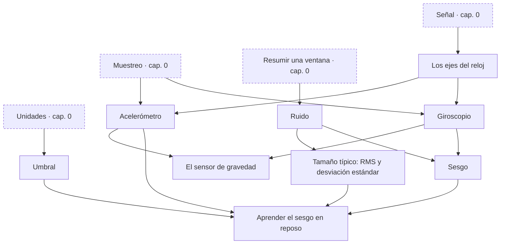

| Concepto | Qué es | Necesita | En el código |
|---|---|---|---|
| **Los ejes del reloj** `ejes_del_reloj` | Tres direcciones pegadas al reloj (x, y, z; z sale de la pantalla): cada sensor da un número por eje y se mueven con el reloj. | `senal` | `mocapmath.js:watchOf` |
| **Acelerómetro** `acelerometro` | Mide en m/s² lo que empuja al reloj más la gravedad, en sus tres ejes. | `ejes_del_reloj`, `unidades`, `muestreo` | `mocapmath.js:synth`, `air_mouse.py:Motion.feed_accel` |
| **Giroscopio** `giroscopio` | Mide qué tan rápido gira el reloj alrededor de cada uno de sus ejes, en °/s. | `ejes_del_reloj`, `unidades`, `muestreo` | `mocapmath.js:synth`, `wrist.js:Wrist.rates` |
| **El sensor de gravedad** `sensor_gravedad` | No es un sensor: es una cuenta interna de Samsung que da la dirección de arriba en los ejes del reloj (y que no podemos auditar). | `acelerometro`, `giroscopio` | `air_mouse.py:Motion.gravity_measurement` |
| **Ruido** `ruido` | La parte de la medida que cambia al azar aunque nada se mueva. | `senal`, `resumir_ventana` | `mocapmath.js:synth`, `air_mouse.py:Motion._rest_window` |
| **Tamaño típico: RMS y desviación estándar** `tamano_tipico` | √(promedio de x²): el tamaño de algo que va y viene; restando antes el promedio es la desviación estándar. | `ruido`, `resumir_ventana` | `sismomath.js:analyze`, `analyze_dataset.py:window_features`, `analyze_dataset.py:event_features` |
| **Sesgo** `sesgo` | Un error que no se va: con la mano quieta el giroscopio no marca cero sino unas décimas de °/s. | `giroscopio`, `ruido`, `resumir_ventana` | `mocapmath.js:synth`, `wrist.js:Wrist.rates` |
| **Umbral** `umbral` | Una línea que separa: por debajo cuenta como quieto (o nada), por encima pasó algo. | `senal`, `unidades` | `air_mouse.py:Motion._rest_window`, `air_mouse.py:DwellDetector.feed` |
| **Aprender el sesgo en reposo** `aprender_sesgo` | Si la muñeca está quieta (poco pico a pico, \|a\| ≈ g, gravedad estable), la mediana del giroscopio es el sesgo; después se sigue de a poco. | `sesgo`, `umbral`, `tamano_tipico`, `acelerometro` | `air_mouse.py:Motion._rest_window`, `air_mouse.py:Motion._calibrate`, `air_mouse.py:Motion._recover_bias`, `air_mouse.py:Motion.feed_gyro`, `wrist.js:Wrist.rates`, `reconstruct_drawing.py:main` |

### 2 · Vectores y marcos

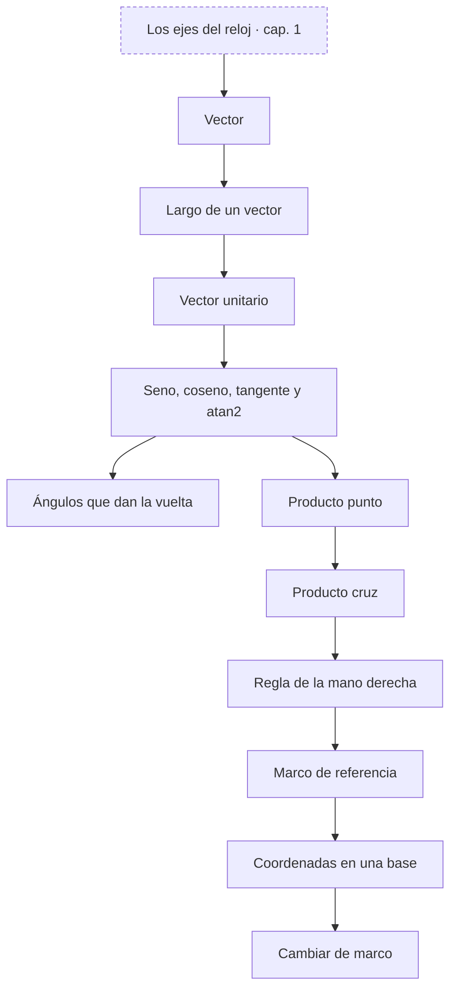

| Concepto | Qué es | Necesita | En el código |
|---|---|---|---|
| **Vector** `vector` | Una flecha con dirección y largo, escrita como tres números (x, y, z) en unos ejes. | `ejes_del_reloj` | `mocapmath.js:hand` |
| **Largo de un vector** `norma` | \|v\| = √(x² + y² + z²): Pitágoras en tres dimensiones. | `vector` | `air_mouse.py:Motion.feed_accel`, `export_mocap.py:windows`, `air_mouse.py:ShakeDetector.feed`, `trazos.js:fromRescue`, `trazos.js:Drawing.point` |
| **Vector unitario** `vector_unitario` | Dividir un vector por su largo deja solo la dirección. | `norma` | `wrist.js:Wrist.rates`, `air_mouse.py:Motion.feed_gravity` |
| **Seno, coseno, tangente y atan2** `trigonometria` | Una flecha de largo 1 con ángulo θ llega a (cos θ, sen θ); tan θ = sen/cos; atan2(y, x) devuelve el ángulo en los cuatro cuadrantes; π radianes = 180°. | `vector_unitario` | `mocapmath.js:axesOf`, `mocapmath.js:headingOf`, `air_mouse.py:Motion.roll_from_gravity` |
| **Ángulos que dan la vuelta** `envolver_angulos` | 350° y −10° son el mismo ángulo: las diferencias de ángulos se llevan a [−180°, 180°) antes de usarlas. | `trigonometria` | `air_mouse.py:wrap_deg` |
| **Producto punto** `producto_punto` | a·b = Σ aᵢbᵢ = \|a\|\|b\| cos θ: cuánto de un vector va en la dirección del otro (su proyección); cero si forman ángulo recto. | `vector`, `norma`, `trigonometria` | `wrist.js:Wrist.rates`, `armfilter.js:feasible`, `game.js:onAccel`, `calibrate.js:metrics` |
| **Producto cruz** `producto_cruz` | a × b es perpendicular a los dos y mide \|a\|\|b\| sen θ, el área del paralelogramo que forman. | `vector`, `norma`, `trigonometria`, `producto_punto` | `wrist.js:Wrist.rates`, `mocapmath.js:hand`, `armfilter.js:feasible` |
| **Regla de la mano derecha** `regla_mano_derecha` | x × y = z fija hacia dónde apunta el producto cruz; un eje dado vuelta es un espejo y cambia el signo de los giros. | `producto_cruz` | `wrist.js:forearmOf`, `mocapmath.js:watchOf` |
| **Marco de referencia** `marco_de_referencia` | Tres ejes unitarios en ángulo recto que sirven de regla: el mismo vector tiene números distintos en el marco del reloj y en el del mundo. | `vector_unitario`, `producto_punto`, `regla_mano_derecha`, `ejes_del_reloj` | `mocapmath.js:watchOf`, `armfilter.js:ArmFilter.step` |
| **Coordenadas en una base** `coordenadas_en_una_base` | Escribir un vector como suma de múltiplos de otros: si son unitarios y en ángulo recto cada coeficiente es un producto punto; si no, hay que resolver un sistema chico. | `marco_de_referencia` | `wrist.js:Wrist.rates`, `reconstruct_drawing.py:frame_rates` |
| **Cambiar de marco** `cambio_de_marco` | Las coordenadas en el mundo de un vector del reloj son productos punto con los ejes; los nueve números juntos forman una matriz. | `marco_de_referencia`, `coordenadas_en_una_base` | `armfilter.js:ArmFilter.step`, `avatar.js:rotationRows`, `mocapmath.js:synth` |

### 3 · Derivar e integrar con números

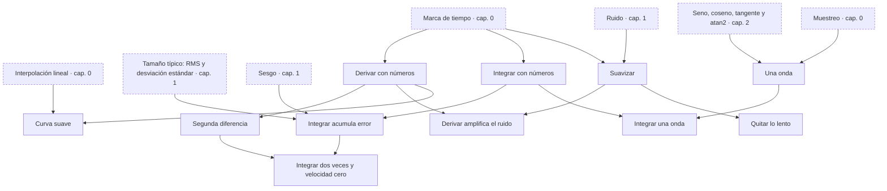

| Concepto | Qué es | Necesita | En el código |
|---|---|---|---|
| **Derivar con números** `derivada_discreta` | (x[k+1] − x[k]) / Δt: cuánto cambia por segundo; la diferencia central usa la muestra anterior y la siguiente. | `marca_de_tiempo`, `senal` | `mocapmath.js:synth`, `armfilter.js:ArmFilter.step`, `air_mouse.py:TapDetector.feed_accel`, `reconstruct_drawing.py:stroke_data`, `air_mouse.py:Motion.feed_accel` |
| **Segunda diferencia** `segunda_derivada` | (x[k+1] − 2x[k] + x[k−1]) / Δt²: la aceleración a partir de tres posiciones seguidas. | `derivada_discreta` | `mocapmath.js:synth` |
| **Integrar con números** `integral_discreta` | Sumar tasa × Δt muestra a muestra (la suma acumulada) da cuánto cambió en total. | `marca_de_tiempo`, `senal` | `mocapmath.js:cursorTrack`, `flick.js:FlickDetector.update`, `dibuja.js:onGyro`, `game.js:onGyro`, `analyze_drawing.py:watch_features` |
| **Integrar acumula error** `error_acumulado` | Un sesgo b se vuelve un error b·t que no para de crecer (la deriva); el ruido suma como un paseo al azar, que crece como √t. | `integral_discreta`, `sesgo`, `ruido`, `tamano_tipico` | `mocapmath.js:cursorTrack`, `armfilter.js:ArmFilter.step` |
| **Integrar dos veces y velocidad cero** `doble_integral_zupt` | De aceleración a velocidad a posición: el error crece como t², así que se fuerza la velocidad a cero cuando se sabe que está quieto (ZUPT). | `error_acumulado`, `segunda_derivada` | `analyze_drawing.py:watch_features`, `armfilter.js:ArmFilter.step` |
| **Suavizar** `suavizar` | Promediar con lo reciente: media móvil o un promedio que olvida, y ← y + α(x − y); deja pasar lo lento y frena lo rápido (paso bajo). | `resumir_ventana`, `marca_de_tiempo`, `ruido` | `analyze_dataset.py:movavg`, `armfilter.js:ArmFilter.step`, `air_mouse.py:OneEuro.alpha`, `air_mouse.py:OneEuro.__call__`, `wrist.js:Wrist.rates`, `reconstruct_drawing.py:stroke_data` |
| **Derivar amplifica el ruido** `derivar_amplifica_ruido` | Dividir por un Δt chico agranda cada temblor: antes de derivar hay que suavizar. | `derivada_discreta`, `ruido`, `suavizar` | `armfilter.js:ArmFilter.step`, `reconstruct_drawing.py:stroke_data` |
| **Quitar lo lento** `paso_alto` | La señal menos su promedio reciente deja solo los cambios rápidos: un golpe se ve aunque la mano se mueva despacio (paso alto). | `suavizar` | `analyze_dataset.py:signals`, `analyze_drawing.py:main`, `air_mouse.py:TapDetector.decide` |
| **Curva suave** `curva_suave` | 3u² − 2u³ va de 0 a 1 con pendiente cero en los dos extremos: une dos tramos sin saltos ni golpes (smoothstep). | `interpolacion_lineal`, `derivada_discreta` | `mocapmath.js:smooth`, `mocapmath.js:env`, `sismomath.js:targetAt`, `mocapmath.js:aimPath` |
| **Una onda** `onda_seno` | a·sen(2πft + φ): amplitud a, frecuencia f (vueltas por segundo) y fase φ; lo más simple que va y viene. | `trigonometria`, `muestreo` | `sismomath.js:wave`, `mocapmath.js:ANIMS` |
| **Integrar una onda** `integrar_un_seno` | Integrar a·sen(2πft) da una onda de amplitud a/(2πf): lo rápido casi no mueve el ángulo. | `onda_seno`, `integral_discreta` | `analyze_dataset.py:main` |

### 4 · La gravedad dice dónde es arriba

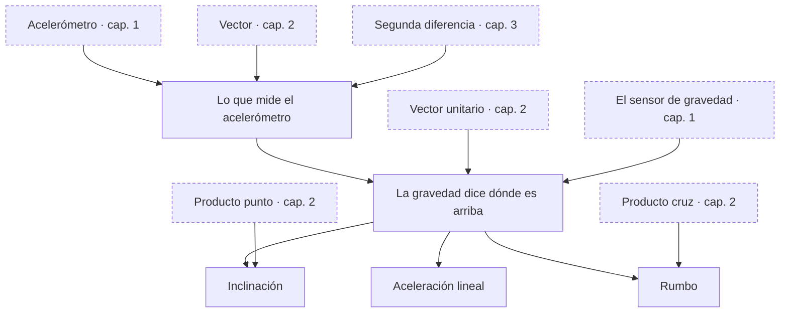

| Concepto | Qué es | Necesita | En el código |
|---|---|---|---|
| **Lo que mide el acelerómetro** `fuerza_especifica` | Quieto marca 9.81 m/s² hacia arriba: siente lo que lo sostiene, no la caída (fuerza específica = aceleración − gravedad). | `acelerometro`, `vector`, `segunda_derivada` | `mocapmath.js:synth`, `air_mouse.py:Motion._rest_window` |
| **La gravedad dice dónde es arriba** `arriba_desde_gravedad` | Normalizada, la gravedad es la dirección vertical en los ejes del reloj: absoluta, sin integrar nada. | `fuerza_especifica`, `vector_unitario`, `sensor_gravedad` | `wrist.js:Wrist.rates`, `air_mouse.py:Motion.gravity_measurement`, `air_mouse.py:Motion.feed_gravity`, `air_mouse.py:AirMouse._calib_forearm` |
| **Inclinación** `inclinacion` | El ángulo entre un eje del reloj y la vertical: sale de un producto punto (arccos) o de atan2 de dos componentes de la gravedad. | `arriba_desde_gravedad`, `producto_punto`, `trigonometria` | `air_mouse.py:Motion.roll_from_gravity`, `analyze_dataset.py:event_features`, `air_mouse.py:AirMouse._pose_gate` |
| **Aceleración lineal** `aceleracion_lineal` | Acelerómetro − gravedad: lo que empuja de verdad, sin el peso. | `fuerza_especifica`, `arriba_desde_gravedad` | `game.js:onAccel`, `analyze_dataset.py:signals`, `analyze_drawing.py:watch_features`, `avatar.js:onAccel` |
| **Rumbo** `rumbo` | Hacia dónde apunta algo en horizontal; girar alrededor de la vertical no cambia la gravedad, así que la gravedad no ve el rumbo. | `arriba_desde_gravedad`, `trigonometria`, `producto_cruz` | `mocapmath.js:headingOf`, `mocapmath.js:axesOf` |

### 5 · Rotar

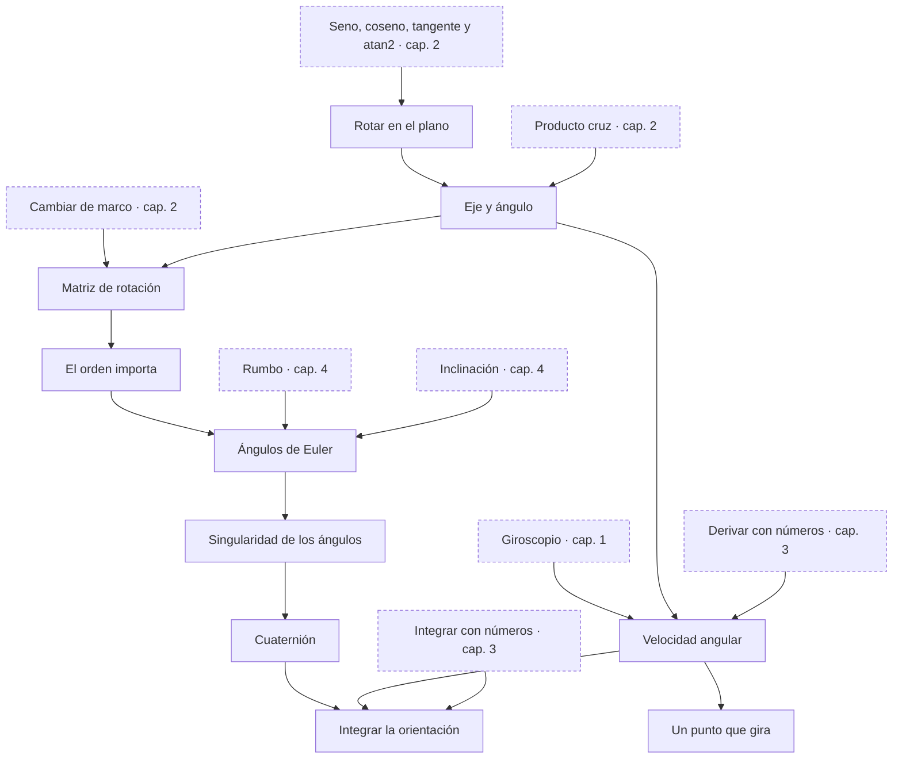

| Concepto | Qué es | Necesita | En el código |
|---|---|---|---|
| **Rotar en el plano** `rotacion_2d` | (x, y) → (x cos θ − y sen θ, x sen θ + y cos θ): girar una flecha sin cambiar su largo. | `trigonometria`, `vector` | `armfilter.js:ArmFilter.rotateY` |
| **Eje y ángulo** `eje_y_angulo` | Todo giro en 3D es girar un ángulo alrededor de un eje; la fórmula de Rodrigues lo aplica a cualquier vector. | `rotacion_2d`, `producto_cruz`, `producto_punto`, `vector_unitario` | `mocapmath.js:rot`, `avatar.js:onGyro` |
| **Matriz de rotación** `matriz_de_rotacion` | Sus columnas son los ejes del reloj vistos en el mundo; es ortonormal: su inversa es su transpuesta. | `cambio_de_marco`, `eje_y_angulo` | `mocapmath.js:qcols`, `mocapmath.js:qfromCols`, `avatar.js:rotationRows`, `armfilter.js:ArmFilter.step` |
| **El orden importa** `orden_no_conmuta` | Girar en x y luego en y no da lo mismo que en y y luego en x: los giros no conmutan. | `matriz_de_rotacion` | `mocapmath.js:build` |
| **Velocidad angular** `velocidad_angular` | Un vector ω: su dirección es el eje del giro y su largo, la rapidez; el giroscopio da sus tres componentes en el marco del reloj. | `giroscopio`, `eje_y_angulo`, `derivada_discreta` | `mocapmath.js:synth`, `avatar.js:onGyro` |
| **Un punto que gira** `velocidad_de_un_punto_que_gira` | Un punto pegado a algo que gira con ω se mueve a ω × r; un vector fijo en el mundo, visto desde el reloj, cambia a −ω × v. | `velocidad_angular`, `producto_cruz` | `air_mouse.py:Motion.feed_gyro`, `armfilter.js:ArmFilter.step` |
| **Ángulos de Euler** `angulos_de_euler` | Tres giros seguidos alrededor de ejes fijos (rumbo, inclinación, giro): fáciles de leer, pero el orden y el punto de partida importan. | `eje_y_angulo`, `orden_no_conmuta`, `rumbo`, `inclinacion` | `mocapmath.js:build` |
| **Singularidad de los ángulos** `singularidad` | Cuando el eje que define el rumbo se alinea con la vertical (el antebrazo colgando), el rumbo deja de existir y un ángulo se come al otro (bloqueo del cardán). | `angulos_de_euler`, `producto_cruz` | `wrist.js:Wrist.rates`, `mocapmath.js:reconstruct`, `air_mouse.py:AirMouse._pose_gate` |
| **Cuaternión** `cuaternion` | Cuatro números (cos θ/2, eje·sen θ/2) que guardan un giro sin singularidades; componer giros es multiplicarlos. | `eje_y_angulo`, `orden_no_conmuta`, `singularidad` | `mocapmath.js:qmul`, `mocapmath.js:qcols`, `mocapmath.js:qfromCols`, `avatar.js:onGyro` |
| **Integrar la orientación** `integrar_orientacion` | Cada muestra gira el cuaternión un poquito, q ← q ⊗ exp(ω Δt/2), y se normaliza para que no se deforme. | `cuaternion`, `velocidad_angular`, `integral_discreta`, `vector_unitario` | `mocapmath.js:reconstruct`, `avatar.js:onGyro` |

### 6 · Del reloj al antebrazo: roll, yaw y pitch

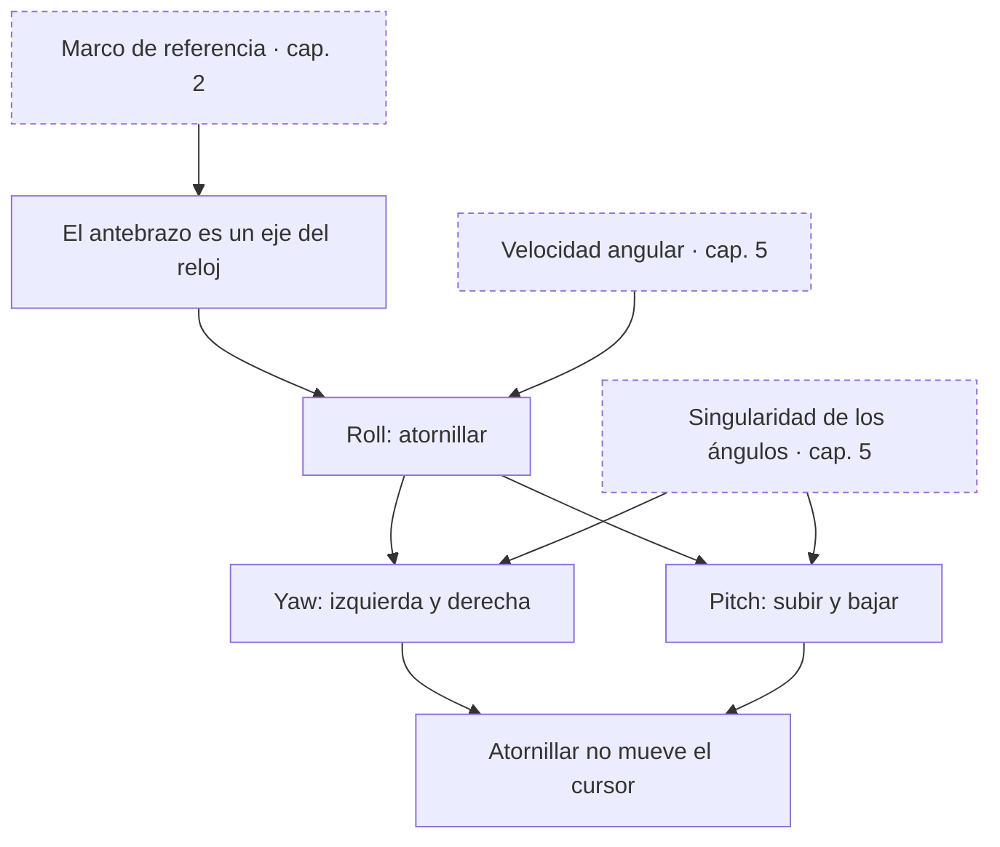

| Concepto | Qué es | Necesita | En el código |
|---|---|---|---|
| **El antebrazo es un eje del reloj** `antebrazo_eje_x` | En la muñeca izquierda el antebrazo (codo → mano) es +x; en la derecha, con el reloj puesto igual, es −x. | `ejes_del_reloj`, `marco_de_referencia`, `regla_mano_derecha` | `wrist.js:forearmOf`, `mocapmath.js:watchOf`, `air_mouse.py:AirMouse._calib_forearm` |
| **Roll: atornillar** `roll` | La parte del giro alrededor del antebrazo f: roll = ω·f (positivo: horario visto desde el codo). | `antebrazo_eje_x`, `velocidad_angular`, `producto_punto` | `wrist.js:Wrist.rates`, `flick.js:FlickDetector.update`, `dibuja.js:point3`, `reconstruct_drawing.py:frame_rates` |
| **Pitch: subir y bajar** `pitch` | El giro alrededor del eje horizontal perpendicular al antebrazo: pitch = ω·(f × g)/\|f × g\|. | `roll`, `producto_cruz`, `arriba_desde_gravedad`, `vector_unitario`, `singularidad` | `wrist.js:Wrist.rates`, `air_mouse.py:Motion.feed_gyro`, `reconstruct_drawing.py:frame_rates`, `analyze_drawing.py:watch_features` |
| **Yaw: izquierda y derecha** `yaw` | El giro alrededor de la vertical, sin la parte que ya es roll: el coeficiente de g al escribir ω en la base {g, f, f × g}, (ω·g − roll·(g·f)) / (1 − (g·f)²). | `roll`, `arriba_desde_gravedad`, `coordenadas_en_una_base`, `singularidad` | `wrist.js:Wrist.rates`, `air_mouse.py:Motion.feed_gyro`, `reconstruct_drawing.py:frame_rates`, `analyze_drawing.py:watch_features`, `game.js:onGyro` |
| **Atornillar no mueve el cursor** `giros_independientes` | Un roll puro no tiene nada de yaw ni de pitch, a cualquier inclinación: los tres giros no se pisan. | `yaw`, `pitch` | `air_mouse.py:Motion.feed_gyro` |

### 7 · De 3D a 2D: el cursor

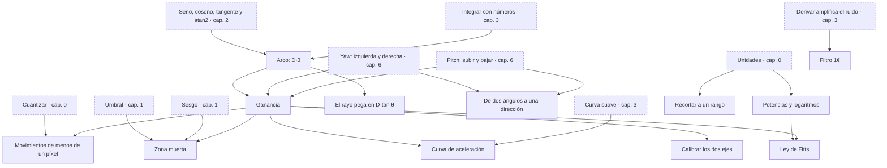

| Concepto | Qué es | Necesita | En el código |
|---|---|---|---|
| **Arco: D·θ** `arco_d_theta` | Girar θ radianes a distancia D recorre un arco D·θ; un grado son D·π/180. | `trigonometria`, `integral_discreta`, `unidades` | `mocapmath.js:cursorTrack` |
| **El rayo pega en D·tan θ** `rayo_tangente` | En una pantalla plana el punto del rayo se aleja como D·tan θ, más rápido que el arco; para ángulos pequeños tan θ ≈ θ. | `arco_d_theta` | `mocapmath.js:cursorTrack` |
| **De dos ángulos a una dirección** `coordenadas_esfericas` | (sen yaw·cos pitch, sen pitch, −cos yaw·cos pitch): la flecha que apunta con esos dos ángulos. | `trigonometria`, `vector_unitario`, `yaw`, `pitch` | `game.js:aimDir`, `dibuja.js:point3` |
| **Ganancia** `ganancia` | Píxeles por grado: el número que convierte el giro de la muñeca en movimiento del cursor. | `arco_d_theta`, `yaw`, `pitch` | `dibuja.js:point2`, `air_mouse.py:Motion.feed_gyro`, `calibrate.js:suggest` |
| **Recortar a un rango** `recortar` | Limitar un valor entre un mínimo y un máximo: el borde de la pantalla, la velocidad máxima, la mira, una pausa demasiado larga. | `unidades` | `air_mouse.py:clamp`, `air_mouse.py:AirMouse._apply_delta`, `game.js:onGyro`, `trazos.js:timeline`, `air_mouse.py:Motion.feed_gyro` |
| **Movimientos de menos de un píxel** `subpixel` | El cursor vive en píxeles enteros: se guarda la posición con decimales y se redondea al mandarla, para no perder los movimientos chicos. | `cuantizar`, `ganancia`, `integral_discreta` | `air_mouse.py:AirMouse._apply_delta`, `air_mouse.py:norm` |
| **Zona muerta** `zona_muerta` | Por debajo de una rapidez el cursor no se mueve, para que el temblor y el sesgo que queda no lo arrastren; si se resta en vez de cortar, no hay salto. | `umbral`, `sesgo`, `norma`, `ganancia` | `air_mouse.py:Motion.feed_gyro`, `wrist.js:Wrist.rates`, `game.js:onGyro` |
| **Curva de aceleración** `curva_de_aceleracion` | La ganancia crece con la rapidez del giro (con una curva suave entre v_lo y v_hi): lento para atinar, rápido para cruzar la pantalla. | `ganancia`, `curva_suave` | `air_mouse.py:Motion.feed_gyro` |
| **Filtro 1€** `filtro_1euro` | Un suavizado cuyo corte sube con la rapidez: quieto suaviza mucho (sin temblor), rápido casi nada (sin retraso). | `suavizar`, `derivar_amplifica_ruido` | `air_mouse.py:OneEuro.alpha`, `air_mouse.py:OneEuro.__call__` |
| **Calibrar los dos ejes** `mapa_lineal_2x2` | Una matriz 2×2 lleva (yaw, pitch) a (x, y): corrige ganancias distintas por eje y ejes que se cruzan a 75° en vez de 90°. | `ganancia`, `cambio_de_marco` | `calibrate.js:suggest`, `analyze_drawing.py:main` |
| **Potencias y logaritmos** `potencias_y_logaritmos` | 2^k es duplicar k veces; log2(x) cuenta cuántas veces hay que duplicar para llegar a x. | `unidades` | `musica.js:midiHz`, `musica.js:Musica.pulse`, `calibrate.js:metrics` |
| **Ley de Fitts** `ley_de_fitts` | El tiempo para atinar a un blanco de ancho W a distancia D crece con log2(D/W + 1), el índice de dificultad; dividido por el tiempo da bits por segundo. | `potencias_y_logaritmos`, `ganancia` | `calibrate.js:metrics` |

### 8 · Fusión de sensores y por qué el rumbo se va

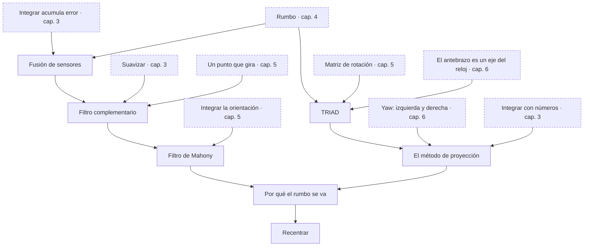

| Concepto | Qué es | Necesita | En el código |
|---|---|---|---|
| **Fusión de sensores** `fusion_de_sensores` | Juntar dos medidas imperfectas para que cada una tape el defecto de la otra: el giroscopio es rápido pero se desvía, la gravedad no se desvía pero no ve el rumbo. | `error_acumulado`, `arriba_desde_gravedad`, `rumbo` | `mocapmath.js:reconstruct` |
| **Filtro complementario** `filtro_complementario` | Integrar el giroscopio y tirar suavemente hacia la medida absoluta: lo rápido de uno y lo lento del otro; con un sesgo b el error queda quieto en b/k. | `fusion_de_sensores`, `suavizar`, `integral_discreta`, `velocidad_de_un_punto_que_gira` | `air_mouse.py:Motion.feed_gyro`, `avatar.js:onGravity` |
| **TRIAD** `triad` | Armar la orientación completa con dos direcciones conocidas en los dos marcos: arriba (de la gravedad) y el antebrazo con un rumbo supuesto. | `arriba_desde_gravedad`, `rumbo`, `matriz_de_rotacion`, `antebrazo_eje_x` | `mocapmath.js:triad` |
| **El método de proyección** `metodo_de_proyeccion` | Rumbo = ∫yaw dt y el resto de la gravedad (TRIAD): sirve para apuntar, pero con el antebrazo casi vertical el rumbo no existe y se pierde. | `triad`, `yaw`, `integral_discreta`, `singularidad` | `mocapmath.js:reconstruct` |
| **Filtro de Mahony** `mahony` | Integrar el cuaternión con ω + Kp·e, donde e = arriba medido × arriba predicho es el giro que falta para que coincidan. | `filtro_complementario`, `integrar_orientacion`, `producto_cruz` | `mocapmath.js:reconstruct`, `avatar.js:onGravity` |
| **Por qué el rumbo se va** `deriva_del_rumbo` | El sesgo alrededor de la vertical no tiene quién lo corrija (la gravedad no lo ve): unos 12 cm en 10 s a 2.4 m de la pantalla. | `mahony`, `metodo_de_proyeccion`, `error_acumulado` | `mocapmath.js:cursorTrack`, `avatar.js:autoCenterStep` |
| **Recentrar** `recentrar` | Como el rumbo es relativo, se fija un frente y se vuelve a él: con un botón o de a poco, cuando la mano descansa. | `deriva_del_rumbo` | `avatar.js:autoCenterStep`, `armfilter.js:ArmFilter.rotateY`, `air_mouse.py:Motion.feed_gyro` |

### 9 · El cuerpo en 3D

```mermaid
flowchart TD
  classDef fuera stroke-dasharray: 4 3
  k_unidades["Unidades · cap. 0"]:::fuera
  k_tamano_tipico["Tamaño típico: RMS y desviación estándar · cap. 1"]:::fuera
  k_sesgo["Sesgo · cap. 1"]:::fuera
  k_vector["Vector · cap. 2"]:::fuera
  k_trigonometria["Seno, coseno, tangente y atan2 · cap. 2"]:::fuera
  k_producto_punto["Producto punto · cap. 2"]:::fuera
  k_producto_cruz["Producto cruz · cap. 2"]:::fuera
  k_segunda_derivada["Segunda diferencia · cap. 3"]:::fuera
  k_doble_integral_zupt["Integrar dos veces y velocidad cero · cap. 3"]:::fuera
  k_curva_suave["Curva suave · cap. 3"]:::fuera
  k_onda_seno["Una onda · cap. 3"]:::fuera
  k_aceleracion_lineal["Aceleración lineal · cap. 4"]:::fuera
  k_velocidad_angular["Velocidad angular · cap. 5"]:::fuera
  k_velocidad_de_un_punto_que_gira["Un punto que gira · cap. 5"]:::fuera
  k_angulos_de_euler["Ángulos de Euler · cap. 5"]:::fuera
  k_antebrazo_eje_x["El antebrazo es un eje del reloj · cap. 6"]:::fuera
  k_potencias_y_logaritmos["Potencias y logaritmos · cap. 7"]:::fuera
  k_metodo_de_proyeccion["El método de proyección · cap. 8"]:::fuera
  k_mahony["Filtro de Mahony · cap. 8"]:::fuera
  k_esqueleto["Esqueleto"]
  k_cinematica_directa["Cinemática directa"]
  k_trayectorias["Trayectorias de una animación"]
  k_ley_de_cosenos["Ley de los cosenos"]
  k_cinematica_inversa["Cinemática inversa de dos huesos"]
  k_ruido_gaussiano["Fabricar ruido"]
  k_sintetizar_imu["Sintetizar lo que leería el reloj"]
  k_prueba_con_verdad["Probar contra la verdad"]
  k_aceleracion_de_un_punto_que_gira["Aceleración de un punto que gira"]
  k_limites_articulares["Límites del cuerpo"]
  k_verosimilitud["Verosimilitud"]
  k_filtro_de_particulas["Filtro de partículas"]
  k_remuestreo_de_particulas["Tamaño efectivo y remuestreo"]
  k_vector --> k_esqueleto
  k_unidades --> k_esqueleto
  k_esqueleto --> k_cinematica_directa
  k_angulos_de_euler --> k_cinematica_directa
  k_cinematica_directa --> k_trayectorias
  k_curva_suave --> k_trayectorias
  k_onda_seno --> k_trayectorias
  k_producto_punto --> k_ley_de_cosenos
  k_cinematica_directa --> k_cinematica_inversa
  k_ley_de_cosenos --> k_cinematica_inversa
  k_tamano_tipico --> k_ruido_gaussiano
  k_trigonometria --> k_ruido_gaussiano
  k_potencias_y_logaritmos --> k_ruido_gaussiano
  k_trayectorias --> k_sintetizar_imu
  k_velocidad_angular --> k_sintetizar_imu
  k_ruido_gaussiano --> k_sintetizar_imu
  k_sesgo --> k_sintetizar_imu
  k_antebrazo_eje_x --> k_sintetizar_imu
  k_sintetizar_imu --> k_prueba_con_verdad
  k_mahony --> k_prueba_con_verdad
  k_metodo_de_proyeccion --> k_prueba_con_verdad
  k_velocidad_de_un_punto_que_gira --> k_aceleracion_de_un_punto_que_gira
  k_segunda_derivada --> k_aceleracion_de_un_punto_que_gira
  k_esqueleto --> k_limites_articulares
  k_producto_cruz --> k_limites_articulares
  k_ruido_gaussiano --> k_verosimilitud
  k_verosimilitud --> k_filtro_de_particulas
  k_aceleracion_de_un_punto_que_gira --> k_filtro_de_particulas
  k_limites_articulares --> k_filtro_de_particulas
  k_doble_integral_zupt --> k_filtro_de_particulas
  k_aceleracion_lineal --> k_filtro_de_particulas
  k_filtro_de_particulas --> k_remuestreo_de_particulas
```

| Concepto | Qué es | Necesita | En el código |
|---|---|---|---|
| **Esqueleto** `esqueleto` | Huesos de largo fijo unidos por articulaciones; la pose son los ángulos de cada una. | `vector`, `unidades` | `mocapmath.js:build`, `mocapmath.js:hand` |
| **Cinemática directa** `cinematica_directa` | De los ángulos de cada articulación a las posiciones, encadenando giros desde el tronco hacia la mano. | `esqueleto`, `eje_y_angulo`, `orden_no_conmuta`, `angulos_de_euler` | `mocapmath.js:build` |
| **Trayectorias de una animación** `trayectorias` | Cómo se mueve la pose en el tiempo: una fase periódica para caminar, curvas suaves entre íconos, un círculo. | `cinematica_directa`, `curva_suave`, `onda_seno` | `mocapmath.js:aimPath`, `mocapmath.js:ANIMS` |
| **Ley de los cosenos** `ley_de_cosenos` | c² = a² + b² − 2ab cos C: con los tres lados de un triángulo se saben sus ángulos. | `trigonometria`, `producto_punto` | `mocapmath.js:ik` |
| **Cinemática inversa de dos huesos** `cinematica_inversa` | Dado dónde debe ir la muñeca, el codo sale de la ley de los cosenos y de un polo que dice hacia dónde se dobla. | `cinematica_directa`, `ley_de_cosenos`, `vector_unitario` | `mocapmath.js:ik` |
| **Fabricar ruido** `ruido_gaussiano` | Números al azar con forma de campana (Box–Muller, a partir de dos uniformes) y una semilla fija para que el azar se repita. | `ruido`, `tamano_tipico`, `trigonometria`, `potencias_y_logaritmos` | `mocapmath.js:rng`, `armfilter.js:mulberry32`, `armfilter.js:ArmFilter.randn` |
| **Sintetizar lo que leería el reloj** `sintetizar_imu` | De la animación: ω por el giro relativo entre muestras, el acelerómetro por segunda diferencia más la gravedad, y encima ruido y sesgo. | `cinematica_directa`, `trayectorias`, `matriz_de_rotacion`, `velocidad_angular`, `fuerza_especifica`, `ruido_gaussiano`, `sesgo`, `antebrazo_eje_x` | `mocapmath.js:synth`, `mocapmath.js:watchOf` |
| **Probar contra la verdad** `prueba_con_verdad` | Si lo reconstruido desde lecturas sintetizadas cae encima de la animación, la cuenta tiene sentido; no prueba el mundo real. | `sintetizar_imu`, `mahony`, `metodo_de_proyeccion` | `mocapmath.js:reconstruct`, `mocapmath.js:cursorTrack` |
| **Aceleración de un punto que gira** `aceleracion_de_un_punto_que_gira` | Un punto a distancia L acelera α × f·L (tangencial) más ω × (ω × f)·L (centrípeta, hacia el eje). | `velocidad_de_un_punto_que_gira`, `segunda_derivada` | `armfilter.js:ArmFilter.step` |
| **Límites del cuerpo** `limites_articulares` | El codo no se dobla más de 150° ni hacia atrás, el brazo no atraviesa el torso: lo imposible pesa casi cero. | `esqueleto`, `producto_punto`, `producto_cruz` | `armfilter.js:feasible`, `armfilter.js:defaultPrior`, `armfilter.js:ArmFilter._init` |
| **Verosimilitud** `verosimilitud` | Qué tan probable es la medida si una hipótesis fuera cierta; con ruido gaussiano de tamaño σ, exp(−r²/2σ²) para un residuo r. | `ruido_gaussiano` | `armfilter.js:ArmFilter.step` |
| **Filtro de partículas** `filtro_de_particulas` | Muchas hipótesis del codo a la vez, cada una con un peso: se mueven con el modelo, se pesan con la medida y vuelven al reposo cuando nada las distingue. | `verosimilitud`, `aceleracion_de_un_punto_que_gira`, `limites_articulares`, `doble_integral_zupt`, `aceleracion_lineal` | `armfilter.js:ArmFilter.step`, `armfilter.js:ArmFilter._init`, `armfilter.js:ArmFilter._estimate`, `armfilter.js:defaultPrior` |
| **Tamaño efectivo y remuestreo** `remuestreo_de_particulas` | Cuando pocos pesos dominan (N_ef = 1/Σw² chico) se clonan las partículas buenas y se olvidan las malas (remuestreo sistemático). | `filtro_de_particulas` | `armfilter.js:ArmFilter._resample`, `armfilter.js:ArmFilter.step` |

### 10 · Gestos

```mermaid
flowchart TD
  classDef fuera stroke-dasharray: 4 3
  k_marca_de_tiempo["Marca de tiempo · cap. 0"]:::fuera
  k_resumir_ventana["Resumir una ventana · cap. 0"]:::fuera
  k_latencia["Latencia · cap. 0"]:::fuera
  k_umbral["Umbral · cap. 1"]:::fuera
  k_producto_punto["Producto punto · cap. 2"]:::fuera
  k_derivada_discreta["Derivar con números · cap. 3"]:::fuera
  k_paso_alto["Quitar lo lento · cap. 3"]:::fuera
  k_aceleracion_lineal["Aceleración lineal · cap. 4"]:::fuera
  k_roll["Roll: atornillar · cap. 6"]:::fuera
  k_recentrar["Recentrar · cap. 8"]:::fuera
  k_deteccion_de_picos["Detectar un pico"]
  k_histeresis["Histéresis"]
  k_periodo_refractario["Periodo refractario"]
  k_umbral_adaptativo["Umbral que se adapta"]
  k_dominancia_de_eje["Dominancia de un eje"]
  k_clic_de_tornillo["El clic de tornillo"]
  k_toque["El toque en la esfera"]
  k_empujon["El empujón"]
  k_sacudida["Sacudida"]
  k_permanencia["Clic por permanencia"]
  k_scroll_por_roll["Scroll con el antebrazo"]
  k_tempo["Tempo"]
  k_aciertos_y_falsas_alarmas["Aciertos contra falsas alarmas"]
  k_auc["AUC"]
  k_umbral --> k_deteccion_de_picos
  k_resumir_ventana --> k_deteccion_de_picos
  k_marca_de_tiempo --> k_deteccion_de_picos
  k_umbral --> k_histeresis
  k_deteccion_de_picos --> k_periodo_refractario
  k_deteccion_de_picos --> k_umbral_adaptativo
  k_deteccion_de_picos --> k_dominancia_de_eje
  k_roll --> k_dominancia_de_eje
  k_dominancia_de_eje --> k_clic_de_tornillo
  k_histeresis --> k_clic_de_tornillo
  k_periodo_refractario --> k_clic_de_tornillo
  k_umbral_adaptativo --> k_clic_de_tornillo
  k_derivada_discreta --> k_toque
  k_paso_alto --> k_toque
  k_periodo_refractario --> k_toque
  k_aceleracion_lineal --> k_empujon
  k_producto_punto --> k_empujon
  k_umbral_adaptativo --> k_empujon
  k_latencia --> k_empujon
  k_dominancia_de_eje --> k_sacudida
  k_umbral --> k_permanencia
  k_marca_de_tiempo --> k_permanencia
  k_histeresis --> k_scroll_por_roll
  k_recentrar --> k_scroll_por_roll
  k_deteccion_de_picos --> k_tempo
  k_deteccion_de_picos --> k_aciertos_y_falsas_alarmas
  k_aciertos_y_falsas_alarmas --> k_auc
```

| Concepto | Qué es | Necesita | En el código |
|---|---|---|---|
| **Detectar un pico** `deteccion_de_picos` | Cruzar el umbral, seguir el máximo, terminar al bajar: un pico es un evento con instante, signo y tamaño. | `umbral`, `resumir_ventana`, `marca_de_tiempo` | `flick.js:FlickDetector.update`, `game.js:onAccel`, `air_mouse.py:TapDetector.feed_accel`, `analyze_dataset.py:event_features` |
| **Histéresis** `histeresis` | Dos umbrales, uno para entrar y otro más bajo para salir, para no parpadear en el borde. | `umbral` | `flick.js:FlickDetector.update`, `air_mouse.py:AirMouse._pose_gate`, `air_mouse.py:RollScroller.feed` |
| **Periodo refractario** `periodo_refractario` | Después de un evento no se acepta otro por un rato (90 ms en el tornillo), para no contar dos veces el mismo. | `deteccion_de_picos` | `flick.js:FlickDetector.update`, `game.js:onAccel`, `air_mouse.py:TapDetector.feed_accel` |
| **Umbral que se adapta** `umbral_adaptativo` | Una fracción de la mediana (o un percentil) de tus picos recientes: se ajusta a tu fuerza sin calibrar. | `umbral`, `deteccion_de_picos`, `resumir_ventana` | `flick.js:FlickDetector.threshold`, `game.js:onAccel` |
| **Dominancia de un eje** `dominancia_de_eje` | Un giro de muñeca es \|ω_x\| mucho mayor que \|ω_y\| y \|ω_z\|; si todo el brazo se mueve, los otros ejes también crecen y no cuenta. | `deteccion_de_picos`, `roll` | `flick.js:FlickDetector.update`, `air_mouse.py:RollScroller.feed`, `air_mouse.py:ShakeDetector.feed` |
| **El clic de tornillo** `clic_de_tornillo` | Un giro rápido del antebrazo (~700 °/s) que domina a los otros ejes; al apuntar, los giros accidentales del dataset nunca pasaron de 117 °/s. | `dominancia_de_eje`, `histeresis`, `periodo_refractario`, `umbral_adaptativo` | `flick.js:FlickDetector.update`, `mocapmath.js:aimPath` |
| **El toque en la esfera** `toque` | Un salto brusco del acelerómetro z con la muñeca quieta antes y después; se decide 250 ms tarde. | `deteccion_de_picos`, `derivada_discreta`, `paso_alto`, `periodo_refractario` | `air_mouse.py:TapDetector.feed_accel`, `air_mouse.py:TapDetector.feed_gyro`, `air_mouse.py:TapDetector.decide` |
| **El empujón** `empujon` | La aceleración lineal a lo largo del antebrazo; la mira se toma 120 ms antes, porque empujar también gira la muñeca. | `aceleracion_lineal`, `producto_punto`, `deteccion_de_picos`, `umbral_adaptativo`, `latencia` | `game.js:onAccel`, `game.js:aimAt` |
| **Sacudida** `sacudida` | Muchos cambios de signo rápidos y fuertes en poco tiempo: la señal para pausar. | `deteccion_de_picos`, `dominancia_de_eje` | `air_mouse.py:ShakeDetector.feed` |
| **Clic por permanencia** `permanencia` | Quedarse quieto sobre un punto un rato, después de haber viajado, cuenta como clic. | `umbral`, `marca_de_tiempo` | `air_mouse.py:DwellDetector.feed` |
| **Scroll con el antebrazo** `scroll_por_roll` | Girar más de 25° desde la postura neutra, tras una pausa y con una rampa lenta; cada muesca con histéresis. | `roll`, `histeresis`, `recentrar` | `air_mouse.py:RollScroller.feed`, `air_mouse.py:Motion.feed_gyro` |
| **Tempo** `tempo` | El intervalo mediano entre giros: BPM = 60000 / intervalo en ms. | `deteccion_de_picos`, `resumir_ventana`, `unidades` | `flick.js:FlickDetector.tempo` |
| **Aciertos contra falsas alarmas** `aciertos_y_falsas_alarmas` | Bajar el umbral atrapa más gestos pero dispara más veces sin querer; se mide por minuto de uso normal (el pellizco: 12 de 20). | `umbral`, `deteccion_de_picos` | `analyze_dataset.py:main` |
| **AUC** `auc` | La probabilidad de que un caso positivo dé más señal que uno negativo cualquiera: 0.5 es no distinguir nada, 1 es separar todo. | `aciertos_y_falsas_alarmas` | `analyze_drawing.py:auc`, `analyze_drawing.py:main` |

### 11 · Frecuencia

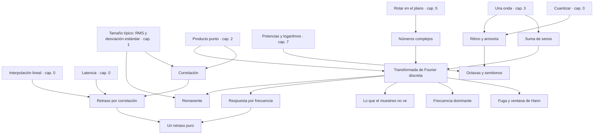

| Concepto | Qué es | Necesita | En el código |
|---|---|---|---|
| **Suma de senos** `suma_de_senos` | Varias ondas juntas: con fases al azar parece imprevisible, pero se repite cada T si cada onda da vueltas enteras en T. | `onda_seno` | `sismomath.js:makeTarget`, `sismomath.js:wave`, `sismomath.js:targetAt` |
| **Correlación** `correlacion` | El producto punto de dos señales centradas, dividido por sus tamaños: 1 es la misma forma, 0 nada que ver. | `producto_punto`, `tamano_tipico` | `sismomath.js:analyze`, `reconstruct_drawing.py:shape_sim` |
| **Retraso por correlación** `retraso_por_correlacion` | Desplazar la línea τ y quedarse con el τ que más se parece a tu aguja; una parábola por tres puntos afina entre muestras. | `correlacion`, `latencia`, `interpolacion_lineal` | `sismomath.js:analyze` |
| **Números complejos** `numeros_complejos` | Flechas del plano que se multiplican: el largo se multiplica y los ángulos se suman; dividir dos ondas compara su tamaño y su atraso. | `vector`, `trigonometria`, `rotacion_2d` | `sismomath.js:analyze` |
| **Transformada de Fourier discreta** `dft` | Multiplicar la señal por una onda de prueba y sumar dice cuánto de esa frecuencia hay, con su amplitud y su fase. | `onda_seno`, `producto_punto`, `numeros_complejos`, `suma_de_senos` | `sismomath.js:analyze`, `analyze_dataset.py:window_features` |
| **Fuga y ventana de Hann** `fuga_y_ventana` | Si una onda no da vueltas enteras en la ventana, su energía se reparte en las frecuencias vecinas; apagar los bordes (Hann) lo reduce. | `dft` | `analyze_dataset.py:window_features`, `sismomath.js:makeTarget` |
| **Frecuencia dominante** `frecuencia_dominante` | La frecuencia del pico más alto del espectro: el ritmo principal de un movimiento. | `dft` | `analyze_dataset.py:window_features`, `analyze_dataset.py:main` |
| **Lo que el muestreo no ve** `nyquist` | Con f_s muestras por segundo no se distingue nada más rápido que f_s/2 (Nyquist); lo más rápido se disfraza de lento (aliasing). | `muestreo`, `onda_seno`, `dft` | `analyze_dataset.py:window_features` |
| **Respuesta por frecuencia** `funcion_de_transferencia` | H = Y/R para cada onda: \|H\| cuánto de ella seguiste, −∠H/(2πf) tu retraso a esa frecuencia y \|1 − H\| el error que te quedó. | `dft`, `numeros_complejos` | `sismomath.js:analyze` |
| **Un retraso puro** `retraso_puro` | Llegar tarde τ deja \|H\| = 1 y gira la fase 2πfτ; su error \|1 − H\| = 2\|sen(πfτ)\| crece con la frecuencia. | `funcion_de_transferencia`, `retraso_por_correlacion` | `sismomath.js:analyze` |
| **Remanente** `remanente` | La parte de tu movimiento que no está en ninguna frecuencia de la línea: temblor, correcciones, deriva; tu ruido. | `dft`, `tamano_tipico` | `sismomath.js:analyze` |
| **Ritmo y armonía** `ritmo_y_armonia` | Pulsos a f₀, a·f₀, b·f₀… coinciden cada 1/f₀; lentos son un polirritmo y pasando de ~20 por segundo se oyen como un acorde de armónicos. | `onda_seno`, `cuantizar` | `musica.js:Pulsos.process`, `musica.js:ratio`, `musica.js:unit` |
| **Octavas y semitonos** `octavas` | Subir una octava es multiplicar la frecuencia por 2; un semitono, por 2^(1/12): la nota m suena a 440·2^((m − 69)/12) Hz. | `ritmo_y_armonia`, `potencias_y_logaritmos` | `musica.js:midiHz`, `musica.js:Musica.f0`, `musica.js:Musica.pulse`, `musica.js:Musica.harp` |

### 12 · Aprender de datos

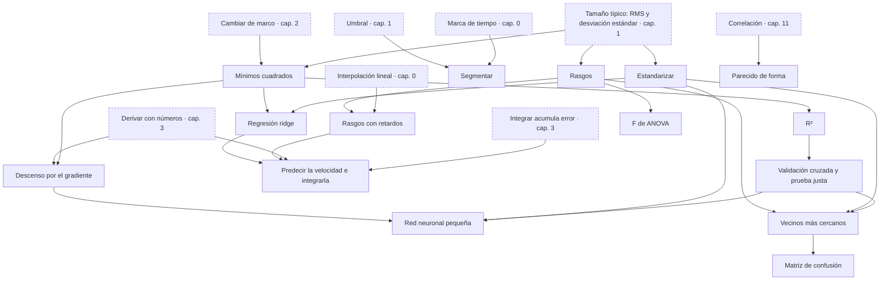

| Concepto | Qué es | Necesita | En el código |
|---|---|---|---|
| **Rasgos** `rasgos` | Describir un trozo de señal con pocos números (máximos, RMS, giros, postura) para poder compararlo con otros. | `resumir_ventana`, `tamano_tipico` | `analyze_dataset.py:event_features`, `analyze_dataset.py:window_features`, `reconstruct_drawing.py:stroke_data`, `analyze_dataset.py:signals` |
| **Segmentar** `segmentar` | Cortar una grabación en trazos, letras o tomas por huecos y pausas. | `umbral`, `marca_de_tiempo` | `analyze_drawing.py:strokes_from`, `analyze_drawing.py:groups_by_pause`, `export_mocap.py:windows`, `export_mocap.py:gap_free`, `trazos.js:fromRescue` |
| **Estandarizar** `estandarizar` | Restar el promedio y dividir por la desviación estándar, para que cada rasgo pese parecido. | `tamano_tipico` | `reconstruct_drawing.py:Ridge.fit`, `reconstruct_drawing.py:MLP.fit`, `analyze_dataset.py:knn_loo` |
| **Mínimos cuadrados** `minimos_cuadrados` | Elegir los números de un modelo lineal que hacen más chica la suma de los errores al cuadrado (una regresión). | `coordenadas_en_una_base`, `cambio_de_marco`, `tamano_tipico` | `analyze_drawing.py:r2`, `analyze_drawing.py:main` |
| **R²** `r_cuadrado` | La fracción de la variación que el modelo explica: 1 es toda, 0 es nada. | `minimos_cuadrados` | `analyze_drawing.py:r2` |
| **Validación cruzada y prueba justa** `validacion_cruzada` | Medir siempre con datos que el modelo no vio: dejar uno fuera, grupos de trazos, letras nunca vistas; si no, el modelo memoriza (sobreajuste). | `minimos_cuadrados`, `r_cuadrado` | `reconstruct_drawing.py:main`, `analyze_dataset.py:knn_loo`, `reconstruct_drawing.py:MLP.fit` |
| **Rasgos con retardos** `ventana_de_retardos` | Los rasgos de ±240 ms alrededor de cada instante (cada 40 ms) dejan ver el antes y el después del movimiento. | `rasgos`, `interpolacion_lineal` | `reconstruct_drawing.py:stroke_data` |
| **Regresión ridge** `ridge` | Mínimos cuadrados con un castigo λ a los coeficientes grandes: (XᵀX + λI)W = XᵀV. | `minimos_cuadrados`, `estandarizar` | `reconstruct_drawing.py:Ridge.fit`, `reconstruct_drawing.py:Ridge.predict` |
| **Predecir la velocidad e integrarla** `predecir_velocidad` | Es más fácil aprender cómo se mueve el dedo que dónde está; integrar la velocidad predicha redibuja el trazo. | `ridge`, `ventana_de_retardos`, `integral_discreta`, `derivada_discreta`, `error_acumulado` | `reconstruct_drawing.py:main`, `reconstruct_drawing.py:stroke_data` |
| **Descenso por el gradiente** `descenso_por_gradiente` | Mover los números del modelo en la dirección en que el error baja más rápido, un paso chico a la vez. | `derivada_discreta`, `minimos_cuadrados` | `reconstruct_drawing.py:MLP.fit` |
| **Red neuronal pequeña** `red_neuronal` | Una capa oculta tanh entre los rasgos y la salida; se entrena por el gradiente (retropropagación, Adam) y se para cuando la validación deja de mejorar. | `descenso_por_gradiente`, `estandarizar`, `validacion_cruzada` | `reconstruct_drawing.py:MLP.fit`, `reconstruct_drawing.py:MLP.predict` |
| **Parecido de forma** `parecido_de_forma` | La correlación entre el trazo real y el reconstruido, los dos centrados: 1 es la misma forma, sin importar dónde empieza. | `correlacion` | `reconstruct_drawing.py:shape_sim`, `reconstruct_drawing.py:main` |
| **Vecinos más cercanos** `vecinos_cercanos` | Un gesto nuevo se compara con los guardados y los k más cercanos votan qué es. | `rasgos`, `estandarizar`, `norma`, `validacion_cruzada` | `analyze_dataset.py:knn_loo`, `analyze_dataset.py:main` |
| **Matriz de confusión** `matriz_de_confusion` | Una tabla de qué gesto se confunde con cuál: los aciertos en la diagonal. | `vecinos_cercanos` | `analyze_dataset.py:confusion` |
| **F de ANOVA** `anova_f` | Cuánto separa un rasgo a los gestos: la variación entre gestos sobre la variación dentro de cada uno. | `rasgos`, `tamano_tipico` | `analyze_dataset.py:fstat` |

## El mapa entero

Los conceptos de todos los capítulos en un solo diagrama (es grande)

```mermaid
flowchart TD
  subgraph c0 ["0 · Un número que cambia"]
    k_senal["Señal"]
    k_unidades["Unidades"]
    k_muestreo["Muestreo"]
    k_marca_de_tiempo["Marca de tiempo"]
    k_interpolacion_lineal["Interpolación lineal"]
    k_cuantizar["Cuantizar"]
    k_lecturas_nuevas["Muestras contra lecturas nuevas"]
    k_resumir_ventana["Resumir una ventana"]
    k_latencia["Latencia"]
    k_alinear_relojes["Alinear dos relojes"]
    k_agrupar_muestras["Agrupar muestras por paquete"]
  end
  subgraph c1 ["1 · Qué es un sensor"]
    k_ejes_del_reloj["Los ejes del reloj"]
    k_acelerometro["Acelerómetro"]
    k_giroscopio["Giroscopio"]
    k_sensor_gravedad["El sensor de gravedad"]
    k_ruido["Ruido"]
    k_tamano_tipico["Tamaño típico: RMS y desviación estándar"]
    k_sesgo["Sesgo"]
    k_umbral["Umbral"]
    k_aprender_sesgo["Aprender el sesgo en reposo"]
  end
  subgraph c2 ["2 · Vectores y marcos"]
    k_vector["Vector"]
    k_norma["Largo de un vector"]
    k_vector_unitario["Vector unitario"]
    k_trigonometria["Seno, coseno, tangente y atan2"]
    k_envolver_angulos["Ángulos que dan la vuelta"]
    k_producto_punto["Producto punto"]
    k_producto_cruz["Producto cruz"]
    k_regla_mano_derecha["Regla de la mano derecha"]
    k_marco_de_referencia["Marco de referencia"]
    k_coordenadas_en_una_base["Coordenadas en una base"]
    k_cambio_de_marco["Cambiar de marco"]
  end
  subgraph c3 ["3 · Derivar e integrar con números"]
    k_derivada_discreta["Derivar con números"]
    k_segunda_derivada["Segunda diferencia"]
    k_integral_discreta["Integrar con números"]
    k_error_acumulado["Integrar acumula error"]
    k_doble_integral_zupt["Integrar dos veces y velocidad cero"]
    k_suavizar["Suavizar"]
    k_derivar_amplifica_ruido["Derivar amplifica el ruido"]
    k_paso_alto["Quitar lo lento"]
    k_curva_suave["Curva suave"]
    k_onda_seno["Una onda"]
    k_integrar_un_seno["Integrar una onda"]
  end
  subgraph c4 ["4 · La gravedad dice dónde es arriba"]
    k_fuerza_especifica["Lo que mide el acelerómetro"]
    k_arriba_desde_gravedad["La gravedad dice dónde es arriba"]
    k_inclinacion["Inclinación"]
    k_aceleracion_lineal["Aceleración lineal"]
    k_rumbo["Rumbo"]
  end
  subgraph c5 ["5 · Rotar"]
    k_rotacion_2d["Rotar en el plano"]
    k_eje_y_angulo["Eje y ángulo"]
    k_matriz_de_rotacion["Matriz de rotación"]
    k_orden_no_conmuta["El orden importa"]
    k_velocidad_angular["Velocidad angular"]
    k_velocidad_de_un_punto_que_gira["Un punto que gira"]
    k_angulos_de_euler["Ángulos de Euler"]
    k_singularidad["Singularidad de los ángulos"]
    k_cuaternion["Cuaternión"]
    k_integrar_orientacion["Integrar la orientación"]
  end
  subgraph c6 ["6 · Del reloj al antebrazo: roll, yaw y pitch"]
    k_antebrazo_eje_x["El antebrazo es un eje del reloj"]
    k_roll["Roll: atornillar"]
    k_pitch["Pitch: subir y bajar"]
    k_yaw["Yaw: izquierda y derecha"]
    k_giros_independientes["Atornillar no mueve el cursor"]
  end
  subgraph c7 ["7 · De 3D a 2D: el cursor"]
    k_arco_d_theta["Arco: D·θ"]
    k_rayo_tangente["El rayo pega en D·tan θ"]
    k_coordenadas_esfericas["De dos ángulos a una dirección"]
    k_ganancia["Ganancia"]
    k_recortar["Recortar a un rango"]
    k_subpixel["Movimientos de menos de un píxel"]
    k_zona_muerta["Zona muerta"]
    k_curva_de_aceleracion["Curva de aceleración"]
    k_filtro_1euro["Filtro 1€"]
    k_mapa_lineal_2x2["Calibrar los dos ejes"]
    k_potencias_y_logaritmos["Potencias y logaritmos"]
    k_ley_de_fitts["Ley de Fitts"]
  end
  subgraph c8 ["8 · Fusión de sensores y por qué el rumbo se va"]
    k_fusion_de_sensores["Fusión de sensores"]
    k_filtro_complementario["Filtro complementario"]
    k_triad["TRIAD"]
    k_metodo_de_proyeccion["El método de proyección"]
    k_mahony["Filtro de Mahony"]
    k_deriva_del_rumbo["Por qué el rumbo se va"]
    k_recentrar["Recentrar"]
  end
  subgraph c9 ["9 · El cuerpo en 3D"]
    k_esqueleto["Esqueleto"]
    k_cinematica_directa["Cinemática directa"]
    k_trayectorias["Trayectorias de una animación"]
    k_ley_de_cosenos["Ley de los cosenos"]
    k_cinematica_inversa["Cinemática inversa de dos huesos"]
    k_ruido_gaussiano["Fabricar ruido"]
    k_sintetizar_imu["Sintetizar lo que leería el reloj"]
    k_prueba_con_verdad["Probar contra la verdad"]
    k_aceleracion_de_un_punto_que_gira["Aceleración de un punto que gira"]
    k_limites_articulares["Límites del cuerpo"]
    k_verosimilitud["Verosimilitud"]
    k_filtro_de_particulas["Filtro de partículas"]
    k_remuestreo_de_particulas["Tamaño efectivo y remuestreo"]
  end
  subgraph c10 ["10 · Gestos"]
    k_deteccion_de_picos["Detectar un pico"]
    k_histeresis["Histéresis"]
    k_periodo_refractario["Periodo refractario"]
    k_umbral_adaptativo["Umbral que se adapta"]
    k_dominancia_de_eje["Dominancia de un eje"]
    k_clic_de_tornillo["El clic de tornillo"]
    k_toque["El toque en la esfera"]
    k_empujon["El empujón"]
    k_sacudida["Sacudida"]
    k_permanencia["Clic por permanencia"]
    k_scroll_por_roll["Scroll con el antebrazo"]
    k_tempo["Tempo"]
    k_aciertos_y_falsas_alarmas["Aciertos contra falsas alarmas"]
    k_auc["AUC"]
  end
  subgraph c11 ["11 · Frecuencia"]
    k_suma_de_senos["Suma de senos"]
    k_correlacion["Correlación"]
    k_retraso_por_correlacion["Retraso por correlación"]
    k_numeros_complejos["Números complejos"]
    k_dft["Transformada de Fourier discreta"]
    k_fuga_y_ventana["Fuga y ventana de Hann"]
    k_frecuencia_dominante["Frecuencia dominante"]
    k_nyquist["Lo que el muestreo no ve"]
    k_funcion_de_transferencia["Respuesta por frecuencia"]
    k_retraso_puro["Un retraso puro"]
    k_remanente["Remanente"]
    k_ritmo_y_armonia["Ritmo y armonía"]
    k_octavas["Octavas y semitonos"]
  end
  subgraph c12 ["12 · Aprender de datos"]
    k_rasgos["Rasgos"]
    k_segmentar["Segmentar"]
    k_estandarizar["Estandarizar"]
    k_minimos_cuadrados["Mínimos cuadrados"]
    k_r_cuadrado["R²"]
    k_validacion_cruzada["Validación cruzada y prueba justa"]
    k_ventana_de_retardos["Rasgos con retardos"]
    k_ridge["Regresión ridge"]
    k_predecir_velocidad["Predecir la velocidad e integrarla"]
    k_descenso_por_gradiente["Descenso por el gradiente"]
    k_red_neuronal["Red neuronal pequeña"]
    k_parecido_de_forma["Parecido de forma"]
    k_vecinos_cercanos["Vecinos más cercanos"]
    k_matriz_de_confusion["Matriz de confusión"]
    k_anova_f["F de ANOVA"]
  end
  k_senal --> k_unidades
  k_unidades --> k_muestreo
  k_muestreo --> k_marca_de_tiempo
  k_marca_de_tiempo --> k_interpolacion_lineal
  k_unidades --> k_cuantizar
  k_marca_de_tiempo --> k_lecturas_nuevas
  k_muestreo --> k_resumir_ventana
  k_marca_de_tiempo --> k_latencia
  k_latencia --> k_alinear_relojes
  k_resumir_ventana --> k_alinear_relojes
  k_latencia --> k_agrupar_muestras
  k_senal --> k_ejes_del_reloj
  k_ejes_del_reloj --> k_acelerometro
  k_muestreo --> k_acelerometro
  k_ejes_del_reloj --> k_giroscopio
  k_muestreo --> k_giroscopio
  k_acelerometro --> k_sensor_gravedad
  k_giroscopio --> k_sensor_gravedad
  k_resumir_ventana --> k_ruido
  k_ruido --> k_tamano_tipico
  k_giroscopio --> k_sesgo
  k_ruido --> k_sesgo
  k_unidades --> k_umbral
  k_sesgo --> k_aprender_sesgo
  k_umbral --> k_aprender_sesgo
  k_tamano_tipico --> k_aprender_sesgo
  k_acelerometro --> k_aprender_sesgo
  k_ejes_del_reloj --> k_vector
  k_vector --> k_norma
  k_norma --> k_vector_unitario
  k_vector_unitario --> k_trigonometria
  k_trigonometria --> k_envolver_angulos
  k_trigonometria --> k_producto_punto
  k_producto_punto --> k_producto_cruz
  k_producto_cruz --> k_regla_mano_derecha
  k_regla_mano_derecha --> k_marco_de_referencia
  k_marco_de_referencia --> k_coordenadas_en_una_base
  k_coordenadas_en_una_base --> k_cambio_de_marco
  k_marca_de_tiempo --> k_derivada_discreta
  k_derivada_discreta --> k_segunda_derivada
  k_marca_de_tiempo --> k_integral_discreta
  k_integral_discreta --> k_error_acumulado
  k_sesgo --> k_error_acumulado
  k_tamano_tipico --> k_error_acumulado
  k_error_acumulado --> k_doble_integral_zupt
  k_segunda_derivada --> k_doble_integral_zupt
  k_marca_de_tiempo --> k_suavizar
  k_ruido --> k_suavizar
  k_derivada_discreta --> k_derivar_amplifica_ruido
  k_suavizar --> k_derivar_amplifica_ruido
  k_suavizar --> k_paso_alto
  k_interpolacion_lineal --> k_curva_suave
  k_derivada_discreta --> k_curva_suave
  k_trigonometria --> k_onda_seno
  k_muestreo --> k_onda_seno
  k_onda_seno --> k_integrar_un_seno
  k_integral_discreta --> k_integrar_un_seno
  k_acelerometro --> k_fuerza_especifica
  k_vector --> k_fuerza_especifica
  k_segunda_derivada --> k_fuerza_especifica
  k_fuerza_especifica --> k_arriba_desde_gravedad
  k_vector_unitario --> k_arriba_desde_gravedad
  k_sensor_gravedad --> k_arriba_desde_gravedad
  k_arriba_desde_gravedad --> k_inclinacion
  k_producto_punto --> k_inclinacion
  k_arriba_desde_gravedad --> k_aceleracion_lineal
  k_arriba_desde_gravedad --> k_rumbo
  k_producto_cruz --> k_rumbo
  k_trigonometria --> k_rotacion_2d
  k_rotacion_2d --> k_eje_y_angulo
  k_producto_cruz --> k_eje_y_angulo
  k_cambio_de_marco --> k_matriz_de_rotacion
  k_eje_y_angulo --> k_matriz_de_rotacion
  k_matriz_de_rotacion --> k_orden_no_conmuta
  k_giroscopio --> k_velocidad_angular
  k_eje_y_angulo --> k_velocidad_angular
  k_derivada_discreta --> k_velocidad_angular
  k_velocidad_angular --> k_velocidad_de_un_punto_que_gira
  k_orden_no_conmuta --> k_angulos_de_euler
  k_rumbo --> k_angulos_de_euler
  k_inclinacion --> k_angulos_de_euler
  k_angulos_de_euler --> k_singularidad
  k_singularidad --> k_cuaternion
  k_cuaternion --> k_integrar_orientacion
  k_velocidad_angular --> k_integrar_orientacion
  k_integral_discreta --> k_integrar_orientacion
  k_marco_de_referencia --> k_antebrazo_eje_x
  k_antebrazo_eje_x --> k_roll
  k_velocidad_angular --> k_roll
  k_roll --> k_pitch
  k_singularidad --> k_pitch
  k_roll --> k_yaw
  k_singularidad --> k_yaw
  k_yaw --> k_giros_independientes
  k_pitch --> k_giros_independientes
  k_trigonometria --> k_arco_d_theta
  k_integral_discreta --> k_arco_d_theta
  k_arco_d_theta --> k_rayo_tangente
  k_yaw --> k_coordenadas_esfericas
  k_pitch --> k_coordenadas_esfericas
  k_arco_d_theta --> k_ganancia
  k_yaw --> k_ganancia
  k_pitch --> k_ganancia
  k_unidades --> k_recortar
  k_cuantizar --> k_subpixel
  k_ganancia --> k_subpixel
  k_umbral --> k_zona_muerta
  k_sesgo --> k_zona_muerta
  k_ganancia --> k_zona_muerta
  k_ganancia --> k_curva_de_aceleracion
  k_curva_suave --> k_curva_de_aceleracion
  k_derivar_amplifica_ruido --> k_filtro_1euro
  k_ganancia --> k_mapa_lineal_2x2
  k_unidades --> k_potencias_y_logaritmos
  k_potencias_y_logaritmos --> k_ley_de_fitts
  k_ganancia --> k_ley_de_fitts
  k_error_acumulado --> k_fusion_de_sensores
  k_rumbo --> k_fusion_de_sensores
  k_fusion_de_sensores --> k_filtro_complementario
  k_suavizar --> k_filtro_complementario
  k_velocidad_de_un_punto_que_gira --> k_filtro_complementario
  k_rumbo --> k_triad
  k_matriz_de_rotacion --> k_triad
  k_antebrazo_eje_x --> k_triad
  k_triad --> k_metodo_de_proyeccion
  k_yaw --> k_metodo_de_proyeccion
  k_integral_discreta --> k_metodo_de_proyeccion
  k_filtro_complementario --> k_mahony
  k_integrar_orientacion --> k_mahony
  k_mahony --> k_deriva_del_rumbo
  k_metodo_de_proyeccion --> k_deriva_del_rumbo
  k_deriva_del_rumbo --> k_recentrar
  k_vector --> k_esqueleto
  k_unidades --> k_esqueleto
  k_esqueleto --> k_cinematica_directa
  k_angulos_de_euler --> k_cinematica_directa
  k_cinematica_directa --> k_trayectorias
  k_curva_suave --> k_trayectorias
  k_onda_seno --> k_trayectorias
  k_producto_punto --> k_ley_de_cosenos
  k_cinematica_directa --> k_cinematica_inversa
  k_ley_de_cosenos --> k_cinematica_inversa
  k_tamano_tipico --> k_ruido_gaussiano
  k_trigonometria --> k_ruido_gaussiano
  k_potencias_y_logaritmos --> k_ruido_gaussiano
  k_trayectorias --> k_sintetizar_imu
  k_velocidad_angular --> k_sintetizar_imu
  k_ruido_gaussiano --> k_sintetizar_imu
  k_sesgo --> k_sintetizar_imu
  k_antebrazo_eje_x --> k_sintetizar_imu
  k_sintetizar_imu --> k_prueba_con_verdad
  k_mahony --> k_prueba_con_verdad
  k_metodo_de_proyeccion --> k_prueba_con_verdad
  k_velocidad_de_un_punto_que_gira --> k_aceleracion_de_un_punto_que_gira
  k_segunda_derivada --> k_aceleracion_de_un_punto_que_gira
  k_esqueleto --> k_limites_articulares
  k_producto_cruz --> k_limites_articulares
  k_ruido_gaussiano --> k_verosimilitud
  k_verosimilitud --> k_filtro_de_particulas
  k_aceleracion_de_un_punto_que_gira --> k_filtro_de_particulas
  k_limites_articulares --> k_filtro_de_particulas
  k_doble_integral_zupt --> k_filtro_de_particulas
  k_aceleracion_lineal --> k_filtro_de_particulas
  k_filtro_de_particulas --> k_remuestreo_de_particulas
  k_umbral --> k_deteccion_de_picos
  k_resumir_ventana --> k_deteccion_de_picos
  k_marca_de_tiempo --> k_deteccion_de_picos
  k_umbral --> k_histeresis
  k_deteccion_de_picos --> k_periodo_refractario
  k_deteccion_de_picos --> k_umbral_adaptativo
  k_deteccion_de_picos --> k_dominancia_de_eje
  k_roll --> k_dominancia_de_eje
  k_dominancia_de_eje --> k_clic_de_tornillo
  k_histeresis --> k_clic_de_tornillo
  k_periodo_refractario --> k_clic_de_tornillo
  k_umbral_adaptativo --> k_clic_de_tornillo
  k_derivada_discreta --> k_toque
  k_paso_alto --> k_toque
  k_periodo_refractario --> k_toque
  k_aceleracion_lineal --> k_empujon
  k_producto_punto --> k_empujon
  k_umbral_adaptativo --> k_empujon
  k_latencia --> k_empujon
  k_dominancia_de_eje --> k_sacudida
  k_umbral --> k_permanencia
  k_marca_de_tiempo --> k_permanencia
  k_histeresis --> k_scroll_por_roll
  k_recentrar --> k_scroll_por_roll
  k_deteccion_de_picos --> k_tempo
  k_deteccion_de_picos --> k_aciertos_y_falsas_alarmas
  k_aciertos_y_falsas_alarmas --> k_auc
  k_onda_seno --> k_suma_de_senos
  k_producto_punto --> k_correlacion
  k_tamano_tipico --> k_correlacion
  k_correlacion --> k_retraso_por_correlacion
  k_latencia --> k_retraso_por_correlacion
  k_interpolacion_lineal --> k_retraso_por_correlacion
  k_rotacion_2d --> k_numeros_complejos
  k_producto_punto --> k_dft
  k_numeros_complejos --> k_dft
  k_suma_de_senos --> k_dft
  k_dft --> k_fuga_y_ventana
  k_dft --> k_frecuencia_dominante
  k_dft --> k_nyquist
  k_dft --> k_funcion_de_transferencia
  k_funcion_de_transferencia --> k_retraso_puro
  k_retraso_por_correlacion --> k_retraso_puro
  k_dft --> k_remanente
  k_tamano_tipico --> k_remanente
  k_onda_seno --> k_ritmo_y_armonia
  k_cuantizar --> k_ritmo_y_armonia
  k_ritmo_y_armonia --> k_octavas
  k_potencias_y_logaritmos --> k_octavas
  k_tamano_tipico --> k_rasgos
  k_umbral --> k_segmentar
  k_marca_de_tiempo --> k_segmentar
  k_tamano_tipico --> k_estandarizar
  k_cambio_de_marco --> k_minimos_cuadrados
  k_tamano_tipico --> k_minimos_cuadrados
  k_minimos_cuadrados --> k_r_cuadrado
  k_r_cuadrado --> k_validacion_cruzada
  k_rasgos --> k_ventana_de_retardos
  k_interpolacion_lineal --> k_ventana_de_retardos
  k_minimos_cuadrados --> k_ridge
  k_estandarizar --> k_ridge
  k_ridge --> k_predecir_velocidad
  k_ventana_de_retardos --> k_predecir_velocidad
  k_derivada_discreta --> k_predecir_velocidad
  k_error_acumulado --> k_predecir_velocidad
  k_derivada_discreta --> k_descenso_por_gradiente
  k_minimos_cuadrados --> k_descenso_por_gradiente
  k_descenso_por_gradiente --> k_red_neuronal
  k_estandarizar --> k_red_neuronal
  k_validacion_cruzada --> k_red_neuronal
  k_correlacion --> k_parecido_de_forma
  k_rasgos --> k_vecinos_cercanos
  k_estandarizar --> k_vecinos_cercanos
  k_validacion_cruzada --> k_vecinos_cercanos
  k_vecinos_cercanos --> k_matriz_de_confusion
  k_rasgos --> k_anova_f
```

## Inventario: qué conceptos usa cada función

Cada función del repo que hace matemática y los conceptos que la explican (con su capítulo).

### `server/web/armfilter.js`

| Función | Qué hace | Conceptos |
|---|---|---|
| `defaultPrior` | La postura de reposo del brazo según hacia dónde apunta el antebrazo. | Límites del cuerpo (9), Filtro de partículas (9) |
| `mulberry32` | Generador de números al azar con semilla. | Fabricar ruido (9) |
| `feasible` | ¿Es posible este brazo? Límites del codo, la pronación, el hombro y el torso. | Producto punto (2), Producto cruz (2), Límites del cuerpo (9) |
| `ArmFilter.randn` | Ruido gaussiano con Box–Muller. | Fabricar ruido (9) |
| `ArmFilter.rotateY` | Gira todas las partículas alrededor de la vertical cuando el avatar recentra. | Rotar en el plano (5), Recentrar (8) |
| `ArmFilter._init` | Siembra las partículas alrededor del reposo, solo en posturas posibles. | Límites del cuerpo (9), Filtro de partículas (9) |
| `ArmFilter.step` | Un paso del filtro: aceleración del codo z = R·a − L·f̈, peso por el residuo centrípeto, predicción con muelle y amortiguación, velocidad cero y sesgo en quietud. | Marco de referencia (2), Cambiar de marco (2), Derivar con números (3), Integrar acumula error (3), Integrar dos veces y velocidad cero (3), Suavizar (3), Derivar amplifica el ruido (3), Matriz de rotación (5), Un punto que gira (5), Aceleración de un punto que gira (9), Verosimilitud (9), Filtro de partículas (9), Tamaño efectivo y remuestreo (9) |
| `ArmFilter._resample` | Remuestreo sistemático con un poco de dispersión. | Tamaño efectivo y remuestreo (9) |
| `ArmFilter._estimate` | Dirección media pesada del brazo y su dispersión. | Filtro de partículas (9) |

### `server/web/avatar.js`

| Función | Qué hace | Conceptos |
|---|---|---|
| `rotationRows` | Cuaternión a matriz de rotación, por filas. | Cambiar de marco (2), Matriz de rotación (5) |
| `onGyro` | Integra el cuaternión con el giroscopio y da yaw, pitch y roll en el marco de la gravedad. | Eje y ángulo (5), Velocidad angular (5), Cuaternión (5), Integrar la orientación (5) |
| `onGravity` | Corrige el cuaternión girándolo hacia la gravedad medida, con una ganancia fija. | Filtro complementario (8), Filtro de Mahony (8) |
| `onAccel` | Aceleración lineal = acelerómetro − gravedad. | Aceleración lineal (4) |
| `autoCenterStep` | Recentra el rumbo de a poco, con una constante de tiempo. | Por qué el rumbo se va (8), Recentrar (8) |

### `server/web/calibrate.js`

| Función | Qué hace | Conceptos |
|---|---|---|
| `metrics` | Prueba de objetivos: tiempo, eficiencia del camino, sobrepaso (proyección), índice de Fitts y rendimiento. | Producto punto (2), Potencias y logaritmos (7), Ley de Fitts (7) |
| `suggest` | Sugiere ganancia por eje, suavizado y zona muerta según los tiempos de la prueba. | Ganancia (7), Calibrar los dos ejes (7) |

### `server/web/dibuja.js`

| Función | Qué hace | Conceptos |
|---|---|---|
| `onGyro` | Integra yaw, pitch y roll en grados. | Marca de tiempo (0), Integrar con números (3) |
| `point2` | De los ángulos a píxeles (2D) o a la altura de la aguja (1D). | Ganancia (7) |
| `point3` | De yaw, pitch y roll a un punto 3D: dirección por dos ángulos y profundidad por el roll. | Roll: atornillar (6), De dos ángulos a una dirección (7) |

### `server/web/flick.js`

| Función | Qué hace | Conceptos |
|---|---|---|
| `FlickDetector.threshold` | Umbral adaptativo: 0.35 × la mediana de tus picos recientes, nunca menos de 70 °/s. | Umbral que se adapta (10) |
| `FlickDetector.update` | Integra ω_x como ángulo y detecta giros: umbral con histéresis, dominancia del eje x y periodo refractario. | Marca de tiempo (0), Integrar con números (3), Roll: atornillar (6), Detectar un pico (10), Histéresis (10), Periodo refractario (10), Dominancia de un eje (10), El clic de tornillo (10) |
| `FlickDetector.tempo` | Tempo: 60000 / el intervalo mediano entre giros. | Unidades (0), Resumir una ventana (0), Tempo (10) |

### `server/web/game.js`

| Función | Qué hace | Conceptos |
|---|---|---|
| `aimDir` | De yaw y pitch a la dirección del dardo. | De dos ángulos a una dirección (7) |
| `onGyro` | Yaw y pitch como wrist.js, zona muerta de 0.8 °/s, integrados y recortados a los límites de la mira. | Integrar con números (3), Yaw: izquierda y derecha (6), Recortar a un rango (7), Zona muerta (7) |
| `aimAt` | La mira de 120 ms antes del empujón. | Latencia (0), El empujón (10) |
| `onAccel` | Empujón: aceleración lineal a lo largo del antebrazo, su pico, periodo refractario y una escala que se adapta (percentil 80). | Producto punto (2), Aceleración lineal (4), Detectar un pico (10), Periodo refractario (10), Umbral que se adapta (10), El empujón (10) |

### `server/web/mocapmath.js`

| Función | Qué hace | Conceptos |
|---|---|---|
| `rot` | Gira un vector alrededor de un eje (fórmula de Rodrigues). | Eje y ángulo (5) |
| `smooth` | Curva suave 3x² − 2x³ entre 0 y 1. | Curva suave (3) |
| `env` | Envolvente: sube suave, se mantiene y baja suave entre cuatro instantes. | Curva suave (3) |
| `axesOf` | De un rumbo H a los vectores «adelante» y «derecha» del cuerpo. | Seno, coseno, tangente y atan2 (2), Rumbo (4) |
| `ik` | Cinemática inversa de dos huesos: el codo por la ley de los cosenos y un polo. | Ley de los cosenos (9), Cinemática inversa de dos huesos (9) |
| `hand` | Los dedos y el pulgar desde la muñeca, el antebrazo y el dorso (producto cruz). | Vector (2), Producto cruz (2), Esqueleto (9) |
| `build` | De la pose (ángulos) al esqueleto entero: cinemática directa de tronco, brazos y piernas. | El orden importa (5), Ángulos de Euler (5), Esqueleto (9), Cinemática directa (9) |
| `watchOf` | El marco del reloj en la muñeca (X, Y, Z) según el lado. | Los ejes del reloj (1), Regla de la mano derecha (2), Marco de referencia (2), El antebrazo es un eje del reloj (6), Sintetizar lo que leería el reloj (9) |
| `aimPath` | La trayectoria del cursor al apuntar: tramos con curva suave, clics de muñeca y un círculo. | Curva suave (3), Trayectorias de una animación (9), El clic de tornillo (10) |
| `ANIMS` | Las tres animaciones: caminar en círculo con una fase periódica, usar una tablet y apuntar. | Una onda (3), Trayectorias de una animación (9) |
| `rng` | Números al azar con semilla y ruido gaussiano (Box–Muller). | Fabricar ruido (9) |
| `synth` | Lo que leería el reloj: giroscopio por el giro relativo entre muestras, acelerómetro por segunda diferencia más gravedad, y gravedad; con ruido y sesgo si se pide. | Acelerómetro (1), Giroscopio (1), Ruido (1), Sesgo (1), Cambiar de marco (2), Derivar con números (3), Segunda diferencia (3), Lo que mide el acelerómetro (4), Velocidad angular (5), Sintetizar lo que leería el reloj (9) |
| `qmul` | Producto de cuaterniones: componer dos giros. | Cuaternión (5) |
| `qcols` | De un cuaternión a los ejes del reloj vistos en el mundo (las columnas de la matriz de rotación). | Matriz de rotación (5), Cuaternión (5) |
| `qfromCols` | De una matriz de rotación a cuaternión (por la traza y su mayor elemento). | Matriz de rotación (5), Cuaternión (5) |
| `triad` | TRIAD: la orientación completa desde «arriba», el antebrazo y un rumbo supuesto. | TRIAD (8) |
| `reconstruct` | Reconstruye el antebrazo solo con giroscopio y gravedad: fusión (Mahony con cuaterniones) o proyección (rumbo integrado más TRIAD). | Singularidad de los ángulos (5), Integrar la orientación (5), Fusión de sensores (8), El método de proyección (8), Filtro de Mahony (8), Probar contra la verdad (9) |
| `headingOf` | Rumbo de un antebrazo con atan2. | Seno, coseno, tangente y atan2 (2), Rumbo (4) |
| `cursorTrack` | El cursor del ratón aéreo: integra yaw y pitch y multiplica por K = D·π/180 metros por grado. | Integrar con números (3), Integrar acumula error (3), Arco: D·θ (7), El rayo pega en D·tan θ (7), Por qué el rumbo se va (8), Probar contra la verdad (9) |

### `server/web/musica.js`

| Función | Qué hace | Conceptos |
|---|---|---|
| `ratio` | De una posición 0..1 a un entero del 1 al 8. | Cuantizar (0), Ritmo y armonía (11) |
| `unit` | Lleva el punto del lápiz a 0..1 en cada dimensión. | Ritmo y armonía (11) |
| `midiHz` | Nota MIDI a hercios: 440·2^((m − 69)/12). | Potencias y logaritmos (7), Octavas y semitonos (11) |
| `Musica.f0` | El pulso base: do0 · 2^k. | Octavas y semitonos (11) |
| `Musica.pulse` | De una frecuencia a la octava de do más cercana (log2). | Potencias y logaritmos (7), Octavas y semitonos (11) |
| `Musica.harp` | Arpa: la altura elige una nota de la pentatónica; paneo y filtro según la posición. | Octavas y semitonos (11) |
| `Pulsos.process` | Generador de pulsos: golpea cuando cambia floor(n·f/sr), con un decaimiento exponencial. | Ritmo y armonía (11) |

### `server/web/sismomath.js`

| Función | Qué hace | Conceptos |
|---|---|---|
| `makeTarget` | Elige las ondas de la línea: frecuencias k/T, amplitudes que bajan con la frecuencia y fases al azar. | Suma de senos (11), Fuga y ventana de Hann (11) |
| `wave` | Suma de senos en el instante t. | Señal (0), Una onda (3), Suma de senos (11) |
| `targetAt` | La línea, que entra suave durante los primeros 2 s. | Curva suave (3), Suma de senos (11) |
| `analyze` | Tu aguja contra la línea: rejilla de 100 Hz, RMS, retraso por correlación con una parábola, DFT en cada onda, H = Y/R y remanente. | Interpolación lineal (0), Tamaño típico: RMS y desviación estándar (1), Correlación (11), Retraso por correlación (11), Números complejos (11), Transformada de Fourier discreta (11), Respuesta por frecuencia (11), Un retraso puro (11), Remanente (11) |

### `server/web/trazos.js`

| Función | Qué hace | Conceptos |
|---|---|---|
| `fromRescue` | Corta las bolitas viejas en trazos cuando se alejan más de 6 cm o cambia el color. | Largo de un vector (2), Segmentar (12) |
| `Drawing.point` | En 3D rellena con bolitas cada 2 cm por interpolación lineal. | Interpolación lineal (0), Largo de un vector (2) |
| `timeline` | Tiempos de reproducción: cada pausa se recorta a 400 ms. | Marca de tiempo (0), Recortar a un rango (7) |

### `server/web/wrist.js`

| Función | Qué hace | Conceptos |
|---|---|---|
| `forearmOf` | El antebrazo en los ejes del reloj: +x en la muñeca izquierda, −x en la derecha. | Regla de la mano derecha (2), El antebrazo es un eje del reloj (6) |
| `Wrist.rates` | Del giroscopio y la gravedad a yaw, pitch y roll en °/s; aprende el sesgo en quietud y corta a cero bajo 0.6 °/s. | Giroscopio (1), Sesgo (1), Aprender el sesgo en reposo (1), Vector unitario (2), Producto punto (2), Producto cruz (2), Coordenadas en una base (2), Suavizar (3), La gravedad dice dónde es arriba (4), Singularidad de los ángulos (5), Roll: atornillar (6), Pitch: subir y bajar (6), Yaw: izquierda y derecha (6), Zona muerta (7) |

### `tools/air_mouse.py`

| Función | Qué hace | Conceptos |
|---|---|---|
| `wrap_deg` | Lleva un ángulo a [−180°, 180°). | Ángulos que dan la vuelta (2) |
| `clamp` | Recorta a un rango (y no deja pasar NaN). | Recortar a un rango (7) |
| `norm` | Píxel a 0..65535 para el movimiento absoluto de Windows. | Unidades (0), Cuantizar (0), Movimientos de menos de un píxel (7) |
| `OneEuro.alpha` | α = 1/(1 + 1/(2π f_c Δt)): el paso de un filtro de primer orden con corte f_c. | Suavizar (3), Filtro 1€ (7) |
| `OneEuro.__call__` | Filtro 1€: suaviza mucho cuando estás quieto y poco cuando te mueves rápido. | Suavizar (3), Filtro 1€ (7) |
| `Motion.feed_gravity` | Normaliza la gravedad medida. | Vector unitario (2), La gravedad dice dónde es arriba (4) |
| `Motion.feed_accel` | Largo de la aceleración y sacudón entre muestras. | Acelerómetro (1), Largo de un vector (2), Derivar con números (3) |
| `Motion.gravity_measurement` | «Arriba»: la gravedad si es reciente; si no, la dirección del acelerómetro. | El sensor de gravedad (1), La gravedad dice dónde es arriba (4) |
| `Motion._rest_window` | ¿El último segundo fue reposo? Pico a pico, mediana, \|a\| ≈ g, sacudón y gravedad estable. | Resumir una ventana (0), Ruido (1), Umbral (1), Aprender el sesgo en reposo (1), Lo que mide el acelerómetro (4) |
| `Motion._calibrate` | Sesgo = la mediana de la primera ventana de reposo. | Aprender el sesgo en reposo (1) |
| `Motion._recover_bias` | Si el sesgo quedó muy mal, toma uno nuevo tras 3 s de reposo. | Aprender el sesgo en reposo (1) |
| `Motion.roll_from_gravity` | Ángulo de giro del antebrazo desde la gravedad (atan2). | Seno, coseno, tangente y atan2 (2), Inclinación (4) |
| `Motion.feed_gyro` | El corazón del ratón: Δt, sesgo lento, gravedad propagada y corregida, yaw/pitch/roll, ángulo de roll, filtro 1€, zona muerta, curva de aceleración, ganancia y tope de velocidad. | Marca de tiempo (0), Aprender el sesgo en reposo (1), Un punto que gira (5), Pitch: subir y bajar (6), Yaw: izquierda y derecha (6), Atornillar no mueve el cursor (6), Ganancia (7), Recortar a un rango (7), Zona muerta (7), Curva de aceleración (7), Filtro complementario (8), Recentrar (8), Scroll con el antebrazo (10) |
| `TapDetector.feed_accel` | Diferencia de a_z cada 10 ms, umbral y candidato si la muñeca venía quieta. | Derivar con números (3), Detectar un pico (10), Periodo refractario (10), El toque en la esfera (10) |
| `TapDetector.feed_gyro` | Espera 250 ms para decidir; no espera para siempre si falta el acelerómetro. | El toque en la esfera (10) |
| `TapDetector.decide` | Forma del golpe (ancho, sin cambio de nivel, polaridad) y muñeca quieta antes y después. | Quitar lo lento (3), El toque en la esfera (10) |
| `DwellDetector.feed` | Clic por permanencia: quieto en 6 px un tiempo, después de haber viajado. | Umbral (1), Clic por permanencia (10) |
| `RollScroller.feed` | Scroll con el roll: entra más allá de 25°, tras una pausa y con una rampa; muescas con histéresis o modo continuo. | Histéresis (10), Dominancia de un eje (10), Scroll con el antebrazo (10) |
| `ShakeDetector.feed` | Sacudida: picos de más de 600 °/s con 4 cambios de signo en 700 ms. | Largo de un vector (2), Dominancia de un eje (10), Sacudida (10) |
| `AirMouse.on_data` | Retraso de base: el mínimo de la edad de las muestras, que sube como mucho 30 ms por segundo. | Latencia (0), Alinear dos relojes (0) |
| `AirMouse._calib_forearm` | Con el brazo colgando, qué eje del reloj se lleva la gravedad (cuál es el antebrazo). | La gravedad dice dónde es arriba (4), El antebrazo es un eje del reloj (6) |
| `AirMouse._pose_gate` | Pausa con el brazo caído (más de 60° bajo la horizontal), con dos umbrales. | Inclinación (4), Singularidad de los ángulos (5), Histéresis (10) |
| `AirMouse._apply_delta` | Presupuesto de píxeles, recorte a la pantalla y diferencias enteras. | Recortar a un rango (7), Movimientos de menos de un píxel (7) |

### `tools/analyze_dataset.py`

| Función | Qué hace | Conceptos |
|---|---|---|
| `load` | Lleva los tres sensores a una rejilla común de 100 Hz. | Muestreo (0), Interpolación lineal (0) |
| `movavg` | Media móvil causal con suma acumulada. | Suavizar (3) |
| `signals` | Aceleración lineal, golpe (paso alto), cambio lento y golpe limpio. | Quitar lo lento (3), Aceleración lineal (4), Rasgos (12) |
| `event_features` | Rasgos alrededor de cada pitido: máximos, RMS, golpes contados y cuánto giró la gravedad. | Resumir una ventana (0), Tamaño típico: RMS y desviación estándar (1), Inclinación (4), Detectar un pico (10), Rasgos (12) |
| `knn_loo` | k vecinos más cercanos con votos pesados, dejando uno fuera. | Estandarizar (12), Validación cruzada y prueba justa (12), Vecinos más cercanos (12) |
| `fstat` | F de ANOVA por medida. | F de ANOVA (12) |
| `confusion` | Matriz de confusión. | Matriz de confusión (12) |
| `window_features` | Rasgos de ventanas de 1 s: RMS, frecuencia dominante con ventana de Hann y energía sobre 8 Hz. | Tamaño típico: RMS y desviación estándar (1), Transformada de Fourier discreta (11), Fuga y ventana de Hann (11), Frecuencia dominante (11), Lo que el muestreo no ve (11), Rasgos (12) |
| `main` | Barrido del umbral del pellizco (aciertos contra falsas alarmas por minuto) y frecuencia y amplitud del giro de muñeca (±A/(2πf) grados). | Integrar una onda (3), Aciertos contra falsas alarmas (10), Frecuencia dominante (11), Vecinos más cercanos (12) |

### `tools/analyze_drawing.py`

| Función | Qué hace | Conceptos |
|---|---|---|
| `strokes_from` | Trazos del dedo: tramos tocando, cortados por huecos de más de 60 ms. | Segmentar (12) |
| `groups_by_pause` | Agrupa trazos en letras por pausas de más de 0.9 s. | Segmentar (12) |
| `auc` | AUC: probabilidad de que un positivo supere a un negativo. | AUC (10) |
| `r2` | Mínimos cuadrados con término constante y R². | Mínimos cuadrados (12), R² (12) |
| `interp3` | Interpolación lineal de las tres componentes a otros instantes. | Interpolación lineal (0) |
| `watch_features` | Lo que el reloj ve de un trazo: yaw y pitch integrados, y la aceleración lineal integrada dos veces con velocidad cero en los extremos. | Integrar con números (3), Integrar dos veces y velocidad cero (3), Aceleración lineal (4), Pitch: subir y bajar (6), Yaw: izquierda y derecha (6) |
| `main` | Tasas reales (Scan Time, lecturas nuevas), golpe en el acelerómetro con AUC, y reconstrucción con R² y mm por grado. | Muestras contra lecturas nuevas (0), Quitar lo lento (3), Calibrar los dos ejes (7), AUC (10), Mínimos cuadrados (12) |

### `tools/export_mocap.py`

| Función | Qué hace | Conceptos |
|---|---|---|
| `resample` | Interpolación a una rejilla común. | Interpolación lineal (0) |
| `gap_free` | ¿Hay huecos de más de 500 ms en el tramo? | Marca de tiempo (0), Segmentar (12) |
| `windows` | Los tramos de 30 s con más giro medio (suma acumulada), sin solaparse. | Resumir una ventana (0), Largo de un vector (2), Segmentar (12) |

### `tools/reconstruct_drawing.py`

| Función | Qué hace | Conceptos |
|---|---|---|
| `frame_rates` | yaw, pitch y roll para muchas muestras a la vez. | Coordenadas en una base (2), Roll: atornillar (6), Pitch: subir y bajar (6), Yaw: izquierda y derecha (6) |
| `stroke_data` | Rasgos con retardos de ±240 ms y la velocidad del dedo, suavizada (Savitzky–Golay) y derivada. | Derivar con números (3), Suavizar (3), Derivar amplifica el ruido (3), Rasgos (12), Rasgos con retardos (12), Predecir la velocidad e integrarla (12) |
| `Ridge.fit` | Estandariza y resuelve (ZᵀZ + λI)W = ZᵀY sin castigar el término constante. | Estandarizar (12), Regresión ridge (12) |
| `Ridge.predict` | Aplica la misma estandarización y W. | Regresión ridge (12) |
| `MLP.fit` | Red de una capa oculta tanh: retropropagación, Adam, castigo L2 y parada temprana con validación. | Estandarizar (12), Validación cruzada y prueba justa (12), Descenso por el gradiente (12), Red neuronal pequeña (12) |
| `MLP.predict` | Pasa los rasgos por la red. | Red neuronal pequeña (12) |
| `shape_sim` | Parecido de forma: correlación de los trazos centrados. | Correlación (11), Parecido de forma (12) |
| `main` | Elige λ con validación cruzada de 5 grupos, prueba con letras nunca vistas, integra la velocidad predicha y mide el largo relativo. | Aprender el sesgo en reposo (1), Validación cruzada y prueba justa (12), Predecir la velocidad e integrarla (12), Parecido de forma (12) |

### `tools/sdb_bridge.py`

| Función | Qué hace | Conceptos |
|---|---|---|
| `Bridge.map_time` | Alinea el reloj de cada sensor con la laptop: desfase = mínimo de (llegada − medida), con una fuga lenta; descarta saltos. | Latencia (0), Alinear dos relojes (0) |
| `Bridge.read_sensor` | µs a ms, y agrupa N muestras por paquete en el reloj (caudal × N). | Unidades (0), Agrupar muestras por paquete (0) |
| `Bridge.report` | Muestras por segundo, retraso de la más nueva e ida y vuelta. | Muestreo (0), Latencia (0), Agrupar muestras por paquete (0) |

## Glosario

El capítulo es donde se define el término: antes de él, el índice no lo usa.

| Término | Concepto | Cap. |
|---|---|---|
| señal | Señal | 0 |
| señales | Señal | 0 |
| unidad | Unidades | 0 |
| unidades | Unidades | 0 |
| muestreo | Muestreo | 0 |
| muestra | Muestreo | 0 |
| muestras | Muestreo | 0 |
| Hz | Muestreo | 0 |
| marca de tiempo | Marca de tiempo | 0 |
| marcas de tiempo | Marca de tiempo | 0 |
| interpol\* | Interpolación lineal | 0 |
| remuestrear | Interpolación lineal | 0 |
| remuestreo | Interpolación lineal | 0 |
| rejilla | Interpolación lineal | 0 |
| cuantizar | Cuantizar | 0 |
| cuantización | Cuantizar | 0 |
| resolución | Cuantizar | 0 |
| lecturas nuevas | Muestras contra lecturas nuevas | 0 |
| promedio | Resumir una ventana | 0 |
| promedios | Resumir una ventana | 0 |
| mediana | Resumir una ventana | 0 |
| medianas | Resumir una ventana | 0 |
| pico a pico | Resumir una ventana | 0 |
| ventana | Resumir una ventana | 0 |
| ventanas | Resumir una ventana | 0 |
| latencia | Latencia | 0 |
| retraso | Latencia | 0 |
| retrasos | Latencia | 0 |
| desfase | Alinear dos relojes | 0 |
| ida y vuelta | Agrupar muestras por paquete | 0 |
| paquete | Agrupar muestras por paquete | 0 |
| paquetes | Agrupar muestras por paquete | 0 |
| caudal | Agrupar muestras por paquete | 0 |
| eje | Los ejes del reloj | 1 |
| ejes | Los ejes del reloj | 1 |
| acelerómetro | Acelerómetro | 1 |
| acelerómetros | Acelerómetro | 1 |
| giroscopio | Giroscopio | 1 |
| giroscopios | Giroscopio | 1 |
| sensor de gravedad | El sensor de gravedad | 1 |
| ruido | Ruido | 1 |
| ruidos | Ruido | 1 |
| RMS | Tamaño típico: RMS y desviación estándar | 1 |
| desviación estándar | Tamaño típico: RMS y desviación estándar | 1 |
| raíz cuadrática media | Tamaño típico: RMS y desviación estándar | 1 |
| sesgo | Sesgo | 1 |
| sesgos | Sesgo | 1 |
| umbral | Umbral | 1 |
| umbrales | Umbral | 1 |
| calibr\* | Aprender el sesgo en reposo | 1 |
| vector | Vector | 2 |
| vectores | Vector | 2 |
| norma | Largo de un vector | 2 |
| unitario | Vector unitario | 2 |
| unitarios | Vector unitario | 2 |
| normalizar | Vector unitario | 2 |
| normalizado | Vector unitario | 2 |
| normalizada | Vector unitario | 2 |
| seno | Seno, coseno, tangente y atan2 | 2 |
| senos | Seno, coseno, tangente y atan2 | 2 |
| coseno | Seno, coseno, tangente y atan2 | 2 |
| cosenos | Seno, coseno, tangente y atan2 | 2 |
| tangente | Seno, coseno, tangente y atan2 | 2 |
| atan2 | Seno, coseno, tangente y atan2 | 2 |
| radián | Seno, coseno, tangente y atan2 | 2 |
| radianes | Seno, coseno, tangente y atan2 | 2 |
| producto punto | Producto punto | 2 |
| proyección | Producto punto | 2 |
| proyecciones | Producto punto | 2 |
| proyectar | Producto punto | 2 |
| perpendicular | Producto punto | 2 |
| perpendiculares | Producto punto | 2 |
| producto cruz | Producto cruz | 2 |
| producto vectorial | Producto cruz | 2 |
| regla de la mano derecha | Regla de la mano derecha | 2 |
| marco | Marco de referencia | 2 |
| marcos | Marco de referencia | 2 |
| marco de referencia | Marco de referencia | 2 |
| coordenadas | Coordenadas en una base | 2 |
| matriz | Cambiar de marco | 2 |
| matrices | Cambiar de marco | 2 |
| cambio de marco | Cambiar de marco | 2 |
| derivada | Derivar con números | 3 |
| derivadas | Derivar con números | 3 |
| derivar | Derivar con números | 3 |
| diferencia central | Derivar con números | 3 |
| segunda derivada | Segunda diferencia | 3 |
| segunda diferencia | Segunda diferencia | 3 |
| integr\* | Integrar con números | 3 |
| suma acumulada | Integrar con números | 3 |
| deriva | Integrar acumula error | 3 |
| paseo al azar | Integrar acumula error | 3 |
| velocidad cero | Integrar dos veces y velocidad cero | 3 |
| ZUPT | Integrar dos veces y velocidad cero | 3 |
| suavizar | Suavizar | 3 |
| suavizado | Suavizar | 3 |
| suavizada | Suavizar | 3 |
| paso bajo | Suavizar | 3 |
| promedio móvil | Suavizar | 3 |
| media móvil | Suavizar | 3 |
| promedio exponencial | Suavizar | 3 |
| paso alto | Quitar lo lento | 3 |
| curva suave | Curva suave | 3 |
| smoothstep | Curva suave | 3 |
| onda | Una onda | 3 |
| ondas | Una onda | 3 |
| amplitud | Una onda | 3 |
| fase | Una onda | 3 |
| fases | Una onda | 3 |
| fuerza específica | Lo que mide el acelerómetro | 4 |
| inclinación | Inclinación | 4 |
| inclinaciones | Inclinación | 4 |
| aceleración lineal | Aceleración lineal | 4 |
| rumbo | Rumbo | 4 |
| rumbos | Rumbo | 4 |
| rotación | Rotar en el plano | 5 |
| rotaciones | Rotar en el plano | 5 |
| rotar | Rotar en el plano | 5 |
| Rodrigues | Eje y ángulo | 5 |
| eje y ángulo | Eje y ángulo | 5 |
| matriz de rotación | Matriz de rotación | 5 |
| ortonormal | Matriz de rotación | 5 |
| transpuesta | Matriz de rotación | 5 |
| conmuta | El orden importa | 5 |
| conmutan | El orden importa | 5 |
| conmutativo | El orden importa | 5 |
| velocidad angular | Velocidad angular | 5 |
| Euler | Ángulos de Euler | 5 |
| ángulos de Euler | Ángulos de Euler | 5 |
| singularidad | Singularidad de los ángulos | 5 |
| singularidades | Singularidad de los ángulos | 5 |
| bloqueo del cardán | Singularidad de los ángulos | 5 |
| cardán | Singularidad de los ángulos | 5 |
| gimbal lock | Singularidad de los ángulos | 5 |
| cuaternión | Cuaternión | 5 |
| cuaterniones | Cuaternión | 5 |
| mapa exponencial | Integrar la orientación | 5 |
| muñeca izquierda | El antebrazo es un eje del reloj | 6 |
| muñeca derecha | El antebrazo es un eje del reloj | 6 |
| roll | Roll: atornillar | 6 |
| pitch | Pitch: subir y bajar | 6 |
| yaw | Yaw: izquierda y derecha | 6 |
| arco | Arco: D·θ | 7 |
| longitud de arco | Arco: D·θ | 7 |
| ángulo pequeño | El rayo pega en D·tan θ | 7 |
| ángulos pequeños | El rayo pega en D·tan θ | 7 |
| coordenadas esféricas | De dos ángulos a una dirección | 7 |
| ganancia | Ganancia | 7 |
| ganancias | Ganancia | 7 |
| recortar | Recortar a un rango | 7 |
| tope | Recortar a un rango | 7 |
| topes | Recortar a un rango | 7 |
| subpíxel | Movimientos de menos de un píxel | 7 |
| subpíxeles | Movimientos de menos de un píxel | 7 |
| zona muerta | Zona muerta | 7 |
| curva de aceleración | Curva de aceleración | 7 |
| 1€ | Filtro 1€ | 7 |
| One Euro | Filtro 1€ | 7 |
| matriz 2×2 | Calibrar los dos ejes | 7 |
| logaritmo | Potencias y logaritmos | 7 |
| logaritmos | Potencias y logaritmos | 7 |
| log2 | Potencias y logaritmos | 7 |
| Fitts | Ley de Fitts | 7 |
| índice de dificultad | Ley de Fitts | 7 |
| fusion\* | Fusión de sensores | 8 |
| filtro complementario | Filtro complementario | 8 |
| complementario | Filtro complementario | 8 |
| TRIAD | TRIAD | 8 |
| método de proyección | El método de proyección | 8 |
| Mahony | Filtro de Mahony | 8 |
| deriva del rumbo | Por qué el rumbo se va | 8 |
| recentr\* | Recentrar | 8 |
| esqueleto | Esqueleto | 9 |
| articulación | Esqueleto | 9 |
| articulaciones | Esqueleto | 9 |
| cinemática directa | Cinemática directa | 9 |
| cinemática | Cinemática directa | 9 |
| ley de los cosenos | Ley de los cosenos | 9 |
| cinemática inversa | Cinemática inversa de dos huesos | 9 |
| gaussiano | Fabricar ruido | 9 |
| gaussiana | Fabricar ruido | 9 |
| campana de Gauss | Fabricar ruido | 9 |
| Box-Muller | Fabricar ruido | 9 |
| Box–Muller | Fabricar ruido | 9 |
| semilla | Fabricar ruido | 9 |
| sintetiz\* | Sintetizar lo que leería el reloj | 9 |
| sintétic\* | Sintetizar lo que leería el reloj | 9 |
| centrípeta | Aceleración de un punto que gira | 9 |
| centrípetas | Aceleración de un punto que gira | 9 |
| tangencial | Aceleración de un punto que gira | 9 |
| límites articulares | Límites del cuerpo | 9 |
| límite articular | Límites del cuerpo | 9 |
| verosimilitud | Verosimilitud | 9 |
| partícula | Filtro de partículas | 9 |
| partículas | Filtro de partículas | 9 |
| filtro de partículas | Filtro de partículas | 9 |
| tamaño efectivo | Tamaño efectivo y remuestreo | 9 |
| remuestreo sistemático | Tamaño efectivo y remuestreo | 9 |
| detección de picos | Detectar un pico | 10 |
| detector de picos | Detectar un pico | 10 |
| histéresis | Histéresis | 10 |
| refractario | Periodo refractario | 10 |
| periodo refractario | Periodo refractario | 10 |
| umbral adaptativo | Umbral que se adapta | 10 |
| percentil | Umbral que se adapta | 10 |
| dominancia | Dominancia de un eje | 10 |
| clic de tornillo | El clic de tornillo | 10 |
| toque en la esfera | El toque en la esfera | 10 |
| empujón | El empujón | 10 |
| empujones | El empujón | 10 |
| permanencia | Clic por permanencia | 10 |
| tempo | Tempo | 10 |
| BPM | Tempo | 10 |
| falsa alarma | Aciertos contra falsas alarmas | 10 |
| falsas alarmas | Aciertos contra falsas alarmas | 10 |
| falso positivo | Aciertos contra falsas alarmas | 10 |
| falsos positivos | Aciertos contra falsas alarmas | 10 |
| AUC | AUC | 10 |
| suma de senos | Suma de senos | 11 |
| correlación | Correlación | 11 |
| correlaciones | Correlación | 11 |
| correlacionar | Correlación | 11 |
| tiempo de reacción | Retraso por correlación | 11 |
| número complejo | Números complejos | 11 |
| números complejos | Números complejos | 11 |
| Fourier | Transformada de Fourier discreta | 11 |
| DFT | Transformada de Fourier discreta | 11 |
| FFT | Transformada de Fourier discreta | 11 |
| transformada | Transformada de Fourier discreta | 11 |
| espectro | Transformada de Fourier discreta | 11 |
| espectros | Transformada de Fourier discreta | 11 |
| fuga espectral | Fuga y ventana de Hann | 11 |
| Hann | Fuga y ventana de Hann | 11 |
| frecuencia dominante | Frecuencia dominante | 11 |
| Nyquist | Lo que el muestreo no ve | 11 |
| aliasing | Lo que el muestreo no ve | 11 |
| función de transferencia | Respuesta por frecuencia | 11 |
| respuesta en frecuencia | Respuesta por frecuencia | 11 |
| respuesta por frecuencia | Respuesta por frecuencia | 11 |
| retraso puro | Un retraso puro | 11 |
| remanente | Remanente | 11 |
| polirritmo | Ritmo y armonía | 11 |
| polirritmos | Ritmo y armonía | 11 |
| armónico | Ritmo y armonía | 11 |
| armónicos | Ritmo y armonía | 11 |
| armonía | Ritmo y armonía | 11 |
| octava | Octavas y semitonos | 11 |
| octavas | Octavas y semitonos | 11 |
| semitono | Octavas y semitonos | 11 |
| semitonos | Octavas y semitonos | 11 |
| pentatónica | Octavas y semitonos | 11 |
| rasgo | Rasgos | 12 |
| rasgos | Rasgos | 12 |
| segmentar | Segmentar | 12 |
| estandarizar | Estandarizar | 12 |
| estandarizado | Estandarizar | 12 |
| estandarizados | Estandarizar | 12 |
| mínimos cuadrados | Mínimos cuadrados | 12 |
| regresión | Mínimos cuadrados | 12 |
| regresiones | Mínimos cuadrados | 12 |
| R² | R² | 12 |
| validación cruzada | Validación cruzada y prueba justa | 12 |
| sobreajuste | Validación cruzada y prueba justa | 12 |
| dejar uno fuera | Validación cruzada y prueba justa | 12 |
| retardos | Rasgos con retardos | 12 |
| ridge | Regresión ridge | 12 |
| regularización | Regresión ridge | 12 |
| gradiente | Descenso por el gradiente | 12 |
| descenso por gradiente | Descenso por el gradiente | 12 |
| red neuronal | Red neuronal pequeña | 12 |
| redes neuronales | Red neuronal pequeña | 12 |
| neurona | Red neuronal pequeña | 12 |
| neuronas | Red neuronal pequeña | 12 |
| capa oculta | Red neuronal pequeña | 12 |
| tanh | Red neuronal pequeña | 12 |
| Adam | Red neuronal pequeña | 12 |
| parecido de forma | Parecido de forma | 12 |
| vecino más cercano | Vecinos más cercanos | 12 |
| vecinos más cercanos | Vecinos más cercanos | 12 |
| k-NN | Vecinos más cercanos | 12 |
| matriz de confusión | Matriz de confusión | 12 |
| ANOVA | F de ANOVA | 12 |
